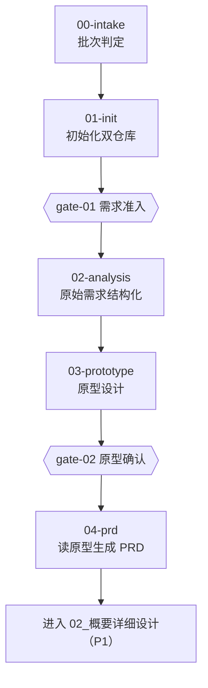

# 01_需求设计

> 原始需求 → 需求分析 → 原型设计 → PRD。这是 P0 阶段唯一完整实现的域。

## 本域的 Skill

| Skill | 职责 | 状态 |
|---|---|---|
| [ai-requirement-00-intake](./skills/ai-requirement-00-intake/SKILL.md) | 批次入口判定（新建 / 续做 / 变更） | ✅ P0 |
| [ai-requirement-01-init](./skills/ai-requirement-01-init/SKILL.md) | 初始化项目文档双仓库与批次上下文 | ✅ P0 |
| [ai-requirement-02-analysis](./skills/ai-requirement-02-analysis/SKILL.md) | 原始需求结构化，产出需求文档集 | ✅ P0 |
| [ai-requirement-03-prototype](./skills/ai-requirement-03-prototype/SKILL.md) | 原型规划与产出（带功能编号标记） | ✅ P0 |
| [ai-requirement-04-prd](./skills/ai-requirement-04-prd/SKILL.md) | 读原型生成 PRD | ✅ P0 |
| [ai-requirement-autopilot](./skills/ai-requirement-autopilot/SKILL.md) | 编排 00 → 04 全流程 | ✅ P0 |
| [ai-figma-axure-convert](./skills/ai-figma-axure-convert/SKILL.md) | 设计稿转原型 | ⏳ P1 |

## 执行顺序



`ai-requirement-autopilot` 负责把这条链串起来，并在每道门禁处停下等人确认。

## 依赖的资产

| 资产 | 位置 | 用途 |
|---|---|---|
| 需求文档规范 | `standards/需求文档规范.md` | 需求条目编号、验收标准写法 |
| 需求分析规范范本 | `references/需求分析规范范本.md` | 02-analysis 的产出标准 |
| PRD 模板 | `templates/PRD 模板.md` | 04-prd 的产出骨架 |
| 功能编号总表 | `.ai/index/功能编号总表.md` | 编号申请的唯一入口 |

## 需要业务方参与的两个点

**gate-01（需求准入）与 gate-02（原型确认）必须由人确认，不可全自动。** 这两个点分别守着"要不要做"与"是不是这个意思"，是后面所有环节的输入。跳过它们，流水线跑得越快、返工越大。

## 产出物去向

本域的产出物**不放本仓库**，放**项目文档仓**：

```
<项目文档仓>/
├── CLAUDE.md              ← 批次上下文（01-init 生成，随流程回写）
└── docs/01_需求/
    ├── 原始需求格式化.md
    ├── 需求功能分析.md
    ├── 原型规划.md
    ├── 需求问题汇总.md
    └── PRD.md
```

原型工程放**独立的原型工程仓**——它是可运行的代码，与文档仓的评审节奏不同。
