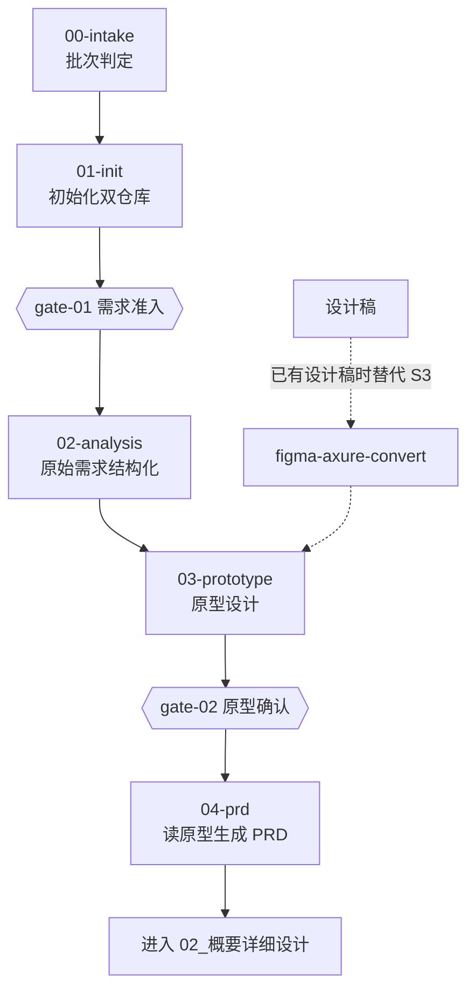

# 01_需求设计

> 原始需求 → 需求分析 → 原型设计 → PRD。
> **这一域的终点是"业务方确认过的、可追溯到编号的需求"**——后面所有环节都建立在此之上。

## 本域的 Skill

| Skill | 职责 | 状态 |
|---|---|---|
| [ai-requirement-00-intake](./skills/ai-requirement-00-intake/SKILL.md) | 批次入口判定（新建 / 续做 / 变更） | ✅ |
| [ai-requirement-01-init](./skills/ai-requirement-01-init/SKILL.md) | 初始化项目文档双仓库与批次上下文 | ✅ |
| [ai-requirement-02-analysis](./skills/ai-requirement-02-analysis/SKILL.md) | 原始需求结构化，产出需求文档集 | ✅ |
| [ai-requirement-03-prototype](./skills/ai-requirement-03-prototype/SKILL.md) | 原型规划与产出（带功能编号标记） | ✅ |
| [ai-requirement-04-prd](./skills/ai-requirement-04-prd/SKILL.md) | 读原型生成 PRD | ✅ |
| [ai-requirement-autopilot](./skills/ai-requirement-autopilot/SKILL.md) | 编排本域 00 → 04 全流程 | ✅ |
| [ai-figma-axure-convert](./skills/ai-figma-axure-convert/SKILL.md) | 设计稿转原型（产出须与 03-prototype 同构） | ✅ |

7 个 Skill 全部已实现，以各自 `SKILL.md` 的 `status` 字段为准。

**一般不需要单独调用它们**——说一句"给列表页加个导出"，`ai-flow-autopilot` 会判定该走哪条路径
并逐步驱动。这一域只在**需求段需要人工干预**时才值得直接介入。

## 执行顺序



**两条路径进原型：** 没有设计稿就走 `03-prototype` 从零规划；已有 Figma / Axure 设计稿时走
`ai-figma-axure-convert` 转换，但**产出必须与 `03-prototype` 同构**（可运行、每个可交互元素带 `data-fn`）——
否则下游的 `04-prd` 与 gate-02 的覆盖率检查都读不了它。

`ai-requirement-autopilot` 负责把这条链串起来，并在每道门禁处停下等人确认。

## 依赖的资产

| 资产 | 位置 | 用途 |
|---|---|---|
| 需求文档规范 | `standards/需求文档规范.md` | 需求条目编号、验收标准写法 |
| 需求分析规范范本 | `references/需求分析规范范本.md` | 02-analysis 的产出标准 |
| 业务场景清单 | `references/业务场景清单.md` | 判断需求归属哪个业务场景（**当前为空骨架，待业务方填充**） |
| 需求分析文档模板 | `templates/需求分析文档模板.md` | 02-analysis 的产出骨架 |
| PRD 模板 | `templates/PRD 模板.md` | 04-prd 的产出骨架 |
| 功能编号总表 | `projects/<项目码>/.agent/index/功能编号总表.md` | 编号申请的唯一入口 |
| 前端组件清单 | `09_资产库/组件库/前端组件清单.md` | 03-prototype 先匹配已有组件再新建（**当前为空骨架**） |
| 生效规范快照 | `projects/<项目码>/.agent/spec-effective/<项目码>.md` | 原型用哪个技术栈，由它决定 |

**`references/` 是域级共享知识**，被本域多个 Skill 引用——按 `references/INDEX.md` 的"何时读取"列按需加载。

## 需要业务方参与的两个点

**gate-01（需求准入）与 gate-02（原型确认）必须由人确认，不可全自动。** 这两个点分别守着"要不要做"与"是不是这个意思"，是后面所有环节的输入。跳过它们，流水线跑得越快、返工越大——而且返工发生在最下游。

## 产出物去向

本域的产出物**不放本仓库**，放**项目文档仓**：

```
<项目文档仓>/
├── CLAUDE.md                    ← 批次上下文（01-init 生成，随流程回写，≤80 行）
└── <需求名>/01_需求/
    ├── 原始需求格式化.md          ← 02-analysis，条目带 REQ 编号
    ├── 需求功能分析.md            ← 02-analysis，功能带 FN 编号与来源 REQ
    ├── 需求问题汇总.md            ← 02-analysis，待澄清清单
    ├── 原型规划.md                ← 03-prototype，页面清单 + PAGE 编号 + 页面↔FN 映射
    ├── 原型与功能映射.md          ← 03-prototype
    ├── 页面原型映射表.md          ← 04-prd，PAGE ↔ FN ↔ PRD 章节
    ├── 原型标记补齐说明.md        ← figma-axure-convert（仅走设计稿路径时产出）
    └── PRD.md                     ← 04-prd，每个功能一节并标注 FN
```

其余落位：

| 产出 | 去向 |
|---|---|
| 文档仓目录骨架（`<需求名>/00_批次` ~ `<需求名>/05_交付`） | 项目文档仓，由 01-init 创建 |
| 原型工程（可运行工程 + 带 `data-fn` 的页面） | **独立的原型工程仓**——它是可运行的代码，与文档仓的评审节奏不同 |
| 批次状态文件、编号登记 | 本仓库 `projects/<项目码>/.agent/state/`、`projects/<项目码>/.agent/index/功能编号总表.md` |

**产出物一律带编号**（`REQ` / `FN` / `PAGE`）。编号是追溯链的锚点，缺了它后面所有覆盖率检查都失效。
