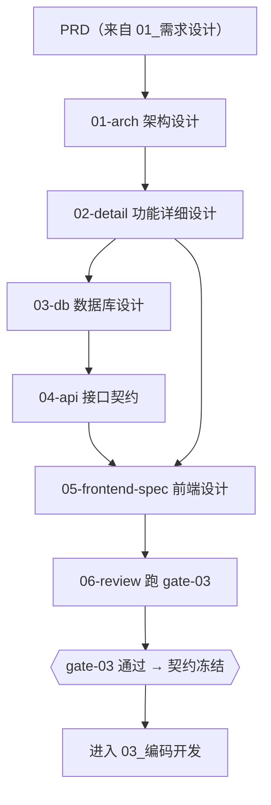

# 02_概要详细设计

> 架构 → 功能详细设计 → 数据库设计 → 接口契约 → 前端设计 → 设计评审。
> **本域的核心产出是冻结的接口契约**——它是前后端并行开发的唯一依据。

## 本域的 Skill

| Skill | 职责 | 状态 |
|---|---|---|
| [ai-design-01-arch](./skills/ai-design-01-arch/SKILL.md) | 架构设计与技术选型（产出 `DEC` 决策记录） | ✅ |
| [ai-design-02-detail](./skills/ai-design-02-detail/SKILL.md) | 功能详细设计（**每 FN 一节**） | ✅ |
| [ai-design-03-db](./skills/ai-design-03-db/SKILL.md) | 数据库设计（DDL + 字段注释 + **回滚脚本**） | ✅ |
| [ai-design-04-api](./skills/ai-design-04-api/SKILL.md) | 接口契约设计（OpenAPI，**契约在这里冻结**） | ✅ |
| [ai-design-05-frontend-spec](./skills/ai-design-05-frontend-spec/SKILL.md) | 前端页面 / 组件 / 状态设计 | ✅ |
| [ai-design-06-review](./skills/ai-design-06-review/SKILL.md) | 执行 gate-03 并冻结契约 | ✅ |

## 执行顺序



`01-arch` 与 `02-detail` 之间、`05-frontend-spec` 与 `06-review` 之间都可以并行，
其余步骤有严格的数据依赖。

## 产出物去向

```
<项目文档仓>/docs/02_设计/
├── 架构设计.md          ← 含 DEC 决策记录
├── 功能详细设计.md      ← 每 FN 一节，标题形如 ## FN-CORE-045 <名称>
├── 数据库设计.md        ← DDL + 字段注释 + 回滚脚本
├── 接口契约.yaml        ← OpenAPI 3，每 operation 带 x-fn-id 与 4xx/5xx
├── 前端设计.md
└── 评审记录.md          ← 评审结论、参与人、契约冻结时间与哈希
```

## 本域产出物与 gate-03 的对应关系

**这不是"最好满足一下"的建议，而是硬约束**——gate-03 的自动检查项直接校验这些形式。
设计 Skill 的 prompt 里都写明了对应的检查项，原因很简单：**如果产出物的形式与门禁的检查方式不匹配，
门禁就只能报"查不了"，而那和没有门禁是一回事。**

| 产出物 | 必须满足 | 对应检查项 |
|---|---|---|
| 架构设计 | 至少一个 `DEC-` 编号 | `decision-recorded`（WARN） |
| 功能详细设计 | 每个 FN 有标题或 `§` 引用形式的专属小节 | `fn-design-section`（WARN） |
| 功能详细设计 | 每个 FN 出现在设计类产出物中 | `fn-coverage-design`（BLOCK） |
| 数据库设计 | DDL 与回滚方案并存 | `ddl-rollback`（BLOCK） |
| 数据库设计 | 字段带 `COMMENT` 或 `COMMENT ON COLUMN` | `db-field-comments`（WARN） |
| 接口契约 | 每 operation 带 `x-fn-id` | `api-has-fn`（BLOCK） |
| 接口契约 | 每 operation 有 4xx/5xx 响应 | `api-error-codes`（WARN） |
| 接口契约 | 通过结构校验 | `openapi-valid`（BLOCK） |

## 依赖的资产

| 资产 | 位置 | 用途 |
|---|---|---|
| 分层架构规范 | `03_编码开发/standards/分层架构规范.md` | 依赖方向约束 |
| 数据库设计规范 | `standards/数据库设计规范.md` | DDL 与索引的通用要求 |
| 接口设计规范 | `standards/接口设计规范.md` | 错误码与契约冻结规则 |
| 前端工程设计规范 | `standards/前端工程设计规范.md` | 目录组织 |
| 规范包 | `09_资产库/规范包/stacks/` | 技术栈细节（架构 Skill **不自行选型**，从这里读） |
| 领域模型 | `09_资产库/领域模型/业务实体字典.md` | 实体与关系 |
| 组件清单 | `09_资产库/组件库/前端组件清单.md` | 组件复用 |

## 三个容易塌掉的地方

**架构 Skill 自行选型。** 技术栈由生效规范快照决定。快照里没有的技术，说明它不在本项目的规范覆盖范围内——此时应停止并说明，而不是"先用着"。用了没有规范包覆盖的技术，等于后续所有产出都失去约束依据。

**详细设计不按 FN 分节。** 这会连锁破坏三件事：下游无法按编号读段落（上下文预算爆掉）、覆盖率无法机械统计、`fn-design-section` 报 WARN。这是本域要求最硬的一条形式约束，理由写在 `ai-design-02-detail/prompt.md` 里。

**契约不冻结就开工。** 契约在 gate-03 通过后才冻结，此后变更走变更子批次。跳过这一步，前后端会各自按自己的理解实现，联调时才发现对不上——而这是代价最高的一类返工，它同时占用两个人的时间。