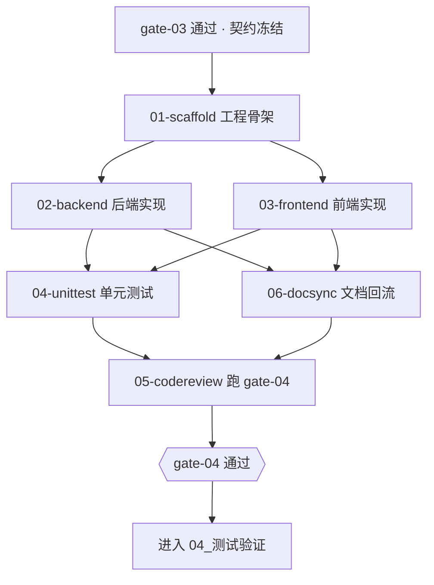

# 03_编码开发

> 工程骨架 → 后端实现 → 前端实现 → 单元测试 → 代码评审 → 文档回流。
> **核心约束：按 `FN` 逐个交付，提交信息必须带 FN 编号。**

## 本域的 Skill

| Skill | 职责 | 状态 |
|---|---|---|
| [ai-dev-01-scaffold](./skills/ai-dev-01-scaffold/SKILL.md) | 工程骨架与模块划分（**不写业务逻辑**） | ✅ |
| [ai-dev-02-backend](./skills/ai-dev-02-backend/SKILL.md) | 后端功能实现（按 FN 逐个交付） | ✅ |
| [ai-dev-03-frontend](./skills/ai-dev-03-frontend/SKILL.md) | 前端实现与联调（从原型迁移） | ✅ |
| [ai-dev-04-unittest](./skills/ai-dev-04-unittest/SKILL.md) | 单元测试与覆盖率补齐 | ✅ |
| [ai-dev-05-codereview](./skills/ai-dev-05-codereview/SKILL.md) | 执行 gate-04 代码评审 | ✅ |
| [ai-dev-06-docsync](./skills/ai-dev-06-docsync/SKILL.md) | 代码变更回流文档 | ✅ |

## 执行顺序



后端与前端可并行（这是契约冻结的价值）；单测与文档回流也可并行；`05-codereview` 是汇聚点。

## 一句话说明本域的核心约束

**提交信息必须带 `FN` 编号。**

```
feat(FN-CORE-045): 列表页新增导出接口
```

这是整条追溯链的最后一环。缺了它，`FN → 提交` 断裂，无法回答"这个功能是什么时候、由哪次提交上线的"，
也无法做"没有对应提交的 FN"这类断链检测。gate-04 的 `commit-format` 是 **BLOCK** 级检查项。

前端按页面交付更自然（一个页面对应多个 FN 是常态），此时在提交 body 中列全所有 FN 编号。

## 产出物去向

```
<项目代码仓>/                   ← 代码与提交
<项目文档仓>/<需求名>/03_实现/
├── 工程骨架说明.md
├── 评审记录.md
└── 文档同步说明.md
```

## 本域最容易塌掉的四个地方

**一、契约不冻结就开工。** 契约在 gate-03 通过后才冻结。跳过这一步，前后端各自按自己的理解实现，
联调时才发现对不上——这是代价最高的一类返工，它同时占用两个人的时间。本域所有 Skill 都以
「契约哈希与记录一致」为前置条件。

**二、顺手改契约。** 实现时发现"字段名不合适""少了个参数"，很容易顺手改。
**绝对不要**——前端此时可能已经按旧契约写完了代码。发现不够用就停下，走变更子批次。

**三、把技术栈写法硬编码进 Skill。** 本域 Skill 的 prompt 里没有任何框架写法，技术细节全部从生效快照读。
这样换技术栈只需新增一个规范包，不需要重写 Skill。代价是：**快照未覆盖的细节必须停下来问用户**，
而这正是刻意的边界——自己决定的实现细节会成为团队里的"另一种写法"，两种写法并存之后没人知道哪种对。

**四、文档只在开始时写一次。** 这是知识库最常见的死法。`06-docsync` 就是防这件事的：
代码行为变了就回流文档，纯重构则不动。它很枯燥，但它是知识库"可信"的唯一保证——
**文档一旦被发现不可信，就再也没人会读它。**

## 依赖的资产

| 资产 | 位置 | 用途 |
|---|---|---|
| 后端编码规范 | `standards/后端编码规范.md` | 跨技术栈的后端基线 |
| 前端编码规范 | `standards/前端编码规范.md` | 跨框架的前端基线 |
| 提交信息与分支规范 | `standards/提交信息与分支规范.md` | 提交格式与 FN 关联 |
| 单元测试规范 | `standards/单元测试规范.md` | 可重复性、命名、覆盖要求 |
| 安全基线 | `standards/安全基线.md` | `STD-BASE-101`~`106`：密钥外置、输入校验、审计留痕等红线 |
| 规范包 | `09_资产库/规范包/stacks/` | **技术细节的唯一来源** |
| 组件清单 | `09_资产库/组件库/前端组件清单.md` | 组件复用（**当前为空骨架**） |
| 后端公共能力清单 | `09_资产库/组件库/后端公共能力清单.md` | 避免绕开已有能力自己实现一遍（**当前为空骨架**） |
| 门禁执行器 | `07_质量门禁/skills/ai-gate-runner/` | `05-codereview` 与 `06-docsync` 依赖它 |