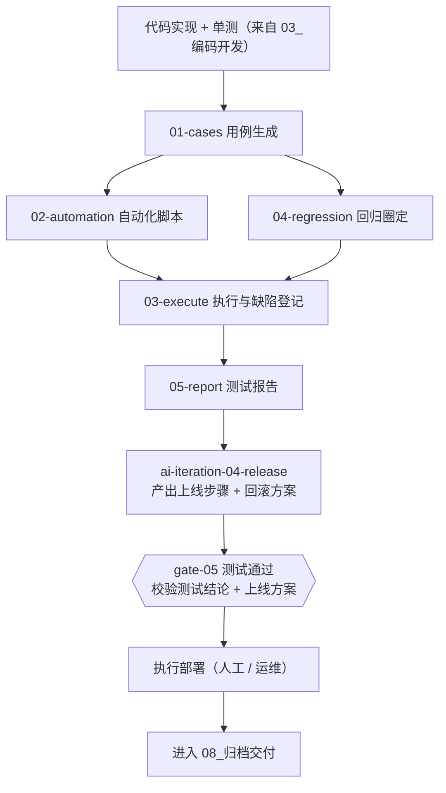

# 04_测试验证

> 用例生成 → 自动化 → 执行与缺陷登记 → 回归圈定 → 测试报告。

## 本域的 Skill

| Skill | 职责 | 状态 |
|---|---|---|
| [ai-test-01-cases](./skills/ai-test-01-cases/SKILL.md) | 测试用例生成（从 PRD + 契约 + 详细设计三者） | ✅ |
| [ai-test-02-automation](./skills/ai-test-02-automation/SKILL.md) | 接口自动化脚本生成（从冻结契约） | ✅ |
| [ai-test-03-execute](./skills/ai-test-03-execute/SKILL.md) | 执行与缺陷登记 | ✅ |
| [ai-test-04-regression](./skills/ai-test-04-regression/SKILL.md) | 回归范围智能圈定 | ✅ |
| [ai-test-05-report](./skills/ai-test-05-report/SKILL.md) | 测试报告与上线建议 | ✅ |

## 执行顺序



**`release` 排在 gate-05 之前**，这一点反直觉但必须如此：gate-05 的 `rollout-plan-present`（BLOCK）
校验的就是上线方案，**门禁要的文件不可能由"门禁已通过"才允许运行的 Skill 产出**。
顺序是「先出方案 → 门禁校验方案与测试结论 → 再真正上线」。

`01-cases` 先于 `02-automation`；`04-regression` 可以与 `02` 并行；`03-execute` 是汇聚点。

## 一句话说明本域的核心价值

**回归范围智能圈定（`ai-test-04-regression`）是测试环节里 AI 增值最大的一步。**

传统做法只有两种，都不好：全量回归（慢）或凭经验选（漏）。本域把它变成图的遍历：

```
代码 diff → FN → 依赖关系图双向遍历 → 受影响 FN → 挂载的 TC 集合
```

比全量快、比经验准，而且**范围是怎么来的可以复核**——这是最关键的一点。

## 两份格式约定，改了会让门禁失效

| 产出物 | 约定 | 谁依赖它 |
|---|---|---|
| 测试报告的「**用例执行率**」字段 | 字段名固定，两种写法任选（见 `ai-test-05-report`） | gate-05 的 `testcase-executed`（BLOCK） |
| 缺陷台账的**表头** | `\| 编号 \| 级别 \| 描述 \| 状态 \| 发现时间 \| 负责人 \|` | gate-05 的 `p0p1-closed`（BLOCK） |

**这不是格式洁癖。** "用例都跑完了吗""P0/P1 都关闭了吗"这两件事必须能被机械判定——
否则只能靠人说，而人说的会被打折。字段名或表头一改，检查项只会报"无法解析"，
于是这两件事又回到了"靠人说"的状态。

## 本域最容易塌掉的三个地方

**一、为了覆盖率而生成空脚本 / 无断言用例。** 自动化测试最容易退化成"跑一遍看有没有报错"——
通过率很高、价值接近于零，因为它只能发现 500，发现不了"返回了错误的 200"。

**二、美化测试结果。** 环境不可用就说不可用，失败就说失败。测试环节一旦开始美化数据，
整套质量机制就失去了唯一的输入源——门禁、度量、技术债识别全部建立在"测试结果是真的"这个前提上。

**三、只往下游遍历依赖。** "改了 A 崩了 C"绝大多数是上游方向没遍历到：改了底层能力，
所有依赖它的功能都受影响。只往下游走会得出"什么都没影响"的结论。

## 产出物去向

```
<项目文档仓>/<需求名>/04_测试/
├── 测试用例.md            ← 01-cases，编号 TC-<FN编号>-<两位>
├── 自动化覆盖说明.md       ← 02-automation，哪些 operation 已自动化、哪些需人工
├── 执行结果.md            ← 03-execute，每条用例的执行结论
├── 缺陷台账.md            ← 03-execute，编号 BUG-<批次号>-<三位>，含级别与状态列
├── 回归范围.md            ← 04-regression，受影响 FN + 用例清单 + 排除理由
└── 测试报告.md            ← 05-report，**含「用例执行率」字段**
```

其余落位：

| 产出 | 去向 |
|---|---|
| 自动化脚本 | 项目代码仓（接口级测试，用例编号与 `TC` 对应） |
| 用例登记 | 本仓库 `projects/<项目码>/.agent/index/功能编号总表.md` 功能点段的「覆盖用例」列 |
| 依赖图更新 | 本仓库 `projects/<项目码>/.agent/index/依赖关系图.md`（回填本批次新增的 FN 依赖） |

**两份产出物的格式是门禁的输入，不可改**——见上一节。

## 依赖的资产

| 资产 | 位置 | 用途 |
|---|---|---|
| 测试用例设计规范 | `standards/测试用例设计规范.md` | 编号挂载、异常与边界覆盖 |
| 缺陷分级标准 | `standards/缺陷分级标准.md` | 定级依据 |
| **依赖关系图** | `projects/<项目码>/.agent/index/依赖关系图.md` | 回归圈定的基础，**为空时 `ai-test-04-regression` 拒绝执行** |
| 功能编号总表 | `projects/<项目码>/.agent/index/功能编号总表.md` | FN ↔ 用例的挂载关系 |
| 门禁检查项清单 | `07_质量门禁/skills/ai-gate-runner/references/检查项清单.md` | 产出物形式要求 |