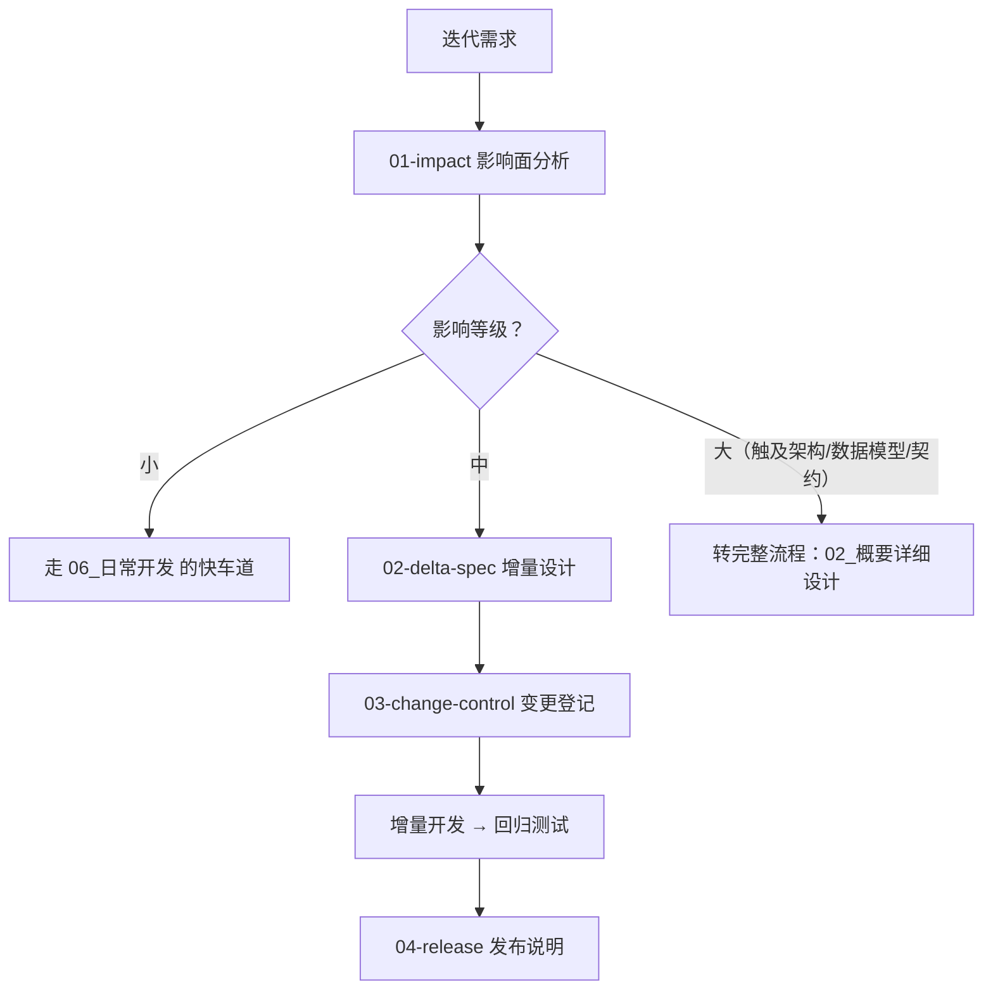

# 05_迭代开发

> 影响面分析 → 增量设计 → 变更控制 → 发布说明。

## 本域的 Skill

| Skill | 职责 | 状态 |
|---|---|---|
| [ai-iteration-01-impact](./skills/ai-iteration-01-impact/SKILL.md) | 变更影响面分析（**本域枢纽**） | ✅ |
| [ai-iteration-02-delta-spec](./skills/ai-iteration-02-delta-spec/SKILL.md) | 增量设计（**只写差异**） | ✅ |
| [ai-iteration-03-change-control](./skills/ai-iteration-03-change-control/SKILL.md) | 变更登记与基线对比 | ✅ |
| [ai-iteration-04-release](./skills/ai-iteration-04-release/SKILL.md) | 发布说明与上线步骤 | ✅ |

## 执行顺序

**等级判定决定后续全部路径。** 判低了会跳过设计评审与契约冻结（前端可能已按旧契约写完代码）；
判高了会让小改动走重流程（团队会开始绕开流程）。

## 为什么迭代流程与新建流程有本质区别

**不是步骤少，而是存在基线。**

已交付的系统就是基线，新需求是在基线上的差异。所以核心动作不是"生成"，而是**对比**：

| | 新建流程 | 迭代流程 |
|---|---|---|
| 设计产出 | 完整的详细设计 | **差异说明**（改什么 / 为什么 / 原设计是什么 / 影响谁） |
| 文档 | 新写 | 原批次产出物**不可变**，另开变更子批次 |
| 追溯 | `REQ → FN → ...` | 加一层：`原批次 → 变更子批次` |

直接改原文档会让"上线那一刻的业务规则是什么"变成不可回答的问题——
而那是排查线上问题时判断"现在的行为对不对"的唯一依据。

## 四道边界（不接受绕过）

| 情况 | 处理 |
|---|---|
| 涉及**对外契约** | 转完整流程。前端与外部调用方受影响 |
| 涉及**表结构** | 转完整流程。存量数据、回滚方案、读写该表的所有 FN 受影响 |
| 影响等级为**大** | 转完整流程，**不接受降级为"中"来省流程** |
| 影响等级为**小** | 走 `06_日常开发` 的快车道，不走本域 |

**「涉及表结构一律判大」是刻意的。** 即使只加一个可空字段，所有读写该表的 FN 都在回归范围内——
把它判成"中"或"小"，是迭代流程里最高频的一类低估，而后果在回归阶段才暴露。

## 本域最容易塌掉的三个地方

**一、为了省流程把「大」降成「中」。** 这是最贵的一种省事：绕过了契约冻结，
而前端可能已经按旧契约写完代码了。`ai-iteration-01-impact` 与 `02-delta-spec` 都会拒绝这类降级。

**二、增量设计写成了重写全文。** 差异说明变成 200 页的新设计，结果是两份文档并存，
且没人知道哪份是当前的。正确做法是：写"改什么、为什么、原设计是什么、影响谁"，一页纸。

**三、发布说明里弱化遗留风险。** 发布说明是使用方唯一的知情渠道。把风险藏着，
等于让他们在不知情的情况下承担后果。

## 依赖的资产

| 资产 | 位置 | 用途 |
|---|---|---|
| 变更管理规范 | `standards/变更管理规范.md` | 变更子批次与影响面优先（`STD-BASE-601/602`） |
| **依赖关系图** | `.ai/index/依赖关系图.md` | 影响面分析的基础，**为空时 `ai-iteration-01-impact` 拒绝执行** |
| 功能编号总表 | `.ai/index/功能编号总表.md` | 已有 FN / 接口 / 表 |
| 已归档批次产出物 | 项目文档仓 | 基线 |
| 批次状态模板 | `.ai/state/_模板.yaml` | `type: change` 与 `parent_batch` |