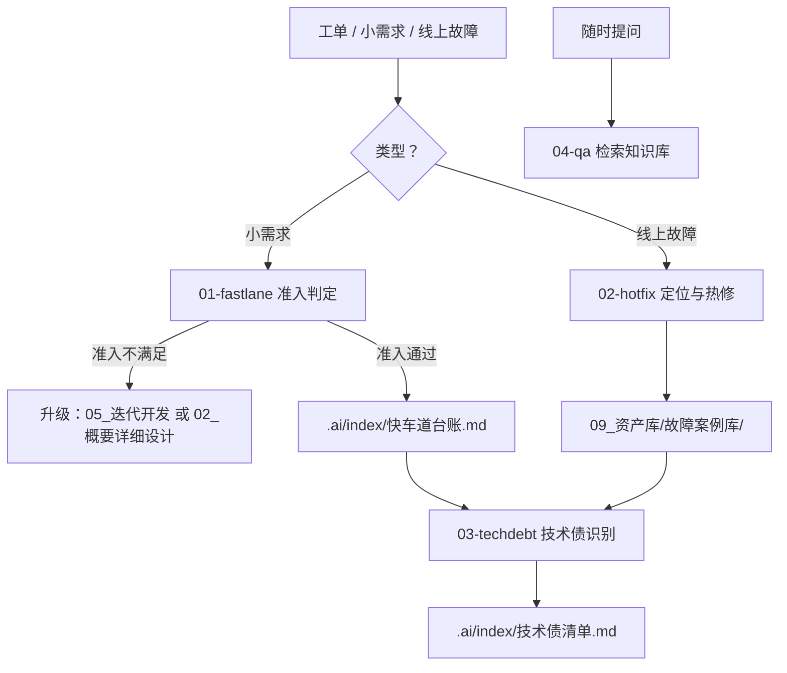

# 06_日常开发

> 小需求快车道 · 热修 · 技术债 · 日常答疑。

## 本域的 Skill

| Skill | 职责 | 状态 |
|---|---|---|
| [ai-daily-01-fastlane](./skills/ai-daily-01-fastlane/SKILL.md) | 小需求快车道（**允许跳步，必须留痕**） | ✅ |
| [ai-daily-02-hotfix](./skills/ai-daily-02-hotfix/SKILL.md) | 线上问题定位与热修 | ✅ |
| [ai-daily-03-techdebt](./skills/ai-daily-03-techdebt/SKILL.md) | 技术债识别与排期建议 | ✅ |
| [ai-daily-04-qa](./skills/ai-daily-04-qa/SKILL.md) | 基于知识库的日常答疑 | ✅ |

## 为什么这一域值得单独做

日常开发占研发团队 **40%–60%** 的实际工时，却几乎在所有流程规范里被忽略——
因为它们"太小了，不值得走流程"。结果是这部分工作完全没有留痕，一个月后没人知道某个字段为什么变了。

本域的设计原则一句话：**允许跳步，但必须留痕。**

## 台账是本域的核心机制

快车道允许跳过设计评审与完整门禁，**但不能跳掉留痕**。`.ai/index/快车道台账.md` 记录每次
快车道改动的时间、人员、涉及 FN、改动摘要与**准入判定依据**。

它有三个作用：

1. 回答"这个字段为什么变了"
2. **技术债识别唯一的数据来源** —— "这块一个月被改了 7 次"能排进计划，"我觉得这块有点乱"不能
3. 复核当时的准入判定有没有认真做（所以台账里要写四项依据，不能只写"通过"）

## 热修的四道强制工序

热修牺牲的是**设计质量**，不能牺牲的是**可追溯性**：

| # | 工序 | 为什么 |
|---|---|---|
| 1 | 有故障单号 | 无单号则无法追溯谁发现的、影响谁、什么时候 |
| 2 | **先写复现用例** | 顺序反了的话，用例只能证明"实现现在是这样"，不能证明"问题存在过" |
| 3 | 提交信息带 FN | 与常规开发同等要求 |
| 4 | 24 小时内补测试用例 | 热修常跳过单测，补上是为了让同类问题不再复发 |

## 本域最容易塌掉的三个地方

**一、把跨模块 / 契约 / 表结构变更判成快车道。** 判据不是"改多少个字"，而是"谁会被影响"。
加一个字段看起来很小，但如果它来自新表或影响对外行为，它就属于完整流程。

**二、热修时顺手重构。** 那等于在故障恢复过程中引入新的不确定性。发现该重构的地方记下来，
但不要在热修时动它。

**三、技术债清单里混入没有数据依据的条目。** 一旦混入"我觉得"，读者就无法区分真问题与个人偏好，
几次之后整份清单会被当成意见集合，也就排不进计划了。

## `ai-daily-04-qa` 的特殊位置

它是知识库**唯一的使用反馈回路**：其他 Skill 都在写知识，只有它在读。

读的时候发现"找不到"，就暴露了知识库的缺口；发现"找到的内容互相矛盾"，就暴露了腐化。
这些信号只有真实提问才能采集到——所以这个 Skill 最重要的纪律是
**找不到就说找不到**，并指出"这个信息应该记在哪"。

## 依赖的资产

| 资产 | 位置 | 用途 |
|---|---|---|
| 快车道准入标准 | `standards/快车道准入标准.md` | 量化准入（`STD-BASE-701/702`） |
| **快车道台账** | `.ai/index/快车道台账.md` | 留痕 + 技术债数据源 |
| **技术债清单** | `.ai/index/技术债清单.md` | `ai-daily-03` 的产出 |
| 故障案例库 | `09_资产库/故障案例库/线上问题复盘.md` | 热修复盘回写 |
| 项目约定 | `.ai/memory/项目约定.md` | 尚未稳定为规范的共识 |