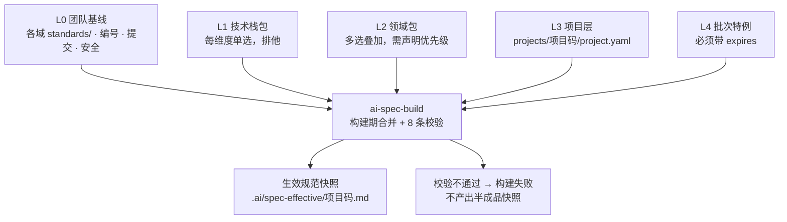

# ai-work-spec

**AI 原生化研发知识库。** 把 需求 → 设计 → 开发 → 测试 → 归档 全流程固化为 AI 可执行的 Skill 与分层规范，供多个项目复用。

> An AI-native engineering knowledge base: turns the full delivery lifecycle into
> executable skills and layered, composable specs.

---

## 它解决什么问题

大多数团队都写过研发规范，绝大多数最后都死在同一件事上：**规范与执行脱节**。

具体表现为三个循环出现的症状：

**规范会腐化。** 团队基线更新了二十条，项目里那份副本永远停在旧版本——因为写副本的人不确定基线覆盖了什么，干脆把相关的都抄一遍。基线一改，副本全废。

**规范写得再好，没人照着做。** 规范写在 Wiki 里，与代码评审、与提交、与测试用例没有任何机械关联。写得越详细，越没人读完。

**产出物之间对不上号。** PRD 说 A、原型是 B、代码实现了 C。没有编号锚点，追溯只能靠人的记忆，而人的记忆在项目结束后就消失了。

这个仓库的主张是：**把流程本身变成 AI 可执行的资产，而不是把规范写成文档。**

- Skill 不是说明书，是可编排、可校验、有输入输出契约的组件
- 规范不是一份文档，是一次**组合**（项目只声明选了哪些包 + 有哪些差异）
- 每个产出物的结构单元都携带编号，构成一条可机械校验的追溯链

---

## 核心机制

### 一、五层规范模型



优先级：**批次 > 项目 > 领域 > 技术栈 > 基线**，标记 `frozen: true` 的条目不接受任何上层修改。

规范编号到**条目**而非文件（`STD-BASE-001`、`STD-VUE3-004`），所以覆盖能精确到条，而不是整份文件覆盖或整份接受。

### 二、合并在构建期完成，不在推理期

一个看起来很自然的做法是：让 AI 执行时自己去读多层规范、自己合并、自己判断优先级。**这个做法必须避免**，四个理由：

| 理由 | 说明 |
|---|---|
| token 成本 | 五层全文每次执行都要读一遍 |
| 结果确定性 | 运行时合并每次结果可能不同；规范的意义恰恰在于"每次都一样" |
| 冲突可见性 | 模型遇到冲突会**静默挑一个**；构建期遇到冲突直接失败 |
| 可审计性 | 快照带哈希，能精确回答"这个批次当时用的是哪版规范" |

`ai-spec-build` 是一个 **纯 Python 脚本，不调用模型**——合并结果必须可复现、可 diff、可审计。

### 三、追溯链

```
REQ（需求条目）→ FN（功能点）→ PAGE / API / TBL（原型页 / 接口 / 数据表）
                              → TC（测试用例）→ 提交 → 归档
```

提交信息必须带功能编号（`feat(FN-CORE-045): ...`），测试用例编号必须挂载到功能编号下（`TC-FN-CORE-045-01`），原型页面元素带 `data-fn` 标记。这条链断了能被自动检出——**断链数是目标为 0 的硬指标**。

### 四、六道质量门禁

| 门禁 | 位置 | 核心检查 | 可豁免 |
|---|---|---|---|
| gate-01 需求准入 | 需求分析前 | 业务目标、干系人、验收标准可量化 | 是 |
| gate-02 原型确认 | PRD 前 | 原型覆盖全部 FN、业务方确认 | **否** |
| gate-03 设计评审 + 契约冻结 | 开发前 | FN 覆盖率、接口可追溯、契约冻结 | 部分 |
| gate-04 代码评审 | 测试前 | 契约一致性、静态检查、提交规范 | 部分 |
| gate-05 测试通过 | 上线前 | 用例覆盖、缺陷收敛、上线方案 | 部分 |
| gate-06 归档交付 | 归档时 | 断链检测、文档代码一致性 | **否** |

区分 `BLOCK` 与 `WARN`——如果所有检查项都是阻断项，团队会在第一次被卡住后要求关掉整道门禁。豁免必须留痕且 7 天后自动复查，**没有自动复查的豁免机制等于没有门禁**。

门禁不是纸面制度：`ai-gate-runner` 是纯脚本执行器，读取门禁定义里的 `auto:<检查项 ID>` 逐项校验，结果写回批次状态文件。它有三条刻意保留的语义（具体命令见[如何使用 · 三、跑门禁](#三跑门禁)）：

- **`skip` 不等于 `pass`。** 缺少校验材料时记为 `skip`，转入人工确认并说明"要做什么才能自动校验"。把"没法校验"当成"校验通过"，是门禁最容易失效的方式。
- **BLOCK 级 `skip` 不能用 `--confirm` 越过**，只能 `--waive`。签核的前提是"有人核对过了"，材料不存在时无从核对。
- **执行器不替人拍板。** 标注 `人` 的检查项原样列出等人工核对；门禁不会自动变绿，需要 `--confirm --by <名字>` 显式签核——门禁记录的价值在于能回答"谁在什么时候确认的"。

---

## 如何使用

### 一句话驱动（推荐）

**你不需要记命令。** 37 个 Skill 已挂载到 `.claude/skills/`，用一句话就能驱动整条流程：

> 给列表页加个导出

`ai-flow-autopilot` 会判定该走哪条路径、驱动全流程、在每个阶段自动跑质量门禁；
**需要人判断的地方会停下来问你**（门禁的人工项、需求取舍、契约冻结、验收签字）。

| 你说什么 | 会发生什么 |
|---|---|
| 「给列表页加个导出」 | 判定新建 / 迭代 → 驱动设计 → 编码 → 测试，每阶段跑门禁 |
| 「线上导出偶发超时」 | 走热修流程（强制先写复现用例，24 小时内补测试） |
| 「改个按钮文案」 | 走快车道（四项量化准入）→ 登记快车道台账 |
| 「这个字段为什么这么设计」 | 只读查询知识库，**不建批次** |
| 「继续」 | 从批次状态文件的断点续做，不重跑已完成的步骤 |

它**不会替你做的四件事**：判定路径有歧义时问你、门禁的人工项留给你、签核要你给名字、豁免要你给原因和复查期。
这不是能力不足，是**责任必须有人承担**。

下面几节是**它背后在做什么**——出问题要排查、或想手动控制某一步时看。

### 挂载层是怎么来的

`.claude/skills/<name>/SKILL.md` 是**生成的指针**，真实定义仍在各域的 `skills/<name>/` 下：

```bash
python3 00_工作空间配置/scripts/build_claude_skills.py          # 生成 / 更新
python3 00_工作空间配置/scripts/build_claude_skills.py --check   # 校验是否与真实定义同步
```

改完任何 Skill 的 `SKILL.md` 或 `prompt.md` 后重跑一次——**`description` 是 Claude 决定"什么时候用哪个 skill"的依据**，
挂载层过期会让模型按错误的触发条件选 Skill。一致性检查会验证两者同步。

> 挂载层是生成的而不是手写的，理由很直接：手写会产生 37 份需要同步的副本，而副本一定会分叉。
> `--check` 模式让"是否同步"变成可机械验证的事。

### 一、接入一个新项目（一次性，目标 ≤ 30 分钟）

**前置要求**：Python 3.8+ 与 PyYAML（`pip install pyyaml`）。以下命令都在仓库根目录执行。

```bash
git clone https://github.com/lichengqun-dev/ai-work-spec.git
cd ai-work-spec
S=00_工作空间配置/skills/ai-spec-build/scripts/spec_build.py

python3 $S --list                    # 1. 看有哪些规范包可选
cp -r projects/_template projects/<你的项目码>
                                     # 2. 编辑 project.yaml：填仓库路径 + 选包 + 写差异
python3 $S --project <你的项目码>      # 3. 编译出生效规范快照
```

产出的 `.ai/spec-effective/<你的项目码>.md` 就是**这个项目实际要遵守的规范全文**——
分「常驻注入 / 按需检索索引 / 来源链 / 项目声明摘要」四段。**不要逐个去读包文件**；
它有变更时重新编译即可（见「四、改规范」）。

`project.yaml` 里唯一容易填错的是**仓库路径**：它是四个字段，`repo` 只是兜底。
文档仓 / 原型仓 / 代码仓分开时要用 `docs_repo` / `prototype_repo` / `code_repo` 分别指定——
一个字段承担三种语义会让门禁的路径解析出错。详见 [`projects/README.md`](./projects/README.md)。

### 二、跑一个批次

先判定走哪条路径，再按该路径的步骤走。**路径判定由 `ai-requirement-00-intake` 负责，不要自己凭感觉选**：

| 路径 | 适用 | 起点 |
|---|---|---|
| **新建** | 从零到一的新系统 | `ai-requirement-00-intake` → 全部 23 步 |
| **迭代** | 已有系统加功能 / 改行为 | `ai-iteration-01-impact` → 增量设计 → 增量开发 → 回归 |
| **快车道** | 小改动、工单（有量化准入条件） | `ai-daily-01-fastlane`，**允许跳步但必须登记台账** |

确定路径后会生成批次状态文件，它是**接手一个批次时的第一个读物**：

```bash
cat .ai/state/<批次号>.yaml     # 卡在哪一步、上一步产出了什么、有什么没解决的问题
```

之后每一步都由 AI 按对应 Skill 的三件套执行：读 `SKILL.md` 确认能不能做 → 按 `prompt.md` 执行 →
产出物登记到状态文件的 `artifacts`。**产出物落项目的文档仓 `docs/`，不在本仓库。**
目录约定（序号固定）见 [`projects/README.md`](./projects/README.md)。

### 三、跑门禁

每道门禁在进入下一阶段前执行。**不允许跳步**——上一道未通过时执行器会拒绝。

```bash
G=07_质量门禁/skills/ai-gate-runner/scripts/gate_run.py

python3 $G --list-checks                                     # 检查项库与实现状态
python3 $G --project <码> --batch <批次号> --gate gate-03     # 执行一道门禁
python3 $G --project <码> --batch <批次号> --all              # 按顺序跑到第一个未通过
python3 $G --project <码> --batch <批次号> --check            # 只校验，不回写状态（CI 用）

# 结果待人工确认时，核对清单后签核：
python3 $G --project <码> --batch <批次号> --gate gate-03 --confirm --by <真实人名>
# 确实要带风险上线时，走豁免（必须给原因与复查日期）：
python3 $G --project <码> --batch <批次号> --gate gate-03 --waive \
        --by <真实人名> --reason "<具体原因>" --expires 2027-06-30
```

退出码：`0` 通过 ｜ `1` 未通过或待人工确认 ｜ `2` 执行器自身错误。

**两道门禁不允许豁免**：`gate-02 原型确认` 与 `gate-06 归档交付`（它们的 `waivable: no`）。
它们守着一个跳过就无法补救的东西——原型确认是需求理解的唯一验证点，归档是追溯链的最后一步。
对它们执行 `--waive` 会被直接拒绝，而不是"记一笔就放行"。

**三条语义不要记错**：

- `skip` **不是** `pass`。缺校验材料时记 `skip` 并说明"要做什么才能自动校验"——把"没法校验"当成"校验通过"，是门禁最容易失效的方式
- **BLOCK 级 `skip` 不能用 `--confirm` 越过**，只能 `--waive`。签核的前提是"有人核对过了"，材料不存在时无从核对
- **执行器不替人拍板**。标注 `人` 的检查项只列清单；`--by` 必须填真实人名，它是"谁在什么时候确认的"的唯一凭据

### 四、改规范

**改了包条目或项目 manifest 之后必须重建快照**，否则规范没生效：

```bash
python3 $S --all                          # 重建全部项目的生效快照
python3 00_工作空间配置/scripts/consistency_check.py   # 跨文件一致性检查
```

一致性检查查的是**单文件检查发现不了、拼起来才暴露的**那类问题：编号悬空引用、Skill 名引用、
三件套完整性、上下文预算超标、门禁引用了未实现的检查项、文档状态描述与实际矛盾。
**建议每次改完规范或 Skill 后跑一次**，不必等到月度。

`ai-spec-build` 的 8 条校验（任一失败即中止，**不产出半成品快照**）：

1. `PACK.md` 必填字段齐全，`files` 列出的文件都存在
2. 条目前缀与所在包的 `prefix` 一致
3. 条目编号全库唯一
4. manifest 引用的包与版本存在且匹配（版本锁定，升级需显式改 manifest）
5. `overrides` 引用的条目存在
6. **对 `frozen` 条目的 override / disable / append 一律拒绝**（append 也被拒——追加内容可以实质架空原条目）
7. `disable` 必须带 `expires`；禁用基线或包条目还需 `approved_by`
8. 同层冲突且未在 manifest 的 `domains` 中声明优先级 → 失败，不允许工具静默挑选

### 五、日常维护

| 频率 | 做什么 | 命令 / Skill |
|---|---|---|
| 改完规范或 Skill | 一致性检查 | `00_工作空间配置/scripts/consistency_check.py` |
| 每月 | 项目特例提升为共享包条目 | `ai-spec-promote` |
| 随时 | 小需求 / 工单 | `ai-daily-01-fastlane`（会写 `.ai/index/快车道台账.md`） |
| 线上故障 | 热修与复盘 | `ai-daily-02-hotfix`（回写 `09_资产库/故障案例库/`） |
| 每月 | 技术债识别与排期建议 | `ai-daily-03-techdebt`（读台账，输出到 `.ai/index/技术债清单.md`） |
| 随时 | 查"这个字段为什么这么设计" | `ai-daily-04-qa`（只读知识库，**找不到就说找不到**） |

`ai-daily-04-qa` 是这套知识库**唯一的使用反馈回路**：其他 Skill 都在写知识，只有它在读。
它报"找不到"的地方，就是知识库下一步该补的地方。

### 命令速查

```bash
S=00_工作空间配置/skills/ai-spec-build/scripts/spec_build.py
G=07_质量门禁/skills/ai-gate-runner/scripts/gate_run.py
C=00_工作空间配置/scripts/consistency_check.py

python3 $S --list                      # 有哪些规范包
python3 $S --project <码>               # 编译某项目的生效快照
python3 $S --all                       # 编译全部
python3 $G --list-checks               # 门禁检查项库
python3 $G --project <码> --batch <批次号> --gate gate-03
python3 $C                             # 跨文件一致性检查
```

---

## 目录结构

```
ai-work-spec/
├── .claude/skills/            Skill 挂载层（生成，让 37 个 Skill 可被发现与调用）
├── CLAUDE.md                  全局上下文：技术栈基线、全局禁止、Skill 路由
├── README.md
├── 00_工作空间配置/            地基：规范 AI 怎么工作、怎么编号、怎么加载上下文
├── 01_需求设计/                原始需求 → 需求分析 → 原型 → PRD
├── 02_概要详细设计/            架构 · 功能详细设计 · 数据库 · 接口契约 · 前端设计
├── 03_编码开发/                工程骨架 · 前后端实现 · 单元测试 · 代码评审
├── 04_测试验证/                用例生成 · 自动化 · 执行 · 回归圈定 · 测试报告
├── 05_迭代开发/                影响面分析 · 增量设计 · 变更登记 · 发布说明
├── 06_日常开发/                小需求快车道 · 热修 · 技术债 · 日常答疑
├── 07_质量门禁/                六道门禁定义 + 统一执行器
├── 08_归档交付/                批次结项 · 断链检测
├── 09_资产库/                  规范包 · 领域模型 · 组件库 · 提示词库 · 故障案例库
├── docs/                       设计方案与演练记录（各机制为什么这么设计、实测卡在哪）
├── projects/                   项目实例层（唯一允许出现具体项目信息的地方）
└── .ai/                        机器状态区：批次状态机 · 编号总表 · 生效快照
```

每个 Skill 目录是三件套：`SKILL.md`（合同：能力边界与输入输出契约）、`prompt.md`（指令：可执行提示词）、`references/`（知识：按需加载，默认只读索引）。

---

## Skill 清单

共 **37 个，全部已实现**（36 个阶段/工具 Skill + 1 个全流程编排入口）。

| 域 | Skill | 状态 |
|---|---|---|
| 工作空间配置 | **`ai-flow-autopilot` 全流程入口（说一句话就能驱动）** / `ai-spec-build` 规范编译器 / `ai-spec-promote` 项目特例提升为共享包 | ✅ |
| 需求设计 | `ai-requirement-00-intake` 批次入口判定 / `01-init` 初始化双仓库 / `02-analysis` 需求结构化 / `03-prototype` 原型产出 / `04-prd` 读原型生成 PRD / `autopilot` 编排全流程 | ✅ |
| 需求设计 | `ai-figma-axure-convert` 设计稿转原型（产出须与 `ai-requirement-03-prototype` 同构） | ✅ |
| 概要详细设计 | `ai-design-01-arch` 架构 / `02-detail` 详细设计 / `03-db` 数据库 / `04-api` 接口契约 / `05-frontend-spec` 前端设计 / `06-review` 设计评审 | ✅ |
| 编码开发 | `ai-dev-01-scaffold` 骨架 / `02-backend` 后端 / `03-frontend` 前端 / `04-unittest` 单测 / `05-codereview` 代码评审 / `06-docsync` 文档回流 | ✅ |
| 测试验证 | `ai-test-01-cases` 用例 / `02-automation` 自动化 / `03-execute` 执行与缺陷 / `04-regression` 回归圈定 / `05-report` 报告 | ✅ |
| 迭代开发 | `ai-iteration-01-impact` 影响面 / `02-delta-spec` 增量设计 / `03-change-control` 变更登记 / `04-release` 发布 | ✅ |
| 日常开发 | `ai-daily-01-fastlane` 快车道 / `02-hotfix` 热修 / `03-techdebt` 技术债 / `04-qa` 答疑 | ✅ |
| 质量门禁 | `ai-gate-runner` 统一门禁执行器（25 个检查项，纯脚本） | ✅ |
| 归档交付 | `ai-archive-01-close` 批次结项与断链检测（**gate-06 的产出方**） | ✅ |

命名规则：阶段 Skill 为 `ai-<域>-<序号>-<动作>`；编排类加 `-autopilot`；工具类加 `-runner` / `-convert` 且不受域枚举约束。

> 调用未实现的 Skill 会因前置条件不满足而拒绝执行——这是刻意设计。占位 `SKILL.md` 的作用是让编排层能正确判断"这个 Skill 还不能用"，而不是让它看起来可用。

---

## 规范包

**规范包按单一技术组件切分，不按技术栈组合切分。** 后者会组合爆炸：3 个前端 × 3 个后端 = 9 个包，且"接口必须定义错误码"这类跨栈规范要改 9 次。按组件切分后，组合由项目 manifest 负责。

| 维度 | 示例包 | 排他性 |
|---|---|---|
| `fe` 前端 | `fe-vue2-elementui` / `fe-vue3-elementplus` / `fe-react-antd` | 单选 |
| `be` 后端 | `be-springboot2-java8` / `be-springboot3-java17` | 单选 |
| `db` 数据库 | `db-dm8`（达梦） | 单选 |
| `domain` 领域 | `platform-base` / `info-security` | **多选叠加** |

技术栈包天然不冲突（一个项目不可能同时用 Vue 2 和 Vue 3 做同一个前端）；领域包会冲突，所以在 manifest 里显式声明 `domains` 顺序，靠前者胜出，裁决结果记入快照的来源链。

**本仓库只预置 8 个规范包作为结构示例**，其中两个领域包是空骨架——领域包承载的是各团队自己的业务知识，本仓库不替使用者拟定业务规则。按需增删即可，**不要一次性建全**：用真实批次反推条目，坐在会议室里凭空写的通用条目实战中往往一条都用不上。

---

## 交付状态与路线图

| 阶段 | 内容 | 状态 |
|---|---|---|
| **P0** | 地基 + 需求流水线：目录、00 配置、规范包骨架、项目 manifest、`ai-spec-build`、需求域 Skill、六道门禁定义与**执行器** | ✅ 已完成 |
| **P1** | 设计 + 开发流水线：`02` `03` 两域 Skill、契约冻结、`ai-gate-runner` | ✅ 已完成 |
| **P2** | 测试 + 迭代 + 日常：`04` `05` `06` 三域 Skill | ✅ 已完成 |
| **P3** | 资产沉淀与度量：领域模型、组件库、故障案例库、度量指标 | ⏳ |

**各阶段必须串行。** P1 的契约冻结依赖 P0 的编号体系；P2 的影响面分析依赖 P1 产出的依赖关系图。并行推进必然返工。

**当前进度：P0、P1、P2 已完成，36 个 Skill 全部实现。**
剩余 P3 为资产沉淀与度量（领域模型、组件库、故障案例库、度量指标）。
**但 P3 主要靠真实批次的数据积累**——在跑过真实需求之前，填规范包与度量基线基本都是凭空写。

当前基线内容：团队基线 **37 条** + 包内条目 **30 条**，共 67 条规范。规范包状态为 `skeleton` / `partial`——**不要指望它们现在就能约束代码质量**，条目要靠真实批次反推逐步填充。

---

## 这是一个通用资产

`00`–`09` 与 `.ai/` 都是**项目无关的**：只有机制、规范模板与通用工程约束，不出现任何具体项目的名称、模块码、表名或业务规则。

**具体项目的一切只存在于 `projects/<项目码>/` 下**，且那里只有组合声明（选了哪些包 + 有哪些差异）与项目特有条目——**没有共享规范的正文**。一旦在项目里粘贴包内规范的内容，这个项目就退化成基线副本，包更新再也影响不到它，这正是分层设计要解决的问题本身。

判断一条内容该放哪，只需问一句：**把这份知识库交给另一个团队，这条内容还成立吗？** 不成立就说明放错了地方。

复用到其他团队：保留 `00`–`09`、`.ai/`、`projects/_template/`，清空 `projects/` 下的其他目录，按自己的技术栈增删规范包即可。

---

## License

[MIT](./LICENSE)
