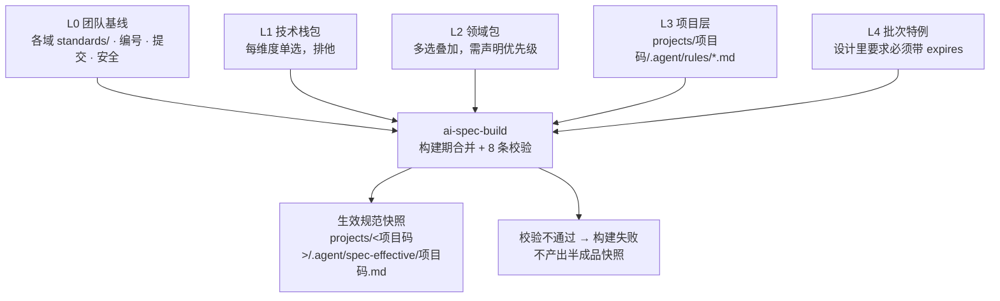
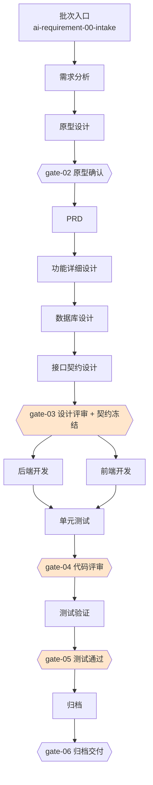

# ai-work-spec

**AI 原生化研发知识库。** 把 需求 → 设计 → 开发 → 测试 → 归档 全流程固化为 AI 可执行的 Skill 与分层规范，供多个项目复用。

> An AI-native engineering knowledge base: turns the full delivery lifecycle into
> executable skills and layered, composable specs.

---

## 它解决什么问题

大多数团队都写过研发规范，绝大多数最后都死在同一件事上：**规范与执行脱节**。

具体表现为三个循环出现的症状：

**规范会腐化。** 团队基线更新了二十条，项目里那份副本永远停在旧版本——因为写副本的人不确定基线覆盖了什么，干脆把相关的都抄一遍。基线一改，副本全废。

**规范写得再好，没人照着做。** 规范写在 Wiki 里，与代码评审、与提交、与测试用例没有任何机械关联。写得越详细，越没人读完。

**产出物之间对不上号。** PRD 说 A、原型是 B、代码实现了 C。没有编号锚点，追溯只能靠人的记忆，而人的记忆在项目结束后就消失了。

这个仓库的主张是：**把流程本身变成 AI 可执行的资产，而不是把规范写成文档。**

- Skill 不是说明书，是可编排、可校验、有输入输出契约的组件
- 规范不是一份文档，是一次**组合**（项目只声明选了哪些包 + 有哪些差异）
- 每个产出物的结构单元都携带编号，构成一条可机械校验的追溯链

---

## 设计目标与五条原则

### 三个目标

**可执行。** 知识库里的每一条规范，都要有对应的 Skill 步骤去执行它。**写进规范但不被执行的条目，一律删掉。**
这条原则会持续净化知识库——它是整套设计里最重要的一条纪律，也是"规范不会腐化成没人读的文档"的唯一保证。

**可追溯。** 任意一个上线功能，可以在 30 秒内回答"它来自哪条原始需求、经过哪些设计决策、
被哪些测试用例覆盖、谁在什么时候评审过"。

**可断点续做。** 一个批次跑到第 7 步中断（人下班了、模型超上下文了、需求方改主意了），
下一个接手的人或 AI 能从状态文件恢复，**不需要重新读一遍所有文档**。

### 五条原则

**原则一：知识即执行契约。** 一个 Skill 不是一份说明书，而是一份合同——它声明"给我这些输入，
我还你这些产出，不满足条件我就拒绝执行"。所以每个 Skill 必须有明确的输入契约、产出契约、前置条件，缺一不可。

**原则二：产物优先于过程。** AI 的中间推理不值得存档，产出物才值得。知识库只沉淀"可被下一步读取的文件"，
不沉淀对话记录。日志只保留执行元数据（时间、输入哈希、产出路径），不保留思维链。

**原则三：编号贯标。** 一切跨阶段的引用走编号，不走自然语言描述。需求编号、功能编号、接口编号、
用例编号形成一张网，任何一环断了都能被自动检出。

**原则四：门禁前置，而非事后检查。** 每个阶段开始前先校验上一阶段产出物的完整性，而不是等阶段跑完再回头检查。
**发现问题的成本，越早越低。**

**原则五：人只做决策，不做搬运。** 人负责的是：需求取舍、架构选型、评审裁决、验收签字。
其余的格式化、对齐、同步、补全、查漏，全部交给 Skill。
**凡是"人反复做同样的手工搬运"的地方，就是这个知识库应该新增 Skill 的地方。**

---

## 核心机制

### 一、三层结构：什么内容放哪里

理解其他一切的前提。**这三层是按"内容归属"分的**（下一节的"五层"是按"规范条目优先级"分的，两个轴不要混）：

| 层 | 位置 | 内容 | 权重 |
|---|---|---|---|
| 用户级 | 顶层 `00`–`09` | 机制、规范模板、通用工程约束——**不含任何项目信息** | 低 |
| 项目级 | `projects/<项目码>/` | 该项目的架构、模块、模型、散文文档；机器面在 `.agent/` | 中 |
| 业务级 | `projects/<项目码>/<需求名>/` | 该需求的全部产出物（PRD/设计/测试/交付/原型） | **高** |

**冲突时：业务级 > 项目级 > 用户级。**

两条判断依据，都只需要问一句话：

- **这条内容该放哪？** 「把这份知识库交给另一个团队，这条还成立吗？」不成立，它就是项目级的。
- **机器状态放哪？** 机器状态（批次状态、编号总表）**天生属于某个项目**——放顶层会让多个项目共用一个编号总表而撞号。所以 `.agent/` **只在项目下，顶层没有**。

产出物按需求聚合而不是按阶段散放，是为了**事后移交只需给一个目录**，而不是在五个阶段目录里各捞一遍。

> **分层的目的不只是"分清归属"，更是变更频率隔离。** 越靠上层变得越快、越靠下层越稳定：
> 业务级产出物每跑一个批次就换一批；项目级的散文文档随业务调整；而 `00`–`09` 的机制与通用约束
> 几个月才动一次。**把变化快的和变化慢的放在不同层，改上层才不会牵动下层。**
> 同一个道理也解释了为什么规则要按**主题**分文件而不是堆在一个大文件里。

### 五条适合做成 Skill 的信号

判断一件事该不该沉淀成 Skill，用原则五那句话：**凡是"人反复做同样的手工搬运"的地方，就该有 Skill。**

具体表现是：每次都要交代一遍同样的背景、每次都在做同样格式化的对齐、每次都要人工核对同一类遗漏、
每次出问题都从同一个地方漏过去。这四种都是信号。反过来，"一次性做一次的事"不该做成 Skill。

### 二、五层规范模型



优先级：**项目级（进快照，常驻）> 域级（随阶段按原文加载）**。领域包与技术栈包不参与编译，层级覆盖机制已退役。

规范编号到**条目**而非文件（`STD-BASE-001`、`STD-VUE3-004`），所以覆盖能精确到条，而不是整份文件覆盖或整份接受。

> ⚠️ **L4 批次特例目前只有文档、没有代码。** 优先级链里写着它，但 `spec_build.py` 里没有任何加载 L4 的代码，全库也没有一个 `STD-BATCH` 实例。这一条是设计意图，不是当前能力——**别照着它去写批次条目**。

### 三、合并在构建期完成，不在推理期

一个看起来很自然的做法是：让 AI 执行时自己去读多层规范、自己合并、自己判断优先级。**这个做法必须避免**，四个理由：

| 理由 | 说明 |
|---|---|
| token 成本 | 五层全文每次执行都要读一遍 |
| 结果确定性 | 运行时合并每次结果可能不同；规范的意义恰恰在于"每次都一样" |
| 冲突可见性 | 模型遇到冲突会**静默挑一个**；构建期遇到冲突直接失败 |
| 可审计性 | 快照带哈希，能精确回答"这个批次当时用的是哪版规范" |

`ai-spec-build` 是**纯脚本 Skill，不调用模型**——合并结果必须可复现、可 diff、可审计。
（同理：`ai-spec-check`、`ai-spec-mount` 也是纯脚本。判定类工作交给脚本，模型只负责转达与解释。）

### 四、散文 + 提炼：项目级规范怎么进来

**这一层是后加的，因为它解决的是一个真实摩擦。**

项目级文档有两个来源：人工维护好复制进来，或 AI 读代码仓梳理总结出来。
无论哪种，它们都**不遵守编号约定、改动频繁**——这正是它们好用的地方。

而生效快照要的是**稳定的、可审计的、能追回出处**的条目。两者性质不同，硬塞进同一份文件会有两种结局：

| 结局 | 症状 |
|---|---|
| 人烦到不写 | 加一条约束要先想"这算不算条目""编号排到几"，于是干脆不写进文档 |
| 格式偷偷漂掉 | 编号重复、标题符号写错——而**构建不报错**，它只是安静地少算几条 |

所以分成两层：

| 层 | 位置 | 谁维护 | 进快照 |
|---|---|---|---|
| **散文** | `projects/<码>/*.md` | 人，或 AI 梳理后给人确认——**自由格式，不写编号** | ❌ |
| **提炼** | `projects/<码>/.agent/rules/*.md` | `ai-spec-extract` 从散文摘录（一源一文件） | ✅ |
| 快照 | `projects/<码>/.agent/spec-effective/` | `ai-spec-build` 生成 | 生成物 |

**提炼是"照抄"，不是"总结"。** 这是这套机制能不能用的分界：约束一概括就会丢限定条件，
而「除 X 外」「仅限 Y 场景」恰恰是约束里最要命的部分。`ai-spec-extract` 的四条硬约束、
以及二十来个正反例，都在它自己的 `references/摘录判据与反例.md` 里。

**漂移检测。** 每个提炼文件在 frontmatter 里记着「摘录自哪个散文、当时它的哈希是多少」。
散文改了而没重新提炼，`ai-spec-build` 会报「源文档已变更」，并**把告警写进快照正文顶部**——
因为「少了一条约束」和「本来就没有这条约束」在快照里长得一模一样，只有这行告警能把两者区分开。

构建**不会因此失败**（改文档是常态），`ai-spec-check` 会另行兜底报出来。
处理方式是调用 `ai-spec-extract` 重新提炼，**不要手工去改 `.agent/rules/`**——那会让来源指纹失效。

### 五、追溯链与编号体系

这是整套设计里**最需要一次做对**的部分。编号乱，追溯就断，知识库就退化成一堆文档。

| 前缀 | 含义 | 格式 | 示例 |
|---|---|---|---|
| `REQ` | 需求条目 | `REQ-<模块码>-<3位>` | `REQ-TASK-012` |
| `FN` | 功能点 | `FN-<模块码>-<3位>` | `FN-TASK-045` |
| `API` | 接口 | `API-<模块码>-<3位>` | `API-TASK-008` |
| `TBL` | 数据表 | `TBL_<模块>_<表名>` | `TBL_TASK_MAIN` |
| `PAGE` | 页面 | `PAGE-<模块码>-<3位>` | `PAGE-TASK-003` |
| `TC` | 测试用例 | `TC-<FN编号>-<2位>` | `TC-FN-TASK-045-01` |
| `BUG` | 缺陷 | `BUG-<批次号>-<3位>` | `BUG-VIPD-20261020-001-007` |
| `DEC` | 设计决策 | `DEC-<模块码>-<3位>` | `DEC-TASK-004` |

```
REQ（需求条目）→ FN（功能点）→ PAGE / API / TBL（原型页 / 接口 / 数据表）
                              → TC（测试用例）→ 提交 → 归档
```

**四条强制规则：**

1. 代码提交信息必须包含 `FN` 编号（`feat(FN-TASK-045): 实现点检任务导出`）
2. 测试用例编号必须挂载到 `FN` 编号下，**覆盖率按 FN 统计而非按文件统计**
3. 原型页面上的每个可交互元素要带 `data-fn="FN-TASK-045"` 标记——
   这是 `ai-requirement-04-prd` 能"读原型生成 PRD"的前提
4. **编号总表是唯一主键表**，任何 Skill 不得自行生成编号，必须向总表申请。编号**一经启用不复用**，
   废弃的编号保留并标记

**断链检测**是 `gate-06` 的硬指标：是否存在没有 `REQ` 来源的 `FN`、没有 `TC` 覆盖的 `FN`、
没有对应提交的 `FN`。任何一类断链都输出报告——**断链数是目标为 0 的指标**。

### 六、六道质量门禁

| 门禁 | 位置 | 核心检查 | 可豁免 |
|---|---|---|---|
| gate-01 需求准入 | 需求分析前 | 业务目标、干系人、验收标准可量化 | 是 |
| gate-02 原型确认 | PRD 前 | 原型覆盖全部 FN、业务方确认 | **否** |
| gate-03 设计评审 + 契约冻结 | 开发前 | FN 覆盖率、接口可追溯、契约冻结 | 部分 |
| gate-04 代码评审 | 测试前 | 契约一致性、静态检查、提交规范 | 部分 |
| gate-05 测试通过 | 上线前 | 用例覆盖、缺陷收敛、上线方案 | 部分 |
| gate-06 归档交付 | 归档时 | 断链检测、文档代码一致性 | **否** |

区分 `BLOCK` 与 `WARN`——如果所有检查项都是阻断项，团队会在第一次被卡住后要求关掉整道门禁。
豁免必须留痕、且复查日期受**机器约束**（须晚于今天、且在 90 天内），把"临时豁免变成永久遗忘"这条最可能的退化路径堵在入口。

> ⚠️ 设计里还有一条"到期自动复查提醒"，**当前未实现**——复查日期会被记录，但没有代码会在到期时提醒。
> 现阶段复查看排期，靠人。

门禁不是纸面制度：`ai-gate-runner` 是纯脚本执行器，读取门禁定义里的 `auto:<检查项 ID>` 逐项校验，
结果写回批次状态文件。**检查项有四种结果，它们的区别就是这套门禁的全部价值所在**（用法见[如何使用 · 三、跑门禁](#三跑门禁)）：

| 结果 | 含义 | 材料能补吗 | 能否签核 |
|---|---|---|---|
| `pass` | 自动校验通过 | — | — |
| `fail` | 自动校验不通过（可定位到具体对象） | — | 修好重跑 |
| `skip` | **缺校验材料** | **能**——补了执行器就能自动校验 | **不能**（BLOCK 级）。签核的前提是"有人核对过了" |
| `external` | **不在执行器职责内** | **不能**——补材料没用 | **能**，但**强制附证据** |

四条刻意保留的语义：

- **`skip` 不等于 `pass`。** 把"没法校验"当成"校验通过"，是门禁最容易失效的方式。
- **BLOCK 级 `skip` 不能签核越过**，只能豁免——材料不存在时无从核对，签核下去记录会显示"已通过"，而它什么都没查。
- **执行器不替人拍板。** 标注 `人` 的检查项原样列出等人工核对；门禁不会自动变绿，需要**带真实人名的显式签核**。
- **`external` 也不等于 `skip`。** 它是"不归它查"（静态检查、覆盖率报告），**必须由人做完并交代证据在哪**——
  不要求证据的话，"我跑过 lint 了"就是一句无成本的口头话，这条门禁退回成走过场。

> 第四态是后来补的，它解的是一个死结：这些项原先挂 `skip`，而其中 `lint-passthrough` 是 BLOCK 级 →
> **gate-04 结构上永远无法通过**，每次都必须走豁免，**豁免从"例外通道"变成了"常规通道"**。
> 拆出 `external` 后 gate-04 回到可签核，而证据要求比原来更严——这不是放宽，是把它挪到了对的位置上。

---

## Skill 与流水线

### Skill 的目录结构与版本号

每个 Skill 都是官方 Agent Skills 格式的**四件套**：
`SKILL.md` + `scripts/` + `references/` + `assets/`。

| 位置 | 角色 | 谁读 | 变更频率 |
|---|---|---|---|
| `SKILL.md` | **唯一入口**：能力边界、输入输出契约、前置条件、执行步骤、明确不做、执行指令 | 编排层读它决定"能不能调用"，模型读它执行 | 低 |
| `references/` | **知识**：领域范本、规则、清单、历史案例 | 模型按需读取（渐进式披露） | 中 |
| `scripts/` | **脚本**：能被机械执行的部分 | 编排层调用 | 低 |
| `assets/` | **产出模板**：产出物要用的文件 | 产出时读取 | 低 |

**`SKILL.md` 就是指令本体**——官方格式里没有"第二类指令文件"。超长的"为什么"下沉到
`references/`，而不是把指令拆成两份：两份指令一定会分叉。

`SKILL.md` 里最重要的是**「边界（明确不做）」与「前置条件」**两节：前者防止 Skill 越界
（AI 天然倾向于"顺手多做一点"，这在流水线里是灾难），后者让编排层能判断该不该调用它。

**版本号语义**（不写清的话，团队会陷入"每次改提示词就升个版本"的混乱）。用语义化版本，但含义与软件版本不同：

| 位 | 变更含义 | 是否触发下游重跑 |
|---|---|---|
| 主版本 X | **流程步骤变化**（多一步、少一步、顺序变） | 是，需人工确认 |
| 次版本 Y | **产出物结构变化**（文档模板改字段、编号规则调整） | 是，需重跑下游 |
| 修订 Z | **提示词优化**（措辞、示例、约束加强），产出结构不变 | 否 |

实际价值是：**修订版本升级可以无脑执行，次版本以上必须走人工确认。**
`2.5.0` → `2.5.1` 是安全升级；`2.5.0` → `2.6.0` 会让所有已完成的下游产出物标记为"待重验"。

### 四条流水线

四条流水线共用同一套 Skill 与资产，区别在于**走哪些步骤**和**门禁松紧**。

| 路径 | 适用 | 规模 | 门禁 |
|---|---|---|---|
| **一 · 新建** | 从零到一的新系统 | 12 个阶段（状态机里是 23 步） | 6 道全开 |
| **二 · 迭代** | 已有系统的增量需求 | 按影响等级分流 | 6 道，部分简化 |
| **三 · 日常** | 小需求、工单、热修 | 允许跳步 | 3 道必过 |
| **四 · 门禁** | 横切，被以上三条复用 | — | — |

> **"12 个阶段"与"23 步"是两个粒度，不是矛盾。** 12 是流程层面的阶段划分（需求 → 分析 → 原型 → PRD →
> 详细设计 → 数据库 → 契约 → 后端 → 前端 → 单测 → 测试验证 → 归档），而状态机按**每个 Skill 一步**记，
> 测试验证一个阶段就对应 5 个 Skill。批次状态文件里的 `steps` 是后者。



**两条相对"朴素流水线"的补充，都是踩过才加的：**

- **接口契约设计是独立一步。** 全栈并行开发如果没有契约冻结，前后端一定会对不上。
  契约必须在设计评审时冻结，之后前端用契约生成 mock，开发从"等后端"变成"等契约"
- **测试验证是独立一层。** 从单元测试直接跳到代码评审再到归档，会缺掉集成/系统测试这一层，
  全栈项目在这里会出现大量未被覆盖的联调问题

**路径之间可以升降级，这是设计上的关键。** 现实中最大的浪费来自"用错流程"：
小改动走了重型流程（效率损失），大改动走了轻量流程（质量损失）。
所以判定要写成**可量化的规则**（改动文件数、是否涉及契约、是否涉及数据模型、是否有跨模块依赖），
而不是"你觉得这个需求大不大"。

> **一个反直觉的判定口径**：路径判定看的是**知识库有没有该项目的基线**，不是系统本身新旧。
> 一个已上线多年的系统，只要在知识库里还没有任何已归档批次，第一次进来就走**新建**。

#### 三步之外：三条路各自的**枢纽**

**迭代的枢纽是影响面分析。** 它读依赖关系图，输入一个新需求，输出：受影响的 `FN`、接口、表、
测试用例范围、工作量等级。这一步做好了，后面"要不要重跑设计""回归测哪些"都有依据；
做不好，团队要么过度设计（每个小改动走全流程），要么回归不足（改了 A 崩了 C）。

**迭代的产出是"差异文档"而不是"完整文档"。** 只改一个字段时，产出是一份变更说明，
而不是重写一份 200 页的详细设计——**这直接决定 AI 的上下文消耗量级**。
新增功能用 `FN-<模块>-<3位>` 正常递增；对已有功能的行为修改用 `FN-<原编号>-D<序号>`，
让追溯链能区分"新增"和"修改"。

**日常开发的枢纽是台账。** 这类工作占研发工时的大头，但在几乎所有流程规范里被忽略——
因为它们"太小了，不值得走流程"。结果是这部分工作**完全没有留痕**，一个月后没人知道某个字段为什么变了。
快车道的原则是：**允许跳步，但必须留痕。**

台账累积一个月后，可以分析出"过去 30 天 `FN-XXX-045` 被改了 7 次，建议对这块做结构性重构"——
这就是技术债识别的数据来源。

**热修**是快车道的一个特殊分支，有额外强制要求：必须有故障单号、**先写复现用例再写修复代码**、
合并后 24 小时内补测试用例。热修牺牲的是设计质量，**不能牺牲的是可追溯性**。

### 双仓库与批次状态机

**每个项目有两个仓库，而不是一个。**

| 仓 | 内容 | 读法 |
|---|---|---|
| 文档仓 | 需求文档、设计、契约、测试用例、结项报告 | 人读为主，结构化文本 |
| **原型工程仓** | 可运行的页面工程，每个可交互元素带 `data-fn` 标记 | 机器读为主 |

分开的理由有两条：原型工程的构建产物会污染文档仓的 diff；文档仓的评审节奏（业务方看 PRD）
与原型仓的评审节奏（前端看页面）不一样。

> **原型工程是这套体系里性价比最高的一环，理由是一个顺序问题：**
> 它让"需求确认"从"读文字想象页面"变成"点开就能看"，
> 同时它天然携带 `FN` 标记，成为 PRD 的**唯一事实源**。
> **PRD 是原型的文字化，而不是原型是 PRD 的配图**——这个顺序反过来，
> 能消除大量"文档说 A 原型是 B"的扯皮。

（前两个仓是默认形态。项目也可以把产出物直接放在知识库内，见「如何使用 · 二、开始一个批次」。）

**批次（Batch）是一等公民。** 批次号格式 `<项目码>-<年月日>-<序号>`，例如 `V-IPD-20261020-001`。

批次不是"一次会议"，而是**一次完整的交付闭环**：从需求进来开始，到归档结束。
所以迭代需求也完整走一遍精简流程，而不是零散地改代码。

**三种批次入口**，判定逻辑由一个 Skill（`ai-requirement-00-intake`）统一处理，
避免每个 Skill 各自实现判断导致不一致：

| 入口 | 判定 | 行为 |
|---|---|---|
| **新建 new** | 状态目录下没有该需求相关的活跃批次 | 走完整流程 |
| **续做 resume** | 存在 `in_progress` 的同批次状态文件 | 读状态 → 恢复到 `current_step` → **不重跑已完成的步骤**。同时检查上一步产出物哈希是否变化（变了说明有人手工改过，要提示） |
| **变更 change** | 存在 `done` 的批次但需求方提了修改 | **不是"回退"，而是开变更子批次** `<原批次号>-C<n>` |

**变更子批次这个设计保护的是审计链。** 原批次产出物保持不可变，
所以你永远能回答"上线那一刻的业务规则是什么"——而那是排查线上问题时判断"现在的行为对不对"
的唯一依据。

---

## 如何使用

### 一句话驱动（推荐）

**你不需要记命令。** 40 个 Skill 已挂载到 `.claude/skills/`，用一句话就能驱动整条流程：

> 给列表页加个导出

`ai-flow-autopilot` 会判定该走哪条路径、驱动全流程、在每个阶段自动跑质量门禁；
**需要人判断的地方会停下来问你**（门禁的人工项、需求取舍、契约冻结、验收签字）。

| 你说什么 | 会发生什么 |
|---|---|
| 「给列表页加个导出」 | 判定新建 / 迭代 → 驱动设计 → 编码 → 测试，每阶段跑门禁 |
| 「线上导出偶发超时」 | 走热修流程（强制先写复现用例，24 小时内补测试） |
| 「改个按钮文案」 | 走快车道（四项量化准入）→ 登记快车道台账 |
| 「这个字段为什么这么设计」 | 只读查询知识库，**不建批次** |
| 「继续」 | 从批次状态文件的断点续做，不重跑已完成的步骤 |

它**不会替你做的四件事**：判定路径有歧义时问你、门禁的人工项留给你、签核要你给名字、豁免要你给原因和复查期。
这不是能力不足，是**责任必须有人承担**。

下面几节是**它背后在做什么**——出问题要排查、或想手动控制某一步时看。

### 挂载层是怎么来的

`.claude/skills/<name>/SKILL.md` 是**生成的指针**，真实定义仍在各域的 `skills/<name>/` 下。

**要重建或校验它，调用 `ai-spec-mount`**，说一句"挂载层过期了"或"检查一下是不是同步的"即可。
不需要记任何参数。

改完任何 Skill 的定义后都要重建一次——**`description` 是 Claude 决定
"什么时候用哪个 skill"的依据**，挂载层过期会让模型按错误的触发条件选 Skill。
`ai-spec-check` 会验证两者是否同步。

> 挂载层是生成的而不是手写的，理由很直接：手写会产生 40 份需要同步的副本，而副本一定会分叉。
> 生成让"是否同步"变成可机械验证的事。
>
> **项目级 Skill 不参与挂载。** 它们的适用面本来只在项目内，挂载会有跨项目同名覆盖的风险。
> `projects/<项目码>/skills/` 下的 Skill 用描述性名字（`run-frontend` / `debug-full-stack`），
> 与顶层 `ai-<域>-<序号>-<动作>` 不是同一套命名。

### 一、接入一个新项目（一次性，目标 ≤ 30 分钟）

```
git clone https://github.com/lichengqun-dev/ai-work-spec.git
cd ai-work-spec
cp -r projects/_template projects/<你的项目码>
                                     # 1. 编辑 .agent/project.yaml：填仓库路径 + 选包 + 写差异
                                     # 2. 写项目级文档（散文，自由格式，不用管编号）
                                     # 3. 让 ai-spec-extract 把文档里的约束摘成条目
                                     # 4. 让 ai-spec-build 编译出生效规范快照
```

**第 1 步是填组合声明**——项目只声明"选了哪些包 + 有哪些差异"，**不复制任何共享规范的正文**。

**第 2、3 步是"散文 → 条目"**（机制见[核心机制 · 四](#四散文--提炼项目级规范怎么进来)）：
项目级文档**不按编号约定写、随便改**；`ai-spec-extract` 把它们里面的约束**照抄**成带编号的条目，
落到 `.agent/rules/`。中间那层不能省——构建只认带编号的条目，它不会去猜散文里哪句话是约束。

**第 4 步是调用 `ai-spec-build`**，说"接入 <项目码>"即可。它自己知道该读哪些包、
该做哪 8 条校验、快照该写到哪。校验不过它会拒绝产出——这是刻意的，见下文。

产出的 `projects/<项目码>/.agent/spec-effective/<你的项目码>.md` 就是**这个项目实际要遵守的规范全文**——
分「常驻注入 / 按需检索索引 / 来源链 / 项目声明摘要」四段。**不要逐个去读包文件**；
它有变更时重新编译即可（见「四、改规范」）。

`ai-spec-build` 唯一的运行前提是 Python 3.8+ 与 PyYAML（`pip install pyyaml`）——
这个前提由 Skill 自己检查，缺了它会说明，不会退化成"编译失败就当通过"。

`project.yaml` 里唯一容易填错的是**仓库路径**：它是四个字段，`repo` 只是兜底。
文档仓 / 原型仓 / 代码仓分开时要用 `docs_repo` / `prototype_repo` / `code_repo` 分别指定——
一个字段承担三种语义会让门禁的路径解析出错。详见 [`projects/README.md`](./projects/README.md)。

### 二、开始一个批次

先判定走哪条路径，再按该路径的步骤走。**路径判定交给总入口，不要自己凭感觉选**——
判错了要么跳过该走的环节，要么让小事走重流程（然后团队开始绕开流程）。

| 路径 | 适用 | 起点 | 规模 |
|---|---|---|---|
| **新建** | 从零到一的新系统 | `ai-requirement-00-intake` | 23 步 |
| **迭代** | 已有系统加功能 / 改行为 | `ai-iteration-01-impact` | 按影响等级分流 |
| **快车道** | 小改动、工单 | `ai-daily-01-fastlane` | 允许跳步，**必须登记台账** |
| **咨询** | 只是问问题 | `ai-daily-04-qa` | 只读，**不建批次** |

> **路径判定看的是"知识库有没有该项目的基线"，不是系统本身新旧。**
> 一个已上线多年的系统，只要在知识库里还没有任何已归档批次，第一次进来就走**新建**。

确定路径后会生成批次状态文件 `projects/<项目码>/.agent/state/<批次号>.yaml`，它是**接手一个批次时的第一个读物**——
卡在哪一步、上一步产出了什么、有什么没解决的问题，都在这一份里。**你不需要读它**，
说一句"继续"就会从断点续做，不重跑已完成的步骤。

之后每一步都由 AI 按对应 Skill 的 `SKILL.md` 执行：先逐条核对「前置条件」确认能不能做 →
按「执行步骤」执行 → 产出物登记到状态文件的 `artifacts`。目录约定（序号固定）见 [`projects/README.md`](./projects/README.md)。

产出物默认落**项目自己的文档仓**，不落本仓库——这样知识库能原样交给另一个团队。
项目也可以选择把产出物放在知识库内（`docs_repo` 指向 `projects/<项目码>/`），
代价是这些内容会随知识库一起提交，**复用到其他团队时要连同该项目目录整个清掉**。

#### 迭代路径：开工前的三条前置（缺一条会被直接拒绝）

**迭代不是"步骤少的新建"，它多一道门槛：必须先有基线。** `ai-iteration-01-impact` 有三条前置条件，
任一不满足它**拒绝执行并说明缺哪一条**——这是刻意的，猜一个影响范围比不猜更危险：

| # | 前置 | 怎么满足 |
|---|---|---|
| 1 | **项目已接入** | `projects/<项目码>/.agent/project.yaml` 存在，且仓库路径填的是真实值（不是 `<占位>`） |
| 2 | **依赖关系图非空** | `projects/<项目码>/.agent/index/依赖关系图.md` 有内容。迭代靠它**双向遍历**圈定影响范围——空了只能猜 |
| 3 | **有基线** | 该功能至少有一个**已归档批次**。**全新功能走新建流程，不走迭代** |

第 2 条是最容易卡住的一条：**冷启动时依赖关系图本来就是空的**（没有真实批次就没有关系可记）。
两条出路：① 按 `projects/<项目码>/.agent/index/依赖关系图.md` 的表格格式，手工补出**本批次涉及的**依赖关系
（不必全量，够遍历即可，跑完第一个批次它就会自己长）；② 由人显式指定影响范围，绕过这个 Skill。

> 这看起来像"工具不好用"，其实是它在守一件事：**无图只能做全量回归或凭经验选，而两者都不该由 Skill 默默决定**。
> 让它猜一个范围然后看起来跑完了，比让它停下来要危险得多。

#### 迭代与新建的本质区别：不是步骤少，是**存在基线**

| | 新建 | 迭代 |
|---|---|---|
| 设计产出 | 完整的详细设计 | **只写差异**（改什么 / 为什么 / 原设计是什么 / 影响谁） |
| 文档 | 新写 | 原批次产出物**不可变**，另开变更子批次 `<原批次号>-C<n>` |
| 追溯 | `REQ → FN → …` | 多一层：`原批次 → 变更子批次` |

**四条边界不接受绕过。** 判据是"谁会被影响"，不是"改多少个字"：

| 情况 | 处理 | 为什么 |
|---|---|---|
| 涉及**对外契约** | 转完整流程 | 前端与外部调用方都受影响 |
| 涉及**表结构** | 转完整流程 | **即使只加一个可空字段**——所有读写该表的 FN 都进了回归范围 |
| 影响等级**大** | 转完整流程 | 不接受降级为"中"来省流程 |
| 影响等级**小** | 走 `06_日常开发` 的快车道 | 小改动走重流程的后果是团队开始绕开流程 |

「涉及表结构一律判大」是刻意的：把它判成"中"或"小"，是迭代流程里最高频的一类低估，
而后果要到回归阶段才暴露。

**迭代也会经过 `release` 与 gate-05**，顺序是：`test-report` → **`ai-iteration-04-release`（产出上线步骤 + 回滚方案）**
→ **gate-05（校验测试结论 + 上线方案）** → 真正上线 → `ai-archive-01-close`。
`release` 排在门禁**之前**是必须的——gate-05 要校验的就是它产出的上线方案，
而"门禁要的文件只有门禁通过才允许产出"会形成死锁。

### 三、跑门禁

每道门禁在进入下一阶段前执行。**不允许跳步**——上一道未通过时执行器会拒绝。

**调用 `ai-gate-runner` 即可**，说"跑 gate-03"或"这个批次的门禁过一下"。它自己知道去哪读门禁定义、
该跑哪些检查项、结果该写回哪个文件。**你不需要记参数，也不需要知道检查项有几项。**

需要你出场的**四种**情况，它会明确告诉你：

| 它说 | 你要做 |
|---|---|
| 有待人工核对的项 | 照它列出的清单核对，核对完给它你的**真实姓名**去签核 |
| 某检查项缺材料，记了 `skip` | 按它说明的"要做什么才能自动校验"补材料，然后重跑 |
| 某检查项是 `external`（🔧） | **说清证据在哪**（lint 结果 / 覆盖率报告记在哪个文件）——不给证据签核会被拒 |
| 确实要带风险上线 | 给它**原因**和**复查日期**（须晚于今天且在 90 天内） |

**两道门禁不允许豁免**：`gate-02 原型确认` 与 `gate-06 归档交付`（它们的 `waivable: no`）。
它们守着一个跳过就无法补救的东西——原型确认是需求理解的唯一验证点，归档是追溯链的最后一步。
对它们要求豁免会被**直接拒绝**，而不是"记一笔就放行"。

**`skip` 与 `external` 的区别不要讲混**（四种结果的完整对照见[核心机制 · 六](#六六道质量门禁)）：

- `skip` 是"**缺材料**，补了就能自动查"，所以补不齐时**不能签核**，只能走豁免
- `external` 是"**不归它查**，补材料没用"，所以**可以签核，但必须交代证据在哪**

讲混的后果很具体：让用户去补一堆**永远补不齐**的材料。

> 门禁的判定结果只有三种：**通过**、**未通过或待人工确认**、**执行器自身错误**（含拒绝执行）。
> 第三种不是"检查没做"，而是"这道门禁根本没跑起来"——它一定会说明原因，且不会被算作通过。

### 四、改规范

**改了包条目、项目 manifest、或项目级散文文档之后必须重建快照**，否则规范没生效——
调用 `ai-spec-build` 即可。改了散文还要先让 `ai-spec-extract` 重新提炼（见下一段）。

改完再调用 **`ai-spec-check`** 做一次跨文件一致性检查。它查的是**单文件检查发现不了、
拼起来才暴露的**那类问题，当前 14 类：编号悬空引用、Skill 名引用无效、目录结构完整性、
上下文预算超标、门禁引用了未实现的检查项、文档状态与 `status` 字段矛盾、挂载层与真实定义不同步、
文档数字与实测不符、Markdown 结构、模板只是复制、过期状态表述、**Skill 内资源引用**、
**项目级条目与源散文已分叉**、**项目级 Skill**。

**建议每次改完规范或 Skill 后都跑一次**，不必等到月度。

> 它只报告，**不自动修复**。就算问题看起来一目了然（"这不就是编号抄错了吗"），也先报告再等确认——
> 一次执行改掉几十个文件，只要有一条判断错了，这份清单就再也没人信了。

五个治理工具的搭配：

| 改了什么 | 调用谁 |
|---|---|
| 规范包 / manifest | `ai-spec-build` 重建快照 |
| 项目级散文文档 | `ai-spec-extract` 重新提炼 → 再 `ai-spec-build` |
| Skill 定义 | `ai-spec-mount` 重建挂载层 |
| 以上任一项 | `ai-spec-check` 收口 |

`ai-spec-build` 的 4 条校验（任一失败即中止，**不产出半成品快照**）：

1. `PACK.md` 必填字段齐全，`files` 列出的文件都存在（路径错了要到对应阶段才暴露）
2. manifest 引用的包存在，且版本与锁定的版本一致（包升级不会自动影响项目）
3. manifest 中 `stacks` 的键与该包的 `key` 一致（`db` 选错包会注入方向相反的规则）
4. 项目级条目前缀正确、编号在项目内唯一

**包内条目不再参与校验**——它们不进快照。覆盖 / 禁用 / `frozen` / 冲突仲裁四类机制已退役。

### 五、日常维护

| 频率 | 做什么 | 调用谁 |
|---|---|---|
| 改完规范 | 重建生效快照 | `ai-spec-build` |
| 改完项目级散文 | 重新提炼条目 | `ai-spec-extract` |
| 改完 Skill | 重建挂载层 | `ai-spec-mount` |
| 改完上面任一项 | 一致性检查收口 | `ai-spec-check` |
| 每月 | 项目特例提升为共享包条目 | `ai-spec-promote` |
| 随时 | 小需求 / 工单 | `ai-daily-01-fastlane`（会写 `projects/<项目码>/.agent/index/快车道台账.md`） |
| 线上故障 | 热修与复盘 | `ai-daily-02-hotfix`（回写 `09_资产库/故障案例库/`） |
| 每月 | 技术债识别与排期建议 | `ai-daily-03-techdebt`（读台账，输出到 `projects/<项目码>/.agent/index/技术债清单.md`） |
| 随时 | 查"这个字段为什么这么设计" | `ai-daily-04-qa`（只读知识库，**找不到就说找不到**） |

`ai-daily-04-qa` 是这套知识库**唯一的使用反馈回路**：其他 Skill 都在写知识，只有它在读。
它报"找不到"的地方，就是知识库下一步该补的地方。

### 全部 40 个 Skill

**使用者只需要认识第一行那一个。** 其余 39 个由它按路径调用——列在这里是为了排查时能对号入座。

| 类别 | Skill |
|---|---|
| **总入口** | `ai-flow-autopilot` —— 说一句话即可 |
| 知识库治理 | `ai-spec-build` 编译规范快照 / `ai-spec-check` 一致性检查 / `ai-spec-mount` 重建挂载层 / `ai-spec-promote` 项目特例提升 / `ai-spec-extract` 项目散文摘成条目 |
| 需求设计 | `ai-requirement-00-intake` · `01-init` · `02-analysis` · `03-prototype` · `04-prd` · `autopilot` · `ai-figma-axure-convert` |
| 概要详细设计 | `ai-design-01-arch` · `02-detail` · `03-db` · `04-api` · `05-frontend-spec` · `06-review` |
| 编码开发 | `ai-dev-01-scaffold` · `02-backend` · `03-frontend` · `04-unittest` · `05-codereview` · `06-docsync` |
| 测试验证 | `ai-test-01-cases` · `02-automation` · `03-execute` · `04-regression` · `05-report` |
| 迭代开发 | `ai-iteration-01-impact` · `02-delta-spec` · `03-change-control` · `04-release` |
| 日常开发 | `ai-daily-01-fastlane` · `02-hotfix` · `03-techdebt` · `04-qa` |
| 门禁与归档 | `ai-gate-runner`（六道门禁的统一执行器） · `ai-archive-01-close` |

命名规则：阶段 Skill 为 `ai-<域>-<序号>-<动作>`；编排类加 `-autopilot`；工具类加 `-runner` / `-convert`。
`ai-spec-*` 这一族是**知识库自身的治理工具**——`spec` 在这里表示"知识库自我维护"，不对应交付阶段。

> **40 个 Skill 全部挂载在 `.claude/skills/` 下可被直接调用。** 这一层是生成的指针，
> 由 `ai-spec-mount` 维护；改完任何 Skill 定义后要重建它，否则模型会按过期的触发条件选 Skill。
> **定义与挂载层是否同步，由 `ai-spec-check` 机械校验**——不靠人记得。

---

## 上下文工程

这一节解决的是"**AI 每次执行时该看到什么**"。它决定知识库能否规模化运行——
如果每次 Skill 执行都把整个知识库塞进上下文，token 成本会失控，模型注意力也会被稀释，
**产出质量反而下降**。

### 三级 CLAUDE.md

| 级 | 位置 | 内容 | 预算 |
|---|---|---|---|
| **全局** | 知识库根 `CLAUDE.md` | 技术栈与版本、全局禁止事项、Skill 路由表 | ≤ 200 行 |
| **阶段** | 各域目录下的 `README.md` | 这个域有哪些 Skill、执行顺序、依赖哪些资产 | — |
| **批次** | `projects/<码>/<需求名>/CLAUDE.md` | **当前批次的状态摘要**，由 `ai-requirement-01-init` 生成并随流程回写 | ≤ 80 行 |

全局那份**只放三类内容**，其中**禁止事项比推荐事项更重要**——推荐事项少看一条不会出事，
禁止事项漏看一条就会出不可逆的事（比如改了上游会覆盖的模块、把密钥提交进仓库）。

批次那份是**整个体系的效率杠杆**：它让每次 Skill 执行只读一个几十行的文件，
就知道"当前该做什么、什么不能碰"，而不需要读全部文档。它记的是已完成到哪、
契约冻没冻、有哪些待澄清问题、本批次**禁止修改什么**。

### 渐进式披露

Skill 的 `references/` 目录**不整体加载**，而是"索引 + 按需读取"：

```
references/
├── INDEX.md              ← 只有这个被默认加载（列出有哪些知识文件、各自何时用）
├── 某个范本.md
└── 某类案例.md
```

模型先读 `INDEX.md`，判断需要哪些知识，再按需读 1–3 个文件。
这把默认注入量从"全部知识"降到"索引 + 少量相关文件"。

### 上下文预算

| 部分 | 预算 |
|---|---|
| 全局 `CLAUDE.md` | ≤ 200 行 |
| 批次 `CLAUDE.md` | ≤ 80 行 |
| Skill 自身 `SKILL.md` | ≤ 400 行（含原 `prompt.md` 的指令） |
| `references` 按需加载 | ≤ 3 个文件，合计 ≤ 1500 行 |
| **上一步产出物** | **只读相关段落，不读全文**（按编号定位） |
| 单次执行合计 | ≤ 3000 行 |

前三项由 `ai-spec-check` **机械校验**（超了会报出来），不靠人自觉。

> **"上一步产出物只读相关段落"这条在实践中非常重要。** 后端开发在处理 `FN-TASK-045` 时，
> 只需要读详细设计里关于 `FN-TASK-045` 的那一节，不需要读完整份详细设计。
> 这要求所有产出物**按编号分节**——这也是为什么编号体系必须先做对。

### 上下文防腐化

知识库跑三个月后必然出现的问题：规范文档里堆了互相矛盾的条目。三条机制对抗它：

**一是规范条目挂编号。** 每条规范有编号，被引用时可追溯。发现矛盾时能查出哪条是新的、哪条该废。

**二是定期一致性检查。** `ai-spec-check` 查的是跨文件的接缝——单看每个文件都没问题、
拼起来才暴露的那类问题。建议每次改完规范就跑一次，不必等到月度。

**三是"不被执行的规则即删除"。** 回到原则一。如果某条规范长期没有被任何 Skill 引用，
它就是候选删除项。`ai-spec-promote` 会统计条目的引用率并输出淘汰候选。
**这条机制让知识库保持在"精瘦可用"，而不是逐年膨胀成无人敢改的巨物。**

---

## 目录结构

**三层：`00`–`09` 是跨项目基线，`projects/<项目码>/` 是项目级，`projects/<项目码>/<需求名>/` 是业务级。**
冲突时 **业务级 > 项目级 > 用户级**。

```
ai-work-spec/
├── .claude/skills/            Skill 挂载层（生成，让 40 个 Skill 可被发现与调用）
├── CLAUDE.md                  全局上下文：技术栈基线、全局禁止、Skill 路由
├── README.md
│            ── 用户级：跨项目基线 ──────────────────────────
├── 00_工作空间配置/            地基：规范 AI 怎么工作、怎么编号、怎么加载上下文
│                              + 5 个知识库治理工具（编译 / 提炼 / 检查 / 挂载 / 提升）
├── 01_需求设计/                原始需求 → 需求分析 → 原型 → PRD
├── 02_概要详细设计/            架构 · 功能详细设计 · 数据库 · 接口契约 · 前端设计
├── 03_编码开发/                工程骨架 · 前后端实现 · 单元测试 · 代码评审
├── 04_测试验证/                用例生成 · 自动化 · 执行 · 回归圈定 · 测试报告
├── 05_迭代开发/                影响面分析 · 增量设计 · 变更登记 · 发布说明
├── 06_日常开发/                小需求快车道 · 热修 · 技术债 · 日常答疑
├── 07_质量门禁/                六道门禁定义 + 统一执行器
├── 08_归档交付/                批次结项 · 断链检测
├── 09_资产库/                  规范包 · 领域模型 · 组件库 · 提示词库 · 故障案例库
│            ── 项目级 / 业务级：唯一允许出现项目信息的地方 ──
└── projects/
    ├── _template/              新项目的空骨架（**含 .agent/ 机制模板**）
    └── <项目码>/
        ├── README.md           项目索引：读什么、怎么定位需求落点
        ├── <项目级文档>.md      散文层：架构/模块/模型/规范/环境（人读的，自由格式）
        ├── skills/             项目级 Skill（官方格式，**不挂载**）
        ├── .agent/             机器面（见下）
        └── <需求名>/            业务级：该需求全部产出物（00_批次 ~ 05_交付 / 迭代 / 原型）
```

项目的 `.agent/`：`project.yaml`（组合声明）· `rules/`（**带编号的项目级条目**，由散文提炼）·
`state/`（批次状态）· `index/`（编号总表与台账）· `memory/`（跨批次约定）·
`spec-effective/`（生效快照，生成物）· `logs/`（执行日志，生成物）。

**`00`–`09` 每个域都有 `README.md`**，是进入该域的入口——先读它，再决定要不要往下读 Skill。
根 `README.md`（就是本文）讲全局与设计理由，域 `README.md` 讲"这个域有哪些 Skill、按什么顺序、依赖什么资产"，
`projects/README.md` 讲三层结构与项目的目录约定。

每个 Skill 目录按官方四件套组织：`SKILL.md`（唯一入口：能力边界、输入输出契约、执行步骤与指令）、`references/`（知识：按需加载，默认只读索引）、`scripts/`、`assets/`。

> **`.agent/` 只在项目下**：它是本知识库的机器状态区，
> 而机器状态天生属于某个项目——放顶层会让多个项目共用一个编号总表而撞号。
>
> **机制模板住在项目骨架里**：`projects/_template/.agent/state/_模板.yaml`（批次状态 Schema）、
> `.../logs/README.md`（日志格式约定）、`.../rules/README.md`（提炼产物的格式与纪律）。
> 复制骨架即得到完整结构。

---

## 规范包

**规范包按单一技术组件切分，不按技术栈组合切分。** 后者会组合爆炸：3 个前端 × 2 个后端 × 2 个数据库 = 12 个包，
且"接口必须定义错误码"这类跨栈规范要改 12 次。按组件切分后，组合由项目 manifest 负责。

| 维度 | 包 | 排他性 |
|---|---|---|
| `fe` 前端 | `fe-vue2-elementui` / `fe-vue3-elementplus` / `fe-react-antd` | 单选 |
| `be` 后端 | `be-springboot2-java8` / `be-springboot3-java17` | 单选 |
| `db` 数据库 | `db-dm8`（达梦）/ `db-gaussdb`（GaussDB·PostgreSQL） | **单选，二者互斥** |
| `domain` 领域 | `platform-base` / `info-security` | **多选叠加** |

技术栈包天然不冲突（一个项目不可能同时用 Vue 2 和 Vue 3 做同一个前端）；领域包会冲突，所以在 manifest 里显式声明 `domains` 顺序，靠前者胜出，裁决结果记入快照的来源链。

**`db` 维度这两个包必须选对，不能默认。** 它们的多条规则**方向相反**——标识符大小写折叠方向、
空串与 NULL 是否等价、有没有 `FROM DUAL`、`CONCAT` 接受几个参数。
**选错不是"少几条约束"，而是把相反的规则注入快照**，而模型遇到冲突会静默挑一个。

**本仓库预置 9 个规范包作为结构示例**（7 个技术栈包 + 2 个领域包），其中两个领域包是空骨架——
领域包承载的是各团队自己的业务知识，本仓库不替使用者拟定业务规则。
按需增删即可，**不要一次性建全**：用真实批次反推条目，坐在会议室里凭空写的通用条目实战中往往一条都用不上。

> **多项目场景下的启动策略**：第一个项目接入时，manifest 里全是项目级条目也不影响使用。
> **真正的验收点在第二个项目接入时**——如果第二个项目复制了第一个项目 50% 的条目，
> 说明包切粗了；如果 9 个包里只有 2 个被选，说明包切细了。
> 把这个节点的观察结论写回包设计，是这套体系能否规模化的分水岭。

### 规范条目怎么写：示例优先，而非原则优先

这一层决定了 AI 生成代码的质量上限，而它的写法有个反直觉的要点：
**规范要和提示词一样"示例优先"。**

| 写法 | 例子 | AI 的执行效果 |
|---|---|---|
| ❌ 原则优先 | 「Service 层不得直接操作数据库，必须通过 Repository 层」 | 执行个大概 |
| ✅ 示例优先 | 「Service 层不得直接操作数据库。**正例**：调用 `repository.findByCondition()`。**反例**：直接 `jdbcTemplate.query(...)`。**原因**：Repository 层统一处理分页与租户过滤，绕过会导致数据越权。**例外**：批量数据迁移脚本」 | 准确执行 |

原因是 **AI 需要的是"可判定的边界"，不是"抽象的原则"**。
**每增加一个反例，模型的误用率就下降一截**——这也是为什么每条规范条目都该带正例、反例、原因、例外四段。

（例外尤其不能省。见[核心机制 · 四](#四散文--提炼项目级规范怎么进来)——丢限定条件是提炼规范时最常见的错误。）

### 契约驱动的前后端并行

全栈项目最容易出问题的地方是前后端联调。用四层机制消除它：

| 层 | 机制 | 状态 |
|---|---|---|
| 一 | **契约冻结**：`gate-03` 之后接口契约进入冻结态，任何修改必须开变更子批次并通知前端负责人 | ✅ |
| 二 | **契约生成 mock**：前端拿冻结的契约直接生成 mock 服务，不依赖后端进度。开发从"等后端"变成"等契约" | ✅ |
| 三 | **契约一致性校验**：`gate-04` 时对比后端实际实现的接口签名与冻结契约，不一致直接 BLOCK | ✅ |
| 四 | **契约变更影响图**：契约变更时自动列出所有引用了受影响接口的 `FN` 和前端页面 | ⏳ 未实现 |

第三层把"联调时才发现对不上"提前到了"代码评审时"——**这是全栈场景下性价比最高的一个改动**。

---

## 当前状态

| 阶段 | 内容 | 状态 |
|---|---|---|
| **P0** | 地基 + 需求流水线：目录、00 配置、规范包骨架、项目 manifest、`ai-spec-build`、需求域 Skill、六道门禁定义与**执行器** | ✅ |
| **P1** | 设计 + 开发流水线：`02` `03` 两域 Skill、契约冻结 | ✅ |
| **P2** | 测试 + 迭代 + 日常：`04` `05` `06` 三域 Skill | ✅ |
| **P3** | 资产沉淀与度量：领域模型、组件库、故障案例库、度量指标 | ⏳ **靠数据积累，无固定节点** |

**40 个 Skill 全部实现并挂载可用，六道门禁与执行器（25 个检查项）已就位。**
`09_资产库/` 下除规范包外的五个子库**当前是空的，这是正确状态，不是待办**——
在跑过真实需求之前，填这些库基本都是凭空写。

### 内容的真实规模

| 层 | 条目数 | 状态 |
|---|---|---|
| L0 团队基线（各域 `standards/`） | **43 条** | 已成型 |
| L1/L2 规范包 | **36 条** | 包状态 `skeleton` / `partial`——**不要指望它们现在就能约束代码质量**，条目要靠真实批次反推逐步填充 |
| L3 项目层 | **29 条**（示例项目 V-IPD） | 由散文提炼而来，带来源指纹 |

一致性检查当前覆盖 **14 类**跨文件问题；六道门禁共 **25 个检查项**，四态语义（`pass` / `fail` / `skip` / `external`）全部实现。

### 已经跑通的东西

知识库不是纸面设计，下面这些是实际跑过并留下记录的：

- **端到端演练**：用一个中性示例项目在隔离副本里完整跑了 23 个阶段 Skill + 6 道门禁，
  产出 **28 条卡点**并逐条记录了现象、根因与修复情况。
  那份记录**已从仓库删除**（本文档合并了它的设计结论，但卡点清单本身没有保留）。
  需要回看时从 git 历史取：`git show 427fc75:docs/首次全流程演练记录.md`
  （`427fc75` 是删除前最后一个含该文件的提交）
- **一个真实项目**：V-IPD（整车研发项目管理平台，Vue 2.6 + Spring Boot 2.6 + GaussDB）
  已接入并跑完第一批次的需求段——10 条 `REQ` / 24 条 `FN` / 4 个原型页（`data-fn` 覆盖 24/24）/
  24 节 PRD，gate-01 与 gate-02 已签核 → [`projects/V-IPD/`](./projects/V-IPD/)
- **该项目的项目级规范**来自 11 份人工维护的散文文档，经 `ai-spec-extract` 提炼成 29 条带编号条目，
  经 `ai-spec-build` 编译进 88 条生效快照（常驻 50）

**P0–P2 之后还做了一轮"加固"**，它不属于路线图的任何阶段，但改变了你上手时会遇到的东西：

- **调用方式去命令化**：文档里不再出现 `python3 xxx.py --flag`，一律改为"调用某个 Skill，说一句话即可"。
  补齐了 `ai-spec-check` / `ai-spec-mount` / `ai-spec-extract` 三个入口，
  与 `ai-spec-build` / `ai-spec-promote` 构成**知识库自身的五个治理工具**。
- **修掉三类门禁缺陷**：空集假通过（什么都没有却判 pass）、假失败（找不到地方却报"不存在"）、
  以及 `external` 态的补入。**前两类是同一枚硬币的两面：把"没查"说成"查了"。**
- **项目级规范改为「散文 + 提炼」两层**：散文自由格式随便改，机器只读提炼产物，
  并带来源指纹做漂移检测。
- **自检脚本的覆盖面从"引用是否悬空"扩到 14 类**。

### 上线前的组织配套（不可省略）

技术方案只是一半。另一半是三件组织事项——**跳过这三件，技术做得再好也会失败**：

**一、明确 Owner。** 知识库必须有唯一负责人（建议是技术负责人而非项目经理），负责规范裁决与版本管理。
**多人共同维护而无裁决者的知识库，三个月内必然出现互相矛盾的规则**，而 AI 面对矛盾会静默挑一条。

**二、试点而非全面铺开。** 先选一个 5–8 人的小组试点。试点组的关键要求是：
**能容忍前期效率下降**。知识库上线第一个月产量通常下降 20%–30%（要写规范、要过门禁），
这是正常的——没有这个预期，试点会在第三周被叫停。

**三、把"用知识库"纳入评价。** 具体做法：代码评审时检查产出物是否齐全
（有 `FN` 编号、有对应设计章节、有测试用例）；合并时检查提交是否带 `FN`。
**不要去考核"使用 AI 的频率"**——那个指标会被刷，而产出物齐不齐刷不了。

---

## 度量体系

度量不是给管理层看的报表，而是**知识库自身的健康度信号**。
选错度量会导致行为扭曲（比如考核"AI 生成代码行数"，团队就会让 AI 写垃圾代码）。
下面所有指标的共同特点是：**都在衡量"返工"和"断链"，而不是"产出量"。**

| 类别 | 指标 | 目标方向 |
|---|---|---|
| **流程效率** | 需求→PRD 周期 | ↓ |
| | 批次闭环率（走完流程归档的批次 / 总批次） | ↑ 反映流程有没有被绕过 |
| | 快车道占比 | 40%–60%：**过高说明流程太重，过低说明流程太轻** |
| | 断点续做成功率 | ↑ 反映状态机设计质量 |
| **质量** | 一次评审通过率（`gate-03` 一次通过） | ↑ 反映设计质量与规范清晰度 |
| | 契约变更次数（冻结后修改 / 批次） | ↓ 超过 3 次说明设计阶段不充分 |
| | 需求返工率（因需求理解错误导致的返工 / 总返工） | ↓ |
| | **缺陷前移率**（设计/编码阶段发现的缺陷 / 总缺陷） | ↑ **最重要的质量指标** |
| | `FN` 测试覆盖率 | ≥ 95% |
| | **断链数**（无 `REQ` 来源 / 无 `TC` 覆盖 / 无提交的 `FN`） | **0**，`gate-06` 硬指标 |
| **知识库自身** | 规则引用率（被引用的条目 / 总条目） | 低于 30% 的规范文件应考虑重写或删除 |
| | 豁免率（门禁豁免 / 门禁执行） | 超过 15% 说明门禁设置不合理 |
| | 上下文超预算率 | 超过 10% 需要拆 Skill |
| | 项目层条目数 | 超过 30 条触发包切分复盘 |
| | 包覆盖率（被 ≥1 个项目选中的包 / 包总数） | 长期为 0 的包应淘汰，说明切分维度选错了 |
| | **项目接入耗时** | 超过半小时说明包粒度或 manifest 结构有问题 |

### 度量使用的三条纪律

**纪律一：只看趋势不看绝对值。**「一次评审通过率 68%」本身没有意义，
「过去三个月从 45% 涨到 68%」才有意义。

**纪律二：不用度量做个人考核。** 一旦「缺陷前移率」和个人绩效挂钩，团队会开始登记大量无效缺陷。
**度量用于改进流程，不用于评价个人。这条如果破了，所有指标都会在两个月内失效。**

**纪律三：每个指标必须有对应的动作。** 如果某个指标亮了但没有预设动作
（比如「契约变更次数超标 → 触发设计复盘会」），这个指标就不该被采集。
**采集了不行动的指标只会消耗信任。**

---

## 反模式与风险

下面每一条都来自"看起来很合理但会失败"的设计。**改机制之前先读这一节**——
知识库最容易被改坏的方式，是善意地改掉一个刻意设计。

### 八个反模式

| # | 反模式 | 表现 | 对策 |
|---|---|---|---|
| 一 | **Skill 臃肿化** | `SKILL.md` 超过 400 行，里面做了 5 件事。成因是遇到例外就"顺手加一条" | `SKILL.md` 硬限 150 行（**由 `ai-spec-check` 机械校验**）。超过就拆，依据是"这个步骤能否被单独复用" |
| 二 | **上下文全量注入** | 每次执行都把整个知识库塞进提示词，因为"怕 AI 不知道" | 执行上下文预算，超预算报错而不是硬跑。否则会形成"越塞越差、越差越塞"的循环 |
| 三 | **门禁全自动阻断** | 每道门禁都是 BLOCK，没有豁免通道 | 区分 BLOCK / WARN；保留豁免但强制留痕 + 复查期限机器约束。**全阻断的结局是团队整体关掉门禁** |
| 四 | **文档与代码脱节** | 设计文档和代码两周后就不一致了 | `ai-dev-06-docsync` 在代码变更时回写文档。**文档一旦被发现不可信，就再也没人会读它** |
| 五 | **AI 产出物不编号** | AI 生成的测试用例、设计章节都是自然语言，没挂 `FN` | 所有产出物的结构单元必须携带编号，在 Skill 层强制 + 门禁检查 |
| 六 | **没有裁决者的规范** | 规范里出现互相矛盾的条目，**AI 随机挑一条执行** | 每域明确 Owner；条目挂编号；冲突时以更新者为准并标注旧条目 |
| 七 | **追求"全自动"** | 试图让需求从输入到上线全程无人参与 | 明确区分"AI 执行"与"人的决策点"。至少四类决策必须由人做：**需求取舍、架构选型、评审裁决、验收签字** |
| 八 | **一次性建完再上线** | 花三个月把知识库建完再让团队用 | 分阶段，每阶段跑真实需求，用真实数据驱动下一阶段设计。**否则上线时所有设计都已经过期** |

反模式七值得单独说一句：**这不是 AI 能力不足，而是责任必须有人承担。**
关键决策无人负责时，出问题就找不到决策依据。

### 主要风险与缓解

| 风险 | 影响 | 缓解 |
|---|---|---|
| 试点期效率下降导致项目被叫停 | 高 | 提前对齐预期；试点只选非关键路径需求；每周展示产出物质量提升的证据 |
| 模型能力波动导致产出不稳定 | 中 | Skill 版本锁定；关键产出物人工复核；建立质量抽检 |
| 知识库腐化（规范与实现脱节） | 高 | `ai-dev-06-docsync`；`ai-spec-check` 常跑；引用率低于阈值的条目强制清理 |
| 团队抵触（认为增加工作量） | 高 | **从"减少加班"切入而不是从"提高规范"切入**；先自动化最枯燥的环节 |
| 编号体系混乱 | 高 | 编号只能向总表申请；`gate-06` 断链检测；编号规范一次性做对 |
| 依赖单一模型供应商 | 中 | `SKILL.md` 与模型解耦（不用模型特有语法）；保留多模型切换能力 |

### 三个判断体系是否成功的信号

运营三个月后，用这三条自检：

**信号一：** 工程师遇到「这个字段为什么这么设计」时，第一反应是**查知识库**而不是问人。

**信号二：** 新人入职第三天就能独立跑完一个迭代批次——说明上下文设计到位了，不需要口头传承。

**信号三：** 知识库里的规范条目数量在**下降**而不是上升。
这说明原则一（知识即执行契约）在生效——团队在把规范变成 Skill，而不是不断堆积文档。

---

## 这是一个通用资产

`00`–`09` 是**项目无关的**：只有机制、规范模板与通用工程约束，不出现任何具体项目的名称、模块码、表名或业务规则。
**项目的机器状态（`.agent/`）也只在 `projects/<项目码>/` 下**，顶层没有它。

**具体项目的一切只存在于 `projects/<项目码>/` 下**，且那里只有组合声明（选了哪些包 + 有哪些差异）、
散文文档与提炼出的条目——**没有共享规范的正文**。一旦在项目里粘贴包内规范的内容，
这个项目就退化成基线副本，包更新再也影响不到它，这正是分层设计要解决的问题本身。

判断一条内容该放哪，只需问一句：**把这份知识库交给另一个团队，这条内容还成立吗？** 不成立就说明放错了地方。

复用到其他团队：保留 `00`–`09` 与 `projects/_template/`，清空 `projects/` 下的其他目录，按自己的技术栈增删规范包即可。
（机制模板住在 `projects/_template/.agent/` 里，所以跟着骨架一起保留。）

---

## License

[MIT](./LICENSE)
