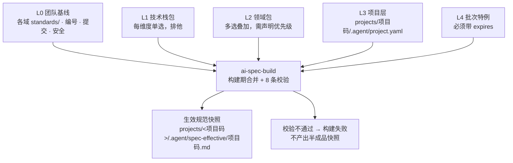

# ai-work-spec

**AI 原生化研发知识库。** 把 需求 → 设计 → 开发 → 测试 → 归档 全流程固化为 AI 可执行的 Skill 与分层规范，供多个项目复用。

> An AI-native engineering knowledge base: turns the full delivery lifecycle into
> executable skills and layered, composable specs.

---

## 它解决什么问题

大多数团队都写过研发规范，绝大多数最后都死在同一件事上：**规范与执行脱节**。

具体表现为三个循环出现的症状：

**规范会腐化。** 团队基线更新了二十条，项目里那份副本永远停在旧版本——因为写副本的人不确定基线覆盖了什么，干脆把相关的都抄一遍。基线一改，副本全废。

**规范写得再好，没人照着做。** 规范写在 Wiki 里，与代码评审、与提交、与测试用例没有任何机械关联。写得越详细，越没人读完。

**产出物之间对不上号。** PRD 说 A、原型是 B、代码实现了 C。没有编号锚点，追溯只能靠人的记忆，而人的记忆在项目结束后就消失了。

这个仓库的主张是：**把流程本身变成 AI 可执行的资产，而不是把规范写成文档。**

- Skill 不是说明书，是可编排、可校验、有输入输出契约的组件
- 规范不是一份文档，是一次**组合**（项目只声明选了哪些包 + 有哪些差异）
- 每个产出物的结构单元都携带编号，构成一条可机械校验的追溯链

---

## 核心机制

### 一、五层规范模型



优先级：**批次 > 项目 > 领域 > 技术栈 > 基线**，标记 `frozen: true` 的条目不接受任何上层修改。

规范编号到**条目**而非文件（`STD-BASE-001`、`STD-VUE3-004`），所以覆盖能精确到条，而不是整份文件覆盖或整份接受。

### 二、合并在构建期完成，不在推理期

一个看起来很自然的做法是：让 AI 执行时自己去读多层规范、自己合并、自己判断优先级。**这个做法必须避免**，四个理由：

| 理由 | 说明 |
|---|---|
| token 成本 | 五层全文每次执行都要读一遍 |
| 结果确定性 | 运行时合并每次结果可能不同；规范的意义恰恰在于"每次都一样" |
| 冲突可见性 | 模型遇到冲突会**静默挑一个**；构建期遇到冲突直接失败 |
| 可审计性 | 快照带哈希，能精确回答"这个批次当时用的是哪版规范" |

`ai-spec-build` 是**纯脚本 Skill，不调用模型**——合并结果必须可复现、可 diff、可审计。
（同理：`ai-spec-check` 与 `ai-spec-mount` 也是纯脚本。判定类工作交给脚本，模型只负责转达与解释。）

### 三、追溯链

```
REQ（需求条目）→ FN（功能点）→ PAGE / API / TBL（原型页 / 接口 / 数据表）
                              → TC（测试用例）→ 提交 → 归档
```

提交信息必须带功能编号（`feat(FN-CORE-045): ...`），测试用例编号必须挂载到功能编号下（`TC-FN-CORE-045-01`），原型页面元素带 `data-fn` 标记。这条链断了能被自动检出——**断链数是目标为 0 的硬指标**。

### 四、六道质量门禁

| 门禁 | 位置 | 核心检查 | 可豁免 |
|---|---|---|---|
| gate-01 需求准入 | 需求分析前 | 业务目标、干系人、验收标准可量化 | 是 |
| gate-02 原型确认 | PRD 前 | 原型覆盖全部 FN、业务方确认 | **否** |
| gate-03 设计评审 + 契约冻结 | 开发前 | FN 覆盖率、接口可追溯、契约冻结 | 部分 |
| gate-04 代码评审 | 测试前 | 契约一致性、静态检查、提交规范 | 部分 |
| gate-05 测试通过 | 上线前 | 用例覆盖、缺陷收敛、上线方案 | 部分 |
| gate-06 归档交付 | 归档时 | 断链检测、文档代码一致性 | **否** |

区分 `BLOCK` 与 `WARN`——如果所有检查项都是阻断项，团队会在第一次被卡住后要求关掉整道门禁。
豁免必须留痕、且复查日期受**机器约束**（须晚于今天、且在 90 天内），把"临时豁免变成永久遗忘"这条最可能的退化路径堵在入口。

> ⚠️ 设计里还有一条"到期自动复查提醒"，**当前未实现**——复查日期会被记录，但没有代码会在到期时提醒。
> 现阶段复查看排期，靠人。

门禁不是纸面制度：`ai-gate-runner` 是纯脚本执行器，读取门禁定义里的 `auto:<检查项 ID>` 逐项校验，
结果写回批次状态文件。**检查项有四种结果，它们的区别就是这套门禁的全部价值所在**（用法见[如何使用 · 三、跑门禁](#三跑门禁)）：

| 结果 | 含义 | 材料能补吗 | 能否签核 |
|---|---|---|---|
| `pass` | 自动校验通过 | — | — |
| `fail` | 自动校验不通过（可定位到具体对象） | — | 修好重跑 |
| `skip` | **缺校验材料** | **能**——补了执行器就能自动校验 | **不能**（BLOCK 级）。签核的前提是"有人核对过了" |
| `external` | **不在执行器职责内** | **不能**——补材料没用 | **能**，但**强制附证据** |

四条刻意保留的语义：

- **`skip` 不等于 `pass`。** 把"没法校验"当成"校验通过"，是门禁最容易失效的方式。
- **BLOCK 级 `skip` 不能签核越过**，只能豁免——材料不存在时无从核对，签核下去记录会显示"已通过"，而它什么都没查。
- **执行器不替人拍板。** 标注 `人` 的检查项原样列出等人工核对；门禁不会自动变绿，需要**带真实人名的显式签核**。
- **`external` 也不等于 `skip`。** 它是"不归它查"（静态检查、覆盖率报告），**必须由人做完并交代证据在哪**——
  不要求证据的话，"我跑过 lint 了"就是一句无成本的口头话，这条门禁退回成走过场。

> 第四态是后来补的，它解的是一个死结：这些项原先挂 `skip`，而其中 `lint-passthrough` 是 BLOCK 级 →
> **gate-04 结构上永远无法通过**，每次都必须走豁免，**豁免从"例外通道"变成了"常规通道"**。
> 拆出 `external` 后 gate-04 回到可签核，而证据要求比原来更严——这不是放宽，是把它挪到了对的位置上。

---

## 如何使用

### 一句话驱动（推荐）

**你不需要记命令。** 40 个 Skill 已挂载到 `.claude/skills/`，用一句话就能驱动整条流程：

> 给列表页加个导出

`ai-flow-autopilot` 会判定该走哪条路径、驱动全流程、在每个阶段自动跑质量门禁；
**需要人判断的地方会停下来问你**（门禁的人工项、需求取舍、契约冻结、验收签字）。

| 你说什么 | 会发生什么 |
|---|---|
| 「给列表页加个导出」 | 判定新建 / 迭代 → 驱动设计 → 编码 → 测试，每阶段跑门禁 |
| 「线上导出偶发超时」 | 走热修流程（强制先写复现用例，24 小时内补测试） |
| 「改个按钮文案」 | 走快车道（四项量化准入）→ 登记快车道台账 |
| 「这个字段为什么这么设计」 | 只读查询知识库，**不建批次** |
| 「继续」 | 从批次状态文件的断点续做，不重跑已完成的步骤 |

它**不会替你做的四件事**：判定路径有歧义时问你、门禁的人工项留给你、签核要你给名字、豁免要你给原因和复查期。
这不是能力不足，是**责任必须有人承担**。

下面几节是**它背后在做什么**——出问题要排查、或想手动控制某一步时看。

### 挂载层是怎么来的

`.claude/skills/<name>/SKILL.md` 是**生成的指针**，真实定义仍在各域的 `skills/<name>/` 下。

**要重建或校验它，调用 `ai-spec-mount`**，说一句"挂载层过期了"或"检查一下是不是同步的"即可。
不需要记任何参数。

改完任何 Skill 的 `SKILL.md` 或 `prompt.md` 后都要重建一次——**`description` 是 Claude 决定
"什么时候用哪个 skill"的依据**，挂载层过期会让模型按错误的触发条件选 Skill。
`ai-spec-check` 会验证两者是否同步。

> 挂载层是生成的而不是手写的，理由很直接：手写会产生 39 份需要同步的副本，而副本一定会分叉。
> 生成让"是否同步"变成可机械验证的事。

### 一、接入一个新项目（一次性，目标 ≤ 30 分钟）

```
git clone https://github.com/lichengqun-dev/ai-work-spec.git
cd ai-work-spec
cp -r projects/_template projects/<你的项目码>
                                     # 1. 编辑 .agent/project.yaml：填仓库路径 + 选包 + 写差异
                                     # 2. 写项目级文档（散文，自由格式，不用管编号）
                                     # 3. 让 ai-spec-extract 把文档里的约束摘成条目
                                     # 4. 让 ai-spec-build 编译出生效规范快照
```

**第 1 步是填组合声明**——项目只声明"选了哪些包 + 有哪些差异"，**不复制任何共享规范的正文**。

**第 2、3 步是"散文 → 条目"**：项目级文档由人工维护或 AI 读代码仓梳理产出，
**不按编号约定写、随便改**；`ai-spec-extract` 把它们里面的约束**照抄**成带编号的条目，
落到 `.agent/rules/`。中间那层不能省——构建只认带编号的条目，它不会去猜散文里哪句话是约束。

**第 4 步是调用 `ai-spec-build`**，说"接入 <项目码>"即可。它自己知道该读哪些包、
该做哪 8 条校验、快照该写到哪。校验不过它会拒绝产出——这是刻意的，见下文。

产出的 `projects/<项目码>/.agent/spec-effective/<你的项目码>.md` 就是**这个项目实际要遵守的规范全文**——
分「常驻注入 / 按需检索索引 / 来源链 / 项目声明摘要」四段。**不要逐个去读包文件**；
它有变更时重新编译即可（见「四、改规范」）。

`ai-spec-build` 唯一的运行前提是 Python 3.8+ 与 PyYAML（`pip install pyyaml`）——
这个前提由 Skill 自己检查，缺了它会说明，不会退化成"编译失败就当通过"。

`project.yaml` 里唯一容易填错的是**仓库路径**：它是四个字段，`repo` 只是兜底。
文档仓 / 原型仓 / 代码仓分开时要用 `docs_repo` / `prototype_repo` / `code_repo` 分别指定——
一个字段承担三种语义会让门禁的路径解析出错。详见 [`projects/README.md`](./projects/README.md)。

### 二、开始一个批次

先判定走哪条路径，再按该路径的步骤走。**路径判定交给总入口，不要自己凭感觉选**——
判错了要么跳过该走的环节，要么让小事走重流程（然后团队开始绕开流程）。

| 路径 | 适用 | 起点 | 规模 |
|---|---|---|---|
| **新建** | 从零到一的新系统 | `ai-requirement-00-intake` | 23 步 |
| **迭代** | 已有系统加功能 / 改行为 | `ai-iteration-01-impact` | 按影响等级分流 |
| **快车道** | 小改动、工单 | `ai-daily-01-fastlane` | 允许跳步，**必须登记台账** |
| **咨询** | 只是问问题 | `ai-daily-04-qa` | 只读，**不建批次** |

确定路径后会生成批次状态文件 `projects/<项目码>/.agent/state/<批次号>.yaml`，它是**接手一个批次时的第一个读物**——
卡在哪一步、上一步产出了什么、有什么没解决的问题，都在这一份里。**你不需要读它**，
说一句"继续"就会从断点续做，不重跑已完成的步骤。

之后每一步都由 AI 按对应 Skill 的三件套执行：读 `SKILL.md` 确认能不能做 → 按 `prompt.md` 执行 →
产出物登记到状态文件的 `artifacts`。**产出物落项目的文档仓 `docs/`，不在本仓库。**
目录约定（序号固定）见 [`projects/README.md`](./projects/README.md)。

#### 迭代路径：开工前的三条前置（缺一条会被直接拒绝）

**迭代不是"步骤少的新建"，它多一道门槛：必须先有基线。** `ai-iteration-01-impact` 有三条前置条件，
任一不满足它**拒绝执行并说明缺哪一条**——这是刻意的，猜一个影响范围比不猜更危险：

| # | 前置 | 怎么满足 |
|---|---|---|
| 1 | **项目已接入** | `projects/<项目码>/.agent/project.yaml` 存在，且仓库路径填的是真实值（不是 `<占位>`） |
| 2 | **依赖关系图非空** | `projects/<项目码>/.agent/index/依赖关系图.md` 有内容。迭代靠它**双向遍历**圈定影响范围——空了只能猜 |
| 3 | **有基线** | 该功能至少有一个**已归档批次**。**全新功能走新建流程，不走迭代** |

第 2 条是最容易卡住的一条：**冷启动时依赖关系图本来就是空的**（没有真实批次就没有关系可记）。
两条出路：① 按 `projects/<项目码>/.agent/index/依赖关系图.md` 的表格格式，手工补出**本批次涉及的**依赖关系
（不必全量，够遍历即可，跑完第一个批次它就会自己长）；② 由人显式指定影响范围，绕过这个 Skill。

> 这看起来像"工具不好用"，其实是它在守一件事：**无图只能做全量回归或凭经验选，而两者都不该由 Skill 默默决定**。
> 让它猜一个范围然后看起来跑完了，比让它停下来要危险得多。

#### 迭代与新建的本质区别：不是步骤少，是**存在基线**

| | 新建 | 迭代 |
|---|---|---|
| 设计产出 | 完整的详细设计 | **只写差异**（改什么 / 为什么 / 原设计是什么 / 影响谁） |
| 文档 | 新写 | 原批次产出物**不可变**，另开变更子批次 `<原批次号>-C<n>` |
| 追溯 | `REQ → FN → …` | 多一层：`原批次 → 变更子批次` |

**四条边界不接受绕过。** 判据是"谁会被影响"，不是"改多少个字"：

| 情况 | 处理 | 为什么 |
|---|---|---|
| 涉及**对外契约** | 转完整流程 | 前端与外部调用方都受影响 |
| 涉及**表结构** | 转完整流程 | **即使只加一个可空字段**——所有读写该表的 FN 都进了回归范围 |
| 影响等级**大** | 转完整流程 | 不接受降级为"中"来省流程 |
| 影响等级**小** | 走 `06_日常开发` 的快车道 | 小改动走重流程的后果是团队开始绕开流程 |

「涉及表结构一律判大」是刻意的：把它判成"中"或"小"，是迭代流程里最高频的一类低估，
而后果要到回归阶段才暴露。

**迭代也会经过 `release` 与 gate-05**，顺序是：`test-report` → **`ai-iteration-04-release`（产出上线步骤 + 回滚方案）**
→ **gate-05（校验测试结论 + 上线方案）** → 真正上线 → `ai-archive-01-close`。
`release` 排在门禁**之前**是必须的——gate-05 要校验的就是它产出的上线方案，
而"门禁要的文件只有门禁通过才允许产出"会形成死锁。

### 三、跑门禁

每道门禁在进入下一阶段前执行。**不允许跳步**——上一道未通过时执行器会拒绝。

**调用 `ai-gate-runner` 即可**，说"跑 gate-03"或"这个批次的门禁过一下"。它自己知道去哪读门禁定义、
该跑哪些检查项、结果该写回哪个文件。**你不需要记参数，也不需要知道检查项有几项。**

需要你出场的**四种**情况，它会明确告诉你：

| 它说 | 你要做 |
|---|---|
| 有待人工核对的项 | 照它列出的清单核对，核对完给它你的**真实姓名**去签核 |
| 某检查项缺材料，记了 `skip` | 按它说明的"要做什么才能自动校验"补材料，然后重跑 |
| 某检查项是 `external`（🔧） | **说清证据在哪**（lint 结果 / 覆盖率报告记在哪个文件）——不给证据签核会被拒 |
| 确实要带风险上线 | 给它**原因**和**复查日期**（须晚于今天且在 90 天内） |

**两道门禁不允许豁免**：`gate-02 原型确认` 与 `gate-06 归档交付`（它们的 `waivable: no`）。
它们守着一个跳过就无法补救的东西——原型确认是需求理解的唯一验证点，归档是追溯链的最后一步。
对它们要求豁免会被**直接拒绝**，而不是"记一笔就放行"。

**`skip` 与 `external` 的区别不要讲混**（四种结果的完整对照见[核心机制 · 四](#四六道质量门禁)）：

- `skip` 是"**缺材料**，补了就能自动查"，所以补不齐时**不能签核**，只能走豁免
- `external` 是"**不归它查**，补材料没用"，所以**可以签核，但必须交代证据在哪**

讲混的后果很具体：让用户去补一堆**永远补不齐**的材料。

> 门禁的判定结果只有三种：**通过**、**未通过或待人工确认**、**执行器自身错误**（含拒绝执行）。
> 第三种不是"检查没做"，而是"这道门禁根本没跑起来"——它一定会说明原因，且不会被算作通过。

### 四、改规范

**改了包条目或项目 manifest 之后必须重建快照**，否则规范没生效——调用 `ai-spec-build` 即可。

改完再调用 **`ai-spec-check`** 做一次跨文件一致性检查。它查的是**单文件检查发现不了、
拼起来才暴露的**那类问题：编号悬空引用、Skill 名引用无效、三件套缺失、上下文预算超标、
门禁引用了未实现的检查项、文档状态与 `status` 字段矛盾、挂载层与真实定义不同步。

**建议每次改完规范或 Skill 后都跑一次**，不必等到月度。

> 它只报告，**不自动修复**。就算问题看起来一目了然（"这不就是编号抄错了吗"），也先报告再等确认——
> 一次执行改掉几十个文件，只要有一条判断错了，这份清单就再也没人信了。

三个治理工具的搭配：改规范 → `ai-spec-build`；改 Skill → `ai-spec-mount`；收口 → `ai-spec-check`。

`ai-spec-build` 的 8 条校验（任一失败即中止，**不产出半成品快照**）：

1. `PACK.md` 必填字段齐全，`files` 列出的文件都存在
2. 条目前缀与所在包的 `prefix` 一致
3. 条目编号全库唯一
4. manifest 引用的包与版本存在且匹配（版本锁定，升级需显式改 manifest）
5. `overrides` 引用的条目存在
6. **对 `frozen` 条目的 override / disable / append 一律拒绝**（append 也被拒——追加内容可以实质架空原条目）
7. `disable` 必须带 `expires`；禁用基线或包条目还需 `approved_by`
8. 同层冲突且未在 manifest 的 `domains` 中声明优先级 → 失败，不允许工具静默挑选

### 五、日常维护

| 频率 | 做什么 | 调用谁 |
|---|---|---|
| 改完规范 | 重建生效快照 | `ai-spec-build` |
| 改完 Skill | 重建挂载层 | `ai-spec-mount` |
| 改完上面任一项 | 一致性检查收口 | `ai-spec-check` |
| 每月 | 项目特例提升为共享包条目 | `ai-spec-promote` |
| 随时 | 小需求 / 工单 | `ai-daily-01-fastlane`（会写 `projects/<项目码>/.agent/index/快车道台账.md`） |
| 线上故障 | 热修与复盘 | `ai-daily-02-hotfix`（回写 `09_资产库/故障案例库/`） |
| 每月 | 技术债识别与排期建议 | `ai-daily-03-techdebt`（读台账，输出到 `projects/<项目码>/.agent/index/技术债清单.md`） |
| 随时 | 查"这个字段为什么这么设计" | `ai-daily-04-qa`（只读知识库，**找不到就说找不到**） |

`ai-daily-04-qa` 是这套知识库**唯一的使用反馈回路**：其他 Skill 都在写知识，只有它在读。
它报"找不到"的地方，就是知识库下一步该补的地方。

### 全部 40 个 Skill

**使用者只需要认识第一行那一个。** 其余 39 个由它按路径调用——列在这里是为了排查时能对号入座。

| 类别 | Skill |
|---|---|
| **总入口** | `ai-flow-autopilot` —— 说一句话即可 |
| 知识库治理 | `ai-spec-build` 编译规范快照 / `ai-spec-check` 一致性检查 / `ai-spec-mount` 重建挂载层 / `ai-spec-promote` 项目特例提升 / `ai-spec-extract` 项目散文摘成条目 |
| 需求设计 | `ai-requirement-00-intake` · `01-init` · `02-analysis` · `03-prototype` · `04-prd` · `autopilot` · `ai-figma-axure-convert` |
| 概要详细设计 | `ai-design-01-arch` · `02-detail` · `03-db` · `04-api` · `05-frontend-spec` · `06-review` |
| 编码开发 | `ai-dev-01-scaffold` · `02-backend` · `03-frontend` · `04-unittest` · `05-codereview` · `06-docsync` |
| 测试验证 | `ai-test-01-cases` · `02-automation` · `03-execute` · `04-regression` · `05-report` |
| 迭代开发 | `ai-iteration-01-impact` · `02-delta-spec` · `03-change-control` · `04-release` |
| 日常开发 | `ai-daily-01-fastlane` · `02-hotfix` · `03-techdebt` · `04-qa` |
| 门禁与归档 | `ai-gate-runner`（六道门禁的统一执行器） · `ai-archive-01-close` |

---

## 目录结构

**三层：`00`–`09` 是跨项目基线，`projects/<项目码>/` 是项目级，`projects/<项目码>/<需求名>/` 是业务级。**
冲突时 **业务级 > 项目级 > 用户级**。

```
ai-work-spec/
├── .claude/skills/            Skill 挂载层（生成，让 40 个 Skill 可被发现与调用）
├── CLAUDE.md                  全局上下文：技术栈基线、全局禁止、Skill 路由
├── README.md
│            ── 用户级：跨项目基线 ──────────────────────────
├── 00_工作空间配置/            地基：规范 AI 怎么工作、怎么编号、怎么加载上下文
│                              + 4 个知识库治理工具（编译 / 检查 / 挂载 / 提升）
├── 01_需求设计/                原始需求 → 需求分析 → 原型 → PRD
├── 02_概要详细设计/            架构 · 功能详细设计 · 数据库 · 接口契约 · 前端设计
├── 03_编码开发/                工程骨架 · 前后端实现 · 单元测试 · 代码评审
├── 04_测试验证/                用例生成 · 自动化 · 执行 · 回归圈定 · 测试报告
├── 05_迭代开发/                影响面分析 · 增量设计 · 变更登记 · 发布说明
├── 06_日常开发/                小需求快车道 · 热修 · 技术债 · 日常答疑
├── 07_质量门禁/                六道门禁定义 + 统一执行器
├── 08_归档交付/                批次结项 · 断链检测
├── 09_资产库/                  规范包 · 领域模型 · 组件库 · 提示词库 · 故障案例库
├── docs/                       设计记录：为什么这么设计、实测卡在哪
│            ── 项目级 / 业务级：唯一允许出现项目信息的地方 ──
└── projects/
    ├── _template/              新项目的空骨架（**含 .agent/ 机制模板**）
    └── <项目码>/
        ├── 系统架构总览.md 等    散文层：架构/模块/模型/规范/环境（人读的，自由格式）
        ├── skills/             项目级 Skill
        ├── .agent/             机器面：project.yaml（组合声明）/ rules（带编号条目）/
        │                       state / index / memory
        └── <需求名>/            业务级：该需求全部产出物（00_批次 ~ 05_交付 / 迭代 / 原型）
```

**`00`–`09` 每个域都有 `README.md`**，是进入该域的入口——先读它，再决定要不要往下读 Skill。
根 `README.md` 讲全局，域 `README.md` 讲"这个域有哪些 Skill、按什么顺序、依赖什么资产"，
`docs/README.md` 说明设计记录的用法（**那两份是记录，不是规范**），
`projects/README.md` 讲三层结构与项目的目录约定。

每个 Skill 目录是三件套：`SKILL.md`（合同：能力边界与输入输出契约）、`prompt.md`（指令：可执行提示词）、`references/`（知识：按需加载，默认只读索引）。

> **`.agent/` 只在项目下**：它是本知识库的机器状态区（`state/` 批次状态 · `index/` 编号总表与台账 ·
> `memory/` 项目约定 · `spec-effective/` 生效快照 · `logs/` 执行日志），
> 而机器状态天生属于某个项目——放顶层会让多个项目共用一个编号总表而撞号。
>
> **机制模板住在项目骨架里**：`projects/_template/.agent/state/_模板.yaml`（批次状态 Schema）、
> `projects/_template/.agent/logs/README.md`（日志格式约定）。复制骨架即得到完整结构。

---

## Skill 清单

共 **40 个，全部已实现**（34 个阶段 Skill + 5 个知识库治理工具 + 1 个全流程编排入口）。

| 域 | Skill | 状态 |
|---|---|---|
| 工作空间配置 | **`ai-flow-autopilot` 全流程入口（说一句话就能驱动）** | ✅ |
| 工作空间配置 | 知识库治理：`ai-spec-build` 编译规范快照 / `ai-spec-check` 一致性检查 / `ai-spec-mount` 重建挂载层 / `ai-spec-promote` 项目特例提升为共享包 | ✅ |
| 需求设计 | `ai-requirement-00-intake` 批次入口判定 / `01-init` 初始化双仓库 / `02-analysis` 需求结构化 / `03-prototype` 原型产出 / `04-prd` 读原型生成 PRD / `autopilot` 编排需求段 | ✅ |
| 需求设计 | `ai-figma-axure-convert` 设计稿转原型（产出须与 `ai-requirement-03-prototype` 同构） | ✅ |
| 概要详细设计 | `ai-design-01-arch` 架构 / `02-detail` 详细设计 / `03-db` 数据库 / `04-api` 接口契约 / `05-frontend-spec` 前端设计 / `06-review` 设计评审 | ✅ |
| 编码开发 | `ai-dev-01-scaffold` 骨架 / `02-backend` 后端 / `03-frontend` 前端 / `04-unittest` 单测 / `05-codereview` 代码评审 / `06-docsync` 文档回流 | ✅ |
| 测试验证 | `ai-test-01-cases` 用例 / `02-automation` 自动化 / `03-execute` 执行与缺陷 / `04-regression` 回归圈定 / `05-report` 报告 | ✅ |
| 迭代开发 | `ai-iteration-01-impact` 影响面 / `02-delta-spec` 增量设计 / `03-change-control` 变更登记 / `04-release` 发布 | ✅ |
| 日常开发 | `ai-daily-01-fastlane` 快车道 / `02-hotfix` 热修 / `03-techdebt` 技术债 / `04-qa` 答疑 | ✅ |
| 质量门禁 | `ai-gate-runner` 统一门禁执行器（25 个检查项，纯脚本） | ✅ |
| 归档交付 | `ai-archive-01-close` 批次结项与断链检测（**gate-06 的产出方**） | ✅ |

命名规则：阶段 Skill 为 `ai-<域>-<序号>-<动作>`；编排类加 `-autopilot`；工具类加 `-runner` / `-convert`。
`ai-spec-*` 这一族是**知识库自身的治理工具**——`spec` 在这里表示"知识库自我维护"，不对应交付阶段。

> **40 个 Skill 全部挂载在 `.claude/skills/` 下可被直接调用。** 这一层是生成的指针，
> 由 `ai-spec-mount` 维护；改完任何 Skill 定义后要重建它，否则模型会按过期的触发条件选 Skill。
> **定义与挂载层是否同步，由 `ai-spec-check` 机械校验**——不靠人记得。

---

## 规范包

**规范包按单一技术组件切分，不按技术栈组合切分。** 后者会组合爆炸：3 个前端 × 2 个后端 × 1 个数据库 = 6 个包，
且"接口必须定义错误码"这类跨栈规范要改 6 次。按组件切分后，组合由项目 manifest 负责。

| 维度 | 示例包 | 排他性 |
|---|---|---|
| `fe` 前端 | `fe-vue2-elementui` / `fe-vue3-elementplus` / `fe-react-antd` | 单选 |
| `be` 后端 | `be-springboot2-java8` / `be-springboot3-java17` | 单选 |
| `db` 数据库 | `db-dm8`（达梦） | 单选 |
| `domain` 领域 | `platform-base` / `info-security` | **多选叠加** |

技术栈包天然不冲突（一个项目不可能同时用 Vue 2 和 Vue 3 做同一个前端）；领域包会冲突，所以在 manifest 里显式声明 `domains` 顺序，靠前者胜出，裁决结果记入快照的来源链。

**本仓库预置 9 个规范包作为结构示例**（7 个技术栈包 + 2 个领域包），其中两个领域包是空骨架——领域包承载的是各团队自己的业务知识，本仓库不替使用者拟定业务规则。按需增删即可，**不要一次性建全**：用真实批次反推条目，坐在会议室里凭空写的通用条目实战中往往一条都用不上。

注意 `db` 维度有**两个互斥的包**（`db-dm8` 达梦 / `db-gaussdb` GaussDB·PostgreSQL），
manifest 里只能选一个——它们的多条规则方向相反，同时引用会让快照里出现互相矛盾的约束。

---

## 交付状态与路线图

| 阶段 | 内容 | 状态 |
|---|---|---|
| **P0** | 地基 + 需求流水线：目录、00 配置、规范包骨架、项目 manifest、`ai-spec-build`、需求域 Skill、六道门禁定义与**执行器** | ✅ 已完成 |
| **P1** | 设计 + 开发流水线：`02` `03` 两域 Skill、契约冻结、`ai-gate-runner` | ✅ 已完成 |
| **P2** | 测试 + 迭代 + 日常：`04` `05` `06` 三域 Skill | ✅ 已完成 |
| **P3** | 资产沉淀与度量：领域模型、组件库、故障案例库、度量指标 | ⏳ |

**各阶段必须串行。** P1 的契约冻结依赖 P0 的编号体系；P2 的影响面分析依赖 P1 产出的依赖关系图。并行推进必然返工。

**当前进度：P0、P1、P2 已完成，40 个 Skill 全部实现并挂载可用。**

**P0–P2 之后还做了一轮"加固"，它不属于路线图的任何阶段**，但值得记在这里，因为它改变了你上手时会遇到的东西：

- **调用方式去命令化**：文档里不再出现 `python3 xxx.py --flag`，一律改为"调用某个 Skill，说一句话即可"。
  原先 `consistency_check` 与挂载层重建这两个脚本**根本没有 Skill 入口**，只能靠命令行——
  现在补成了 `ai-spec-check` 与 `ai-spec-mount`，与 `ai-spec-build` / `ai-spec-promote` 构成
  **知识库自身的四个治理工具**。
- **修掉三类门禁缺陷**：空集假通过（什么都没有却判 pass）、假失败（找不到地方却报"不存在"）、
  以及 `external` 态的补入。**前两类是同一枚硬币的两面：把"没查"说成"查了"。**
- **自检脚本的覆盖面从"引用是否悬空"扩到 12 类**——数字对齐实测、Markdown 结构、
  挂载层同步、过期状态表述等，都在里面了。

剩余 **P3 为资产沉淀与度量**（领域模型、组件库、故障案例库、指标基线）。
**但 P3 主要靠真实批次的数据积累**——在跑过真实需求之前，填规范包与度量基线基本都是凭空写。
`09_资产库/` 下除规范包外的五个子库**当前是空的，这是正确状态，不是待办**。

当前基线内容：团队基线 **43 条** + 包内条目 **36 条**，共 79 条规范。规范包状态为 `skeleton` / `partial`——**不要指望它们现在就能约束代码质量**，条目要靠真实批次反推逐步填充。

---

## 这是一个通用资产

`00`–`09` 是**项目无关的**：只有机制、规范模板与通用工程约束，不出现任何具体项目的名称、模块码、表名或业务规则。
**项目的机器状态（`.agent/`）也只在 `projects/<项目码>/` 下**，顶层没有它——
机器状态天生属于某个项目，放顶层会让多个项目共用一个编号总表而撞号。

**具体项目的一切只存在于 `projects/<项目码>/` 下**，且那里只有组合声明（选了哪些包 + 有哪些差异）与项目特有条目——**没有共享规范的正文**。一旦在项目里粘贴包内规范的内容，这个项目就退化成基线副本，包更新再也影响不到它，这正是分层设计要解决的问题本身。

判断一条内容该放哪，只需问一句：**把这份知识库交给另一个团队，这条内容还成立吗？** 不成立就说明放错了地方。

复用到其他团队：保留 `00`–`09` 与 `projects/_template/`，清空 `projects/` 下的其他目录，按自己的技术栈增删规范包即可。
（机制模板住在 `projects/_template/.agent/` 里，所以跟着骨架一起保留。）

---

## License

[MIT](./LICENSE)
