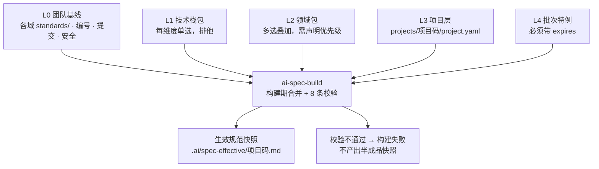

# ai-work-spec

**AI 原生化研发知识库。** 把 需求 → 设计 → 开发 → 测试 → 归档 全流程固化为 AI 可执行的 Skill 与分层规范，供多个项目复用。

> An AI-native engineering knowledge base: turns the full delivery lifecycle into
> executable skills and layered, composable specs.

---

## 它解决什么问题

大多数团队都写过研发规范，绝大多数最后都死在同一件事上：**规范与执行脱节**。

具体表现为三个循环出现的症状：

**规范会腐化。** 团队基线更新了二十条，项目里那份副本永远停在旧版本——因为写副本的人不确定基线覆盖了什么，干脆把相关的都抄一遍。基线一改，副本全废。

**规范写得再好，没人照着做。** 规范写在 Wiki 里，与代码评审、与提交、与测试用例没有任何机械关联。写得越详细，越没人读完。

**产出物之间对不上号。** PRD 说 A、原型是 B、代码实现了 C。没有编号锚点，追溯只能靠人的记忆，而人的记忆在项目结束后就消失了。

这个仓库的主张是：**把流程本身变成 AI 可执行的资产，而不是把规范写成文档。**

- Skill 不是说明书，是可编排、可校验、有输入输出契约的组件
- 规范不是一份文档，是一次**组合**（项目只声明选了哪些包 + 有哪些差异）
- 每个产出物的结构单元都携带编号，构成一条可机械校验的追溯链

---

## 核心机制

### 一、五层规范模型



优先级：**批次 > 项目 > 领域 > 技术栈 > 基线**，标记 `frozen: true` 的条目不接受任何上层修改。

规范编号到**条目**而非文件（`STD-BASE-001`、`STD-VUE3-004`），所以覆盖能精确到条，而不是整份文件覆盖或整份接受。

### 二、合并在构建期完成，不在推理期

一个看起来很自然的做法是：让 AI 执行时自己去读多层规范、自己合并、自己判断优先级。**这个做法必须避免**，四个理由：

| 理由 | 说明 |
|---|---|
| token 成本 | 五层全文每次执行都要读一遍 |
| 结果确定性 | 运行时合并每次结果可能不同；规范的意义恰恰在于"每次都一样" |
| 冲突可见性 | 模型遇到冲突会**静默挑一个**；构建期遇到冲突直接失败 |
| 可审计性 | 快照带哈希，能精确回答"这个批次当时用的是哪版规范" |

`ai-spec-build` 是一个 **纯 Python 脚本，不调用模型**——合并结果必须可复现、可 diff、可审计。

### 三、追溯链

```
REQ（需求条目）→ FN（功能点）→ PAGE / API / TBL（原型页 / 接口 / 数据表）
                              → TC（测试用例）→ 提交 → 归档
```

提交信息必须带功能编号（`feat(FN-CORE-045): ...`），测试用例编号必须挂载到功能编号下（`TC-FN-CORE-045-01`），原型页面元素带 `data-fn` 标记。这条链断了能被自动检出——**断链数是目标为 0 的硬指标**。

### 四、六道质量门禁

| 门禁 | 位置 | 核心检查 | 可豁免 |
|---|---|---|---|
| gate-01 需求准入 | 需求分析前 | 业务目标、干系人、验收标准可量化 | 是 |
| gate-02 原型确认 | PRD 前 | 原型覆盖全部 FN、业务方确认 | **否** |
| gate-03 设计评审 + 契约冻结 | 开发前 | FN 覆盖率、接口可追溯、契约冻结 | 部分 |
| gate-04 代码评审 | 测试前 | 契约一致性、静态检查、提交规范 | 部分 |
| gate-05 测试通过 | 上线前 | 用例覆盖、缺陷收敛、上线方案 | 部分 |
| gate-06 归档交付 | 归档时 | 断链检测、文档代码一致性 | **否** |

区分 `BLOCK` 与 `WARN`——如果所有检查项都是阻断项，团队会在第一次被卡住后要求关掉整道门禁。豁免必须留痕且 7 天后自动复查，**没有自动复查的豁免机制等于没有门禁**。

门禁不是纸面制度：`ai-gate-runner` 是纯脚本执行器，读取门禁定义里的 `auto:<检查项 ID>` 逐项校验，结果写回批次状态文件。它有两条刻意保留的语义：

- **`skip` 不等于 `pass`。** 缺少校验材料（项目仓未挂载、依赖的 Skill 尚未实现）时记为 `skip`，转入人工确认并说明"要做什么才能自动校验"。把"没法校验"当成"校验通过"，是门禁最容易失效的方式。
- **执行器不替人拍板。** 标注 `人` 的检查项原样列出等人工核对；门禁不会自动变绿，需要 `--confirm --by <名字>` 显式签核——门禁记录的价值在于能回答"谁在什么时候确认的"。

```bash
S=07_质量门禁/skills/ai-gate-runner/scripts/gate_run.py
python3 $S --list-checks                                        # 检查项库
python3 $S --project <码> --batch <批次号> --all                 # 按顺序跑到第一个未通过
```

---

## 快速开始

**前置要求**：Python 3.8+ 与 PyYAML（`pip install pyyaml`）。

```bash
git clone https://github.com/lichengqun-dev/ai-work-spec.git
cd ai-work-spec

# 1. 看有哪些规范包可选
python3 00_工作空间配置/skills/ai-spec-build/scripts/spec_build.py --list

# 2. 接入一个项目
cp -r projects/_template projects/<你的项目码>
#    编辑 projects/<你的项目码>/project.yaml：选包 + 写差异

# 3. 编译出生效规范快照
python3 00_工作空间配置/skills/ai-spec-build/scripts/spec_build.py --project <你的项目码>
```

产出的 `.ai/spec-effective/<项目码>.md` 就是**实际要遵守的规范全文**——分「常驻注入 / 按需检索索引 / 来源链 / 项目声明摘要」四段。不要逐个去读包文件。

接入一个新项目的目标耗时 **≤ 30 分钟**。超过说明包粒度太细（选项太多）或 manifest 结构太复杂——这是衡量分层设计是否成功的硬指标。

### `ai-spec-build` 的 8 条校验

任一失败即中止，**不产出半成品快照**：

1. `PACK.md` 必填字段齐全，`files` 列出的文件都存在
2. 条目前缀与所在包的 `prefix` 一致
3. 条目编号全库唯一
4. manifest 引用的包与版本存在且匹配（版本锁定，升级需显式改 manifest）
5. `overrides` 引用的条目存在
6. **对 `frozen` 条目的 override / disable / append 一律拒绝**（append 也被拒——追加内容可以实质架空原条目）
7. `disable` 必须带 `expires`；禁用基线或包条目还需 `approved_by`
8. 同层冲突且未在 manifest 的 `domains` 中声明优先级 → 失败，不允许工具静默挑选

---

## 目录结构

```
ai-work-spec/
├── CLAUDE.md                  全局上下文：技术栈基线、全局禁止、Skill 路由
├── README.md
├── 00_工作空间配置/            地基：规范 AI 怎么工作、怎么编号、怎么加载上下文
├── 01_需求设计/                原始需求 → 需求分析 → 原型 → PRD
├── 02_概要详细设计/            架构 · 功能详细设计 · 数据库 · 接口契约 · 前端设计
├── 03_编码开发/                工程骨架 · 前后端实现 · 单元测试 · 代码评审
├── 04_测试验证/                用例生成 · 自动化 · 执行 · 回归圈定 · 测试报告
├── 05_迭代开发/                影响面分析 · 增量设计 · 变更登记 · 发布说明
├── 06_日常开发/                小需求快车道 · 热修 · 技术债 · 日常答疑
├── 07_质量门禁/                六道门禁定义 + 统一执行器
├── 08_归档交付/                批次结项 · 断链检测
├── 09_资产库/                  规范包 · 领域模型 · 组件库 · 提示词库 · 故障案例库
├── docs/                       设计方案（说明各机制为什么这么设计）
├── projects/                   项目实例层（唯一允许出现具体项目信息的地方）
└── .ai/                        机器状态区：批次状态机 · 编号总表 · 生效快照
```

每个 Skill 目录是三件套：`SKILL.md`（合同：能力边界与输入输出契约）、`prompt.md`（指令：可执行提示词）、`references/`（知识：按需加载，默认只读索引）。

---

## Skill 清单

共 **36 个**，其中 **34 个已实现**、**2 个为占位**（`status: not_implemented`，前置条件会拒绝执行）。

| 域 | Skill | 状态 |
|---|---|---|
| 工作空间配置 | `ai-spec-build` 规范编译器 / `ai-spec-promote` 项目特例提升为共享包 | ✅ |
| 需求设计 | `ai-requirement-00-intake` 批次入口判定 / `01-init` 初始化双仓库 / `02-analysis` 需求结构化 / `03-prototype` 原型产出 / `04-prd` 读原型生成 PRD / `autopilot` 编排全流程 | ✅ |
| 需求设计 | `ai-figma-axure-convert` 设计稿转原型（需先有原型的真实产出作为格式基准） | ⏳ 待实现 |
| 概要详细设计 | `ai-design-01-arch` 架构 / `02-detail` 详细设计 / `03-db` 数据库 / `04-api` 接口契约 / `05-frontend-spec` 前端设计 / `06-review` 设计评审 | ✅ |
| 编码开发 | `ai-dev-01-scaffold` 骨架 / `02-backend` 后端 / `03-frontend` 前端 / `04-unittest` 单测 / `05-codereview` 代码评审 / `06-docsync` 文档回流 | ✅ |
| 测试验证 | `ai-test-01-cases` 用例 / `02-automation` 自动化 / `03-execute` 执行与缺陷 / `04-regression` 回归圈定 / `05-report` 报告 | ✅ |
| 迭代开发 | `ai-iteration-01-impact` 影响面 / `02-delta-spec` 增量设计 / `03-change-control` 变更登记 / `04-release` 发布 | ✅ |
| 日常开发 | `ai-daily-01-fastlane` 快车道 / `02-hotfix` 热修 / `03-techdebt` 技术债 / `04-qa` 答疑 | ✅ |
| 质量门禁 | `ai-gate-runner` 统一门禁执行器（25 个检查项，纯脚本） | ✅ |
| 归档交付 | `ai-archive-01-close` 批次结项与断链检测 | ⏳ P2 |

命名规则：阶段 Skill 为 `ai-<域>-<序号>-<动作>`；编排类加 `-autopilot`；工具类加 `-runner` / `-convert` 且不受域枚举约束。

> 调用未实现的 Skill 会因前置条件不满足而拒绝执行——这是刻意设计。占位 `SKILL.md` 的作用是让编排层能正确判断"这个 Skill 还不能用"，而不是让它看起来可用。

---

## 规范包

**规范包按单一技术组件切分，不按技术栈组合切分。** 后者会组合爆炸：3 个前端 × 3 个后端 = 9 个包，且"接口必须定义错误码"这类跨栈规范要改 9 次。按组件切分后，组合由项目 manifest 负责。

| 维度 | 示例包 | 排他性 |
|---|---|---|
| `fe` 前端 | `fe-vue2-elementui` / `fe-vue3-elementplus` / `fe-react-antd` | 单选 |
| `be` 后端 | `be-springboot2-java8` / `be-springboot3-java17` | 单选 |
| `db` 数据库 | `db-dm8`（达梦） | 单选 |
| `domain` 领域 | `platform-base` / `info-security` | **多选叠加** |

技术栈包天然不冲突（一个项目不可能同时用 Vue 2 和 Vue 3 做同一个前端）；领域包会冲突，所以在 manifest 里显式声明 `domains` 顺序，靠前者胜出，裁决结果记入快照的来源链。

**本仓库只预置 8 个规范包作为结构示例**，其中两个领域包是空骨架——领域包承载的是各团队自己的业务知识，本仓库不替使用者拟定业务规则。按需增删即可，**不要一次性建全**：用真实批次反推条目，坐在会议室里凭空写的通用条目实战中往往一条都用不上。

---

## 交付状态与路线图

| 阶段 | 内容 | 状态 |
|---|---|---|
| **P0** | 地基 + 需求流水线：目录、00 配置、规范包骨架、项目 manifest、`ai-spec-build`、需求域 Skill、六道门禁定义与**执行器** | ✅ 已完成 |
| **P1** | 设计 + 开发流水线：`02` `03` 两域 Skill、契约冻结、`ai-gate-runner` | ✅ 已完成 |
| **P2** | 测试 + 迭代 + 日常：`04` `05` `06` 三域 Skill | ✅ 已完成 |
| **P3** | 资产沉淀与度量：领域模型、组件库、故障案例库、度量指标 | ⏳ |

**各阶段必须串行。** P1 的契约冻结依赖 P0 的编号体系；P2 的影响面分析依赖 P1 产出的依赖关系图。并行推进必然返工。

**当前进度：P0、P1、P2 已完成。** 剩余 P3 为资产沉淀与度量（领域模型、组件库、故障案例库、度量指标），属持续投入，无固定交付节点。

当前基线内容：团队基线 **37 条** + 包内条目 **30 条**，共 67 条规范。规范包状态为 `skeleton` / `partial`——**不要指望它们现在就能约束代码质量**，条目要靠真实批次反推逐步填充。

---

## 这是一个通用资产

`00`–`09` 与 `.ai/` 都是**项目无关的**：只有机制、规范模板与通用工程约束，不出现任何具体项目的名称、模块码、表名或业务规则。

**具体项目的一切只存在于 `projects/<项目码>/` 下**，且那里只有组合声明（选了哪些包 + 有哪些差异）与项目特有条目——**没有共享规范的正文**。一旦在项目里粘贴包内规范的内容，这个项目就退化成基线副本，包更新再也影响不到它，这正是分层设计要解决的问题本身。

判断一条内容该放哪，只需问一句：**把这份知识库交给另一个团队，这条内容还成立吗？** 不成立就说明放错了地方。

复用到其他团队：保留 `00`–`09`、`.ai/`、`projects/_template/`，清空 `projects/` 下的其他目录，按自己的技术栈增删规范包即可。

---

## License

[MIT](./LICENSE)
