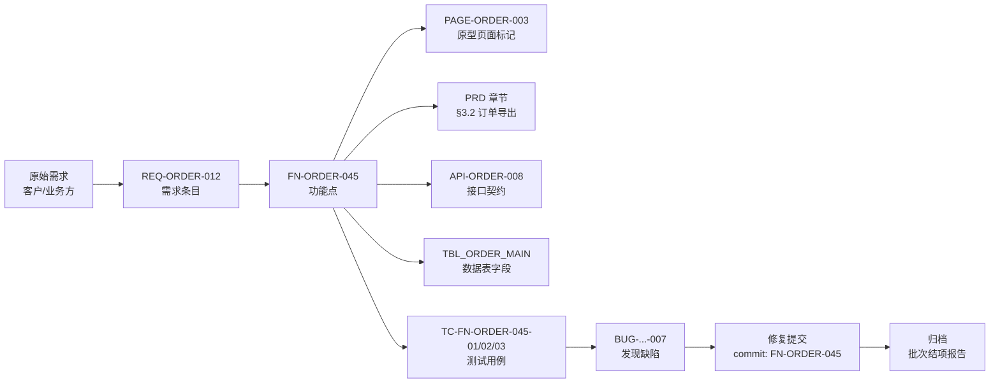
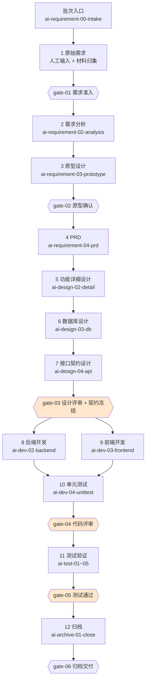
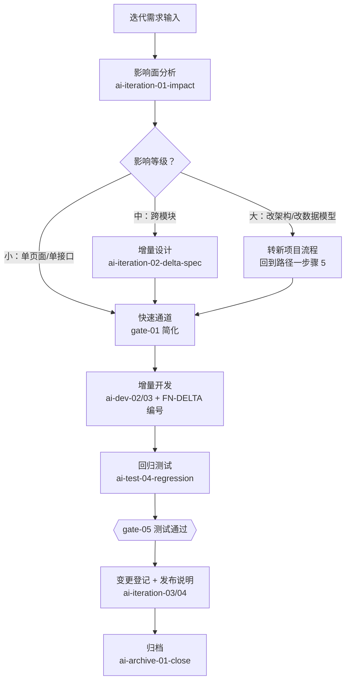
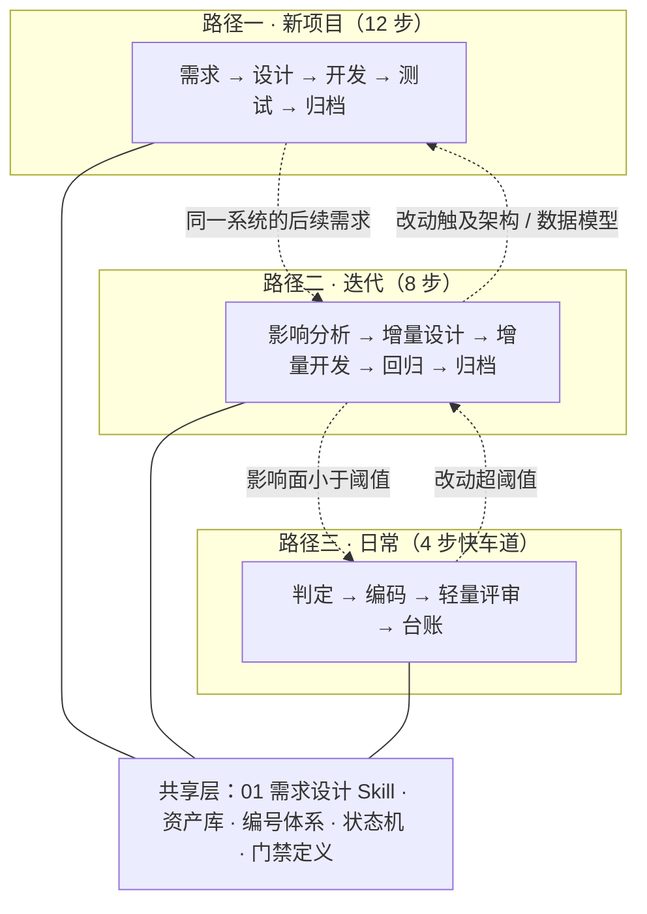
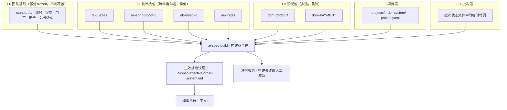

# AI 原生化开发知识库 · 设计方案

> ⚠️ **目录结构已演进，本文档中的路径为写作时的形态，未逐处回改。**
>
> 本文档记录的是**当时的机制设计意图**，按"历史记录不改写"的原则保留原样。
> 但两处结构性变化会让文中的路径对不上现状，读之前先知道：
>
> | 本文中的写法 | 现在的位置 |
> |---|---|
> | `.ai/spec-effective/`、`.ai/state/`、`.ai/index/`、`.ai/logs/` | **项目级**：`projects/<项目码>/.agent/…`（`.ai` 已改名为 `.agent`；顶层不再有它） |
> | 产出物 `docs/01_需求/…` | **业务级**：`projects/<项目码>/<需求名>/01_需求/…`（一个需求一个目录） |
> | `projects/<项目码>/project.yaml` | **`projects/<项目码>/.agent/project.yaml`**（机器面统一收进 `.agent/`） |
> | `项目特有规范.md`（单独一个文件装项目级条目） | **已取消**。带编号的 `## STD-PRJ-<项目码大写>-NNN` 条目**直接写进项目根下相关的主题文档**（数据库条目进 `数据库设计规范.md`、后端条目进 `后端开发规范.md`…），中间夹着解释性段落。`ai-spec-build` 扫 `projects/<项目码>/*.md` 找条目（不递归） |
>
> **三层结构与理由见 `../projects/README.md`。** 之所以要分：机器状态（批次状态、编号总表）
> 天生属于某个项目，放顶层会让多个项目共用一个编号总表而撞号；
> 而产出物按阶段散放会让一个需求的东西混在五个目录里。
> 项目目录里的一切本来就都是该项目范围内的东西，所以不再单独标注"特有"。

> **这是设计文档，不是规范。** 现行规范以各域 `standards/` 与 `09_资产库/规范包/` 为准；
> 项目实际要遵守的规范是 `projects/<项目码>/.agent/spec-effective/<项目码>.md`（由 `ai-spec-build` 生成）。
>
> 本文说明**这些机制为什么这么设计**——五层规范模型、为什么合并在构建期而非推理期、
> 编号体系怎么兜住追溯链、门禁为什么留豁免通道。仓库里读不懂的地方，答案多半在这。

---

> 覆盖 需求 → 设计 → 开发 → 测试 → 归档 全生命周期的 AI 可执行知识库
> 版本 v1.0 ｜ 适用范围：全栈项目（前端 + 后端）｜ 参考形态：ai-requirement-* 系列 Skill 体系

---

## 0. 摘要

这份方案要解决的核心问题不是"用 AI 写文档"，而是**把研发流程本身变成 AI 可执行的资产**。

截图里已经出现了这个雏形：`ai-requirement-01-init` → `02-analysis` → `03-prototype` → `04-prd` 四个 Skill 串成一条需求流水线，每个 Skill 有独立的 `SKILL.md` / `prompt.md` / `references/`，有自己的版本号（v2.5.0），上一步的"产出"严格作为下一步的"输入"。这套做法的价值在于：流程不再是写在 Wiki 里没人看的规范，而是**每次都被真正执行的代码**。

本方案把它从"需求设计"一段扩展到全生命周期，形成九个业务域（01–09）、一个配置域（00）、一个项目实例层（`projects/`）加状态区（`.ai/`）的完整知识库，包含五层规范体系、四条流水线、六道质量门禁、36 个 Skill，并解决五个原方案必然会撞上的问题：

| 问题 | 本方案的解法 |
|---|---|
| Skill 越写越多，互相不知道对方存在 | 编排层（autopilot）+ 批次状态机，用状态文件而非人的记忆来串联 |
| AI 产出物前后对不上号 | 功能编号贯标（FN-ID 追溯链），从需求条目一路贯到测试用例和归档 |
| 上下文越塞越长，模型开始胡编 | 分层 CLAUDE.md + 索引加载 + 渐进式披露，单次注入预算硬约束 |
| 流程跑完了没人验收 | 六道门禁，每道有明确的入口条件、自动检查项、阻断级别 |
| 多个项目规范各不相同，基线一改就全员返工 | 五层规范模型（基线 / 技术栈包 / 领域包 / 项目 / 批次）+ 构建期合并的生效快照，见第 9 章 |

---

## 1. 设计目标与核心原则

### 1.1 三个目标

**可执行**：知识库里的每一条规范，都要有对应的 Skill 步骤去执行它。写进规范但不被执行的条目，一律删掉。这条原则会持续净化知识库——它是这份方案里最重要的一条纪律。

**可追溯**：任意一个上线功能，可以在 30 秒内回答"它来自哪条原始需求、经过哪些设计决策、被哪些测试用例覆盖、谁在什么时候评审过"。

**可断点续做**：一个批次跑到第 7 步中断（人下班了、模型超上下文了、需求方改主意了），下一个接手的人或 AI 能从状态文件恢复，不需要重新读一遍所有文档。

### 1.2 五条核心原则

**原则一：知识即执行契约。** 一个 Skill 不是一份说明书，而是一份合同——它声明"给我这些输入，我还你这些产出，不满足条件我就拒绝执行"。所以每个 Skill 必须有明确的 `inputs`、`outputs`、`preconditions`，缺一不可。

**原则二：产物优先于过程。** AI 的中间推理不值得存档，产出物才值得。知识库只沉淀"可被下一步读取的文件"，不沉淀对话记录。日志只保留执行元数据（时间、输入哈希、产出路径），不保留思维链。

**原则三：编号贯标。** 一切跨阶段的引用走编号，不走自然语言描述。需求编号、功能编号、接口编号、用例编号形成一张网，任何一环断了都能被自动检出。

**原则四：门禁前置，而非事后检查。** 每个阶段开始前先校验上一阶段的产出物完整性（preconditions），而不是等阶段跑完再回头检查。发现问题的成本，越早越低。

**原则五：人只做决策，不做搬运。** 人负责的是：需求取舍、架构选型、评审裁决、验收签字。其余的格式化、对齐、同步、补全、查漏，全部交给 Skill。凡是"人反复做同样的手工搬运"的地方，就是这个知识库应该新增 Skill 的地方。

---

## 2. 总体架构

知识库分为四层。这个分层的意义在于**变更频率隔离**：越往上层变得越快，越往下层越稳定。

```
┌──────────────────────────────────────────────────────────────┐
│  L1 编排层  Orchestration                                     │
│  · ai-requirement-autopilot / ai-gate-runner                  │
│  · 批次状态机 .ai/state/<batch>.yaml                          │
│  · 门禁网关：判断"能不能进下一步"，不能就停                    │
├──────────────────────────────────────────────────────────────┤
│  L2 流程层  Pipeline（变更频率：高，随业务调整）                │
│  · 01 需求设计  02 概要详细设计  03 编码开发  04 测试验证        │
│  · 05 迭代开发  06 日常开发      07 质量门禁  08 归档交付        │
│  · 每个阶段由若干 Skill 组成，Skill 之间靠编号和文件契约通信     │
├──────────────────────────────────────────────────────────────┤
│  L3 资产层  Assets（变更频率：中，随技术栈演进）                │
│  · templates/  各类文档模板                                    │
│  · standards/  编码/接口/数据库/测试规范                        │
│  · references/ 领域模型、业务场景库、组件库、故障案例库          │
├──────────────────────────────────────────────────────────────┤
│  L4 上下文层  Context（变更频率：低，是地基）                   │
│  · CLAUDE.md 分层体系（全局 / 阶段 / 批次三级）                 │
│  · .ai/index/ 文档索引、功能编号总表                            │
│  · .ai/memory/ 跨会话记忆（领域约定、历史决策）                  │
└──────────────────────────────────────────────────────────────┘
```

**L1 编排层**是整个体系区别于"一堆散装 Skill"的关键。它解决的是截图里的 `ai-requirement-autopilot` 想解决但没展开的问题：谁来保证 01 跑完一定接 02？答案是状态机 + 编排 Skill，而不是人的自觉。

**L2 流程层**是主体工作量所在。设计约束是：**一个 Skill 只做一件事，做完整的一件事**。`02-analysis` 负责"原始需求结构化"，它不该顺手把原型也画了——那是 03 的职责。粒度太粗会导致 Skill 无法复用（迭代开发时可能只需要 02，不需要 01），粒度太细会导致 Skill 之间通信成本爆炸。

**L3 资产层**是知识库的"记忆体"。这一层最容易被忽略，但它是 Skill 能不能产出高质量结果的决定因素。比如 `ai-dev-02-backend` 生成的代码质量，90% 取决于 `standards/后端编码规范.md` 写得够不够具体（有没有真实的正反例代码）。**没有资产层的 Skill 只是一段提示词，有资产层的 Skill 才是工程能力。**

**L4 上下文层**负责解决"模型不知道什么"的问题。详见第 10 章。

---

## 3. 知识库目录结构

### 3.1 设计思路

截图里的结构是 `01_需求设计 / 02_设计开发 / 03_迭代开发 / 04_日常开发` 四个一级目录 + 一个 `AI工作空间配置.md`。这个骨架的合理之处在于**按"人的工作场景"分区**，而不是按"文档类型"分区——因为 Skill 的触发时机是由场景决定的，不是由文档类型决定的。

本方案保留这个分区逻辑，做三处扩展：

1. **补齐正向流程的中间段**。原结构里"02_设计开发"把设计、前端、后端、测试揉在一起，颗粒度太粗。AI 执行到这里需要的是"概要设计""详细设计""数据库设计""接口契约""后端编码""前端编码""单元测试""代码评审"这八个不同的动作，它们的输入输出契约完全不同，必须拆开。拆成 `02_概要详细设计`、`03_编码开发`、`04_测试验证` 三个域。

2. **把质量门禁独立成域**。门禁不是某个阶段的附属品，它横跨所有阶段（设计评审在 02 尾部，代码评审在 03 尾部，测试门禁在 04 尾部）。独立成 `07_质量门禁` 才能被所有阶段复用。

3. **增加资产层与状态层**。`09_资产库` 和 `.ai/` 是整个体系的地基，原结构里没有，但它们决定了 Skill 输出的上限。

### 3.2 完整目录树

```
ai-work-spec/                          ← 知识库根目录（独立仓库，与业务代码仓平级）
│
├── CLAUDE.md                       ← 全局上下文入口（模型每次会话必读）
├── README.md                       ← 给新人看的导航，说明每个域是干什么的
│
├── 00_工作空间配置/                 ← 地基：规范 AI 怎么工作
│   ├── AI工作空间配置.md            ← 对应截图中的同名文件，扩展为完整配置
│   ├── 上下文注入规范.md            ← 什么内容在什么时机注入，注入预算多少
│   ├── 命名与编号规范.md            ← REQ/FN/API/TBL/TC 全套编号规则
│   ├── Skill 编写规范.md            ← SKILL.md 三件套的格式与验收标准
│   ├── 模型与工具矩阵.md            ← 哪个步骤用哪个模型/工具，成本与质量权衡
│   └── skills/                      ← 地基类 Skill（第 9 章）
│       ├── ai-spec-build/           ← 规范编译器：多层合并 → 生效规范快照
│       │   ├── SKILL.md
│       │   ├── prompt.md
│       │   └── references/
│       │       ├── 冲突仲裁规则.md
│       │       └── 快照生成模板.md
│       └── ai-spec-promote/         ← 规范提升器：项目特例 → 共享规范包
│           ├── SKILL.md
│           └── prompt.md
│
├── 01_需求设计/                     ← 对应截图 01_需求设计
│   ├── README.md
│   ├── skills/
│   │   ├── ai-requirement-00-intake/        ← 批次入口：新建 / 续做 / 变更
│   │   │   ├── SKILL.md
│   │   │   ├── prompt.md
│   │   │   └── references/
│   │   │       └── 批次判定规则.md
│   │   ├── ai-requirement-01-init/          ← 对应截图，初始化项目文档双仓库
│   │   │   ├── SKILL.md
│   │   │   ├── prompt.md
│   │   │   └── references/
│   │   │       ├── 文档仓骨架模板.md
│   │   │       └── CLAUDE.md 生成规则.md
│   │   ├── ai-requirement-02-analysis/      ← 对应截图，原始需求结构化
│   │   │   ├── SKILL.md
│   │   │   ├── prompt.md
│   │   │   └── references/
│   │   │       ├── 需求分析规范范本.md
│   │   │       └── 业务场景清单.md
│   │   ├── ai-requirement-03-prototype/     ← 对应截图，原型规划与产出
│   │   │   ├── SKILL.md
│   │   │   ├── prompt.md
│   │   │   └── references/
│   │   │       ├── 原型工程骨架.md
│   │   │       └── 功能编号标记规则.md
│   │   ├── ai-requirement-04-prd/           ← 对应截图，AI 读取原型生成 PRD
│   │   │   ├── SKILL.md
│   │   │   ├── prompt.md
│   │   │   └── references/
│   │   │       ├── PRD 模板.md
│   │   │       └── 页面原型映射表模板.md
│   │   ├── ai-figma-axure-convert/          ← 对应截图，设计稿转原型
│   │   │   ├── SKILL.md
│   │   │   └── prompt.md
│   │   └── ai-requirement-autopilot/        ← 对应截图，编排 00→04 全流程
│   │       ├── SKILL.md
│   │       └── prompt.md
│   ├── templates/                           ← 需求分析规范、PRD 模板母版
│   └── standards/                           ← 需求条目化规范、验收标准写法
│
├── 02_概要详细设计/
│   ├── README.md
│   ├── skills/
│   │   ├── ai-design-01-arch/               ← 架构设计与技术选型
│   │   ├── ai-design-02-detail/             ← 功能详细设计（对应 12 步里的"功能详细设计"）
│   │   ├── ai-design-03-db/                 ← 数据库设计（DDL + 迁移脚本 + 索引评审）
│   │   ├── ai-design-04-api/                ← 接口契约设计（OpenAPI 冻结）
│   │   ├── ai-design-05-frontend-spec/      ← 前端页面/组件/状态流转设计
│   │   └── ai-design-06-review/             ← 设计评审门禁执行器
│   ├── templates/
│   └── standards/
│       ├── 分层架构规范.md
│       ├── 数据库设计规范.md
│       ├── 接口设计规范.md
│       └── 前端工程设计规范.md
│
├── 03_编码开发/
│   ├── README.md
│   ├── skills/
│   │   ├── ai-dev-01-scaffold/              ← 依据设计生成工程骨架与模块划分
│   │   ├── ai-dev-02-backend/               ← 后端功能实现（按 FN 编号逐个交付）
│   │   ├── ai-dev-03-frontend/              ← 前端页面与联调实现
│   │   ├── ai-dev-04-unittest/              ← 单元测试生成与覆盖率补齐
│   │   ├── ai-dev-05-codereview/            ← 代码评审门禁执行器
│   │   └── ai-dev-06-docsync/               ← 代码变更回流文档（防止文档腐化）
│   └── standards/
│       ├── 后端编码规范.md
│       ├── 前端编码规范.md
│       ├── 提交信息与分支规范.md
│       └── 单元测试规范.md
│
├── 04_测试验证/
│   ├── README.md
│   ├── skills/
│   │   ├── ai-test-01-cases/                ← 依据 FN + 接口契约生成测试用例
│   │   ├── ai-test-02-automation/           ← 接口/UI 自动化脚本生成
│   │   ├── ai-test-03-execute/              ← 执行与缺陷登记（BUG-批次-序号）
│   │   ├── ai-test-04-regression/           ← 回归范围智能圈定（影响面分析）
│   │   └── ai-test-05-report/               ← 测试报告与上线建议
│   └── standards/
│       ├── 测试用例设计规范.md
│       └── 缺陷分级标准.md
│
├── 05_迭代开发/                     ← 对应截图 03_迭代开发
│   ├── README.md
│   ├── skills/
│   │   ├── ai-iteration-01-impact/          ← 变更影响面分析（改哪里、谁受影响）
│   │   ├── ai-iteration-02-delta-spec/      ← 增量设计（只写差异，不重写文档）
│   │   ├── ai-iteration-03-change-control/  ← 需求变更登记与基线对比
│   │   └── ai-iteration-04-release/         ← 发布说明与版本对齐
│   └── standards/
│       └── 变更管理规范.md
│
├── 06_日常开发/                     ← 对应截图 04_日常开发
│   ├── README.md
│   ├── skills/
│   │   ├── ai-daily-01-fastlane/            ← 小需求快车道（跳步但留痕）
│   │   ├── ai-daily-02-hotfix/              ← 线上问题定位与热修
│   │   ├── ai-daily-03-techdebt/            ← 技术债识别与偿还排期
│   │   └── ai-daily-04-qa/                  ← 日常答疑（基于知识库检索回答）
│   └── standards/
│       └── 快车道准入标准.md
│
├── 07_质量门禁/
│   ├── README.md
│   ├── gates/
│   │   ├── gate-01-需求准入.md
│   │   ├── gate-02-设计评审.md
│   │   ├── gate-03-契约冻结.md
│   │   ├── gate-04-代码评审.md
│   │   ├── gate-05-测试通过.md
│   │   └── gate-06-归档交付.md
│   ├── skills/
│   │   └── ai-gate-runner/                  ← 统一门禁执行器，读取 gates/*.md 执行
│   ├── checklists/                          ← 人工检查清单（自动检查覆盖不到的）
│   └── scripts/                             ← 自动检查脚本（lint、契约 diff、覆盖率）
│
├── 08_归档交付/
│   ├── README.md
│   ├── skills/
│   │   └── ai-archive-01-close/             ← 批次结项：产出物归集、索引更新
│   └── templates/
│       └── 批次结项报告模板.md
│
├── 09_资产库/                       ← 知识库的"长期记忆"
│   ├── 领域模型/
│   │   ├── 业务实体字典.md
│   │   └── 术语表.md
│   ├── 组件库/
│   │   ├── 前端组件清单.md
│   │   └── 后端公共能力清单.md
│   ├── 提示词库/
│   │   ├── 高效提示词模式.md
│   │   └── 反模式（踩坑记录）.md
│   ├── 故障案例库/
│   │   └── 线上问题复盘.md
│   ├── 指标基线/
│   │   └── 效率与质量基线.md
│   └── 规范包/                      ← 第 9 章：L1 技术栈包 + L2 领域包
│       ├── INDEX.md                 ← 全部包的清单与当前版本
│       ├── stacks/                  ← 技术栈包（每维度单选，按单一组件切分）
│       │   ├── fe-vue3-ts/
│       │   │   ├── PACK.md          ← 包元信息：版本、维度、适用条件
│       │   │   ├── 目录组织规范.md   ← 条目带 STD-VUE3-xxx 编号
│       │   │   ├── 编码规范.md
│       │   │   ├── 状态管理规范.md
│       │   │   ├── 依赖与构建.md
│       │   │   └── 常见陷阱.md
│       │   ├── fe-react-ts/
│       │   ├── be-spring-boot-3/
│       │   ├── be-go-gin/
│       │   ├── db-mysql-8/
│       │   ├── db-postgres-16/
│       │   ├── mw-redis/
│       │   └── test-vitest-junit5/
│       └── domains/                 ← 领域包（多选叠加，需声明优先级）
│           ├── order/
│           │   ├── PACK.md
│           │   ├── 术语表.md
│           │   ├── 实体模型.md
│           │   ├── 领域约束.md       ← 条目带 STD-DOM-ORDER-xxx 编号
│           │   └── 典型测试场景.md
│           ├── payment/
│           └── member/
│
├── projects/                        ← 项目实例层（第 9 章：L3 项目级规范）
│   ├── _template/
│   │   ├── project.yaml             ← manifest 模板
│   │   └── 项目特有规范.md
│   ├── order-system/
│   │   ├── project.yaml             ← 组合声明：选哪些包 + 哪些差异
│   │   ├── 项目特有规范.md           ← 只写本项目特有差异，不复制基线
│   │   └── 规范升级记录.md           ← 包版本变更的历史决策
│   └── pay-center/
│
└── .ai/                             ← 机器状态区（人少看，AI 高频读写）
    ├── state/
    │   └── <批次号>.yaml            ← 批次状态机：当前步骤、门禁结果、产出物哈希
    ├── spec-effective/              ← 生效规范快照（ai-spec-build 产出）
    │   ├── <项目码>.md              ← 合并后的规范，模型只读这一份
    │   ├── <项目码>.json            ← 机读版，含每条规范的来源链
    │   └── <项目码>.conflicts.md    ← 冲突报告（仅在有警告时生成）
    ├── index/
    │   ├── 功能编号总表.md           ← FN-ID 全局索引，追溯链的主键表
    │   ├── 文档索引.md               ← 所有产出物的路径与摘要
    │   └── 依赖关系图.md             ← FN 之间的依赖，用于回归范围圈定
    ├── logs/
    │   └── <批次号>.jsonl           ← Skill 执行日志（元数据，不含思维链）
    └── memory/
        └── 项目约定.md              ← 跨批次沉淀的领域约定与历史决策
```

### 3.3 几个结构决策的说明

**为什么 Skill 放在各域内部，而不是集中一个 `skills/` 目录？** 截图里 `skills/` 是挂在 `01_需求设计` 下的，这是对的。Skill 和它服务的领域强耦合——`ai-design-03-db` 依赖 `02_概要详细设计/standards/数据库设计规范.md`，放一起改起来不用跳目录。集中放会导致一个域改动要动两个地方。

**为什么有 `templates/` 和 `references/` 两套？** `templates/` 是**空壳**（待填的文档骨架），`references/` 是**知识**（已填满的范本、规则、领域数据）。Skill 执行时通常是"读 references 学怎么做，套 templates 写出结果"。混在一起会导致 Skill 分不清哪个是学哪个是抄。

**`.ai/` 为什么用点号开头？** 一是排目录时它会沉到底部，不干扰阅读；二是约定俗成表示"这是工具目录，不是给人读的"。但 `index/` 里面的文件是**人机都要读**的——`功能编号总表.md` 是整条追溯链的主键表，评审时人要查它。

**为什么知识库要独立成一个仓库？** 三个理由：一是它跨项目复用，同一个团队做三个项目，规范层和 Skill 层应该共享；二是它的变更节奏和业务代码完全不同，混在一起会互相干扰；三是它能被所有项目的 AI 会话引用，作为只读的上下文源。业务产出物（PRD、设计文档、原型）不放这里，放**项目文档仓**——这就是截图里"项目文档双仓库"的含义。

**为什么 `projects/` 放在顶层而不在 `09_资产库/` 下？** 因为它是**实例层**而不是资产层——资产（规范包、组件库、领域模型）是被复用的，实例（某个具体项目的 manifest）是被消费的。这个区别在权限管理上也成立：技术栈包由技术负责人维护，项目 manifest 由项目组自己维护，两者的 Owner 不同，放一起会导致权限边界模糊。项目级规范的分层机制见第 9 章。

**为什么规范有 `standards/` 和 `规范包/` 两个位置？** 各域内部的 `standards/` 是 **L0 团队基线**——所有项目无差别适用，且被同域的 Skill 就近引用；`09_资产库/规范包/` 是 **L1 技术栈包 + L2 领域包**——按堆栈和领域切片，供项目按需组合。前者是"人人都有"，后者是"按需装配"。把基线也拆成包会让每个项目都要在 manifest 里声明一遍基础规范，反而增加了成本和出错面。

---

## 4. Skill 设计规范

### 4.1 三件套结构

截图里的每个 Skill 都是这个形态：`SKILL.md` + `prompt.md` + `references/`。这个三分法非常准确，值得固化成规范。三者的分工是：

| 文件 | 角色 | 谁读 | 变更频率 |
|---|---|---|---|
| `SKILL.md` | **合同**：能力边界、输入输出契约、前置条件、执行步骤 | 编排层（autopilot、gate-runner）读它来决定"能不能调用" | 低 |
| `prompt.md` | **指令**：真正投给模型的可执行提示词 | 模型执行时读 | 高（调优） |
| `references/` | **知识**：领域范本、规则、清单、历史案例 | 模型执行时按需读取（渐进式披露） | 中 |

分开的核心价值是**可以独立演进**。调提示词不会影响编排逻辑；补充领域知识不会串改流程。如果三样混在一个文件里，每次优化提示词都可能不小心改坏了流程契约。

### 4.2 SKILL.md 标准格式

```markdown
---
name: ai-requirement-02-analysis
version: 2.5.0
stage: 01_需求设计
owner: <负责人>
updated: 2026-10-19
---

# 能力声明

把原始需求（会议记录 / 工单 / 口头描述 / 设计稿）结构化为标准化的
需求文档集。不负责原型产出，不负责 PRD 撰写。

## 输入契约
| 输入 | 来源 | 必需 | 校验规则 |
|---|---|---|---|
| 原始需求材料 | 用户提供 / 批次目录 inbox/ | 是 | 非空，含业务目标描述 |
| 项目文档仓 CLAUDE.md | ai-requirement-01-init 产出 | 是 | 含技术栈与模块划分 |
| 业务场景清单 | references/ | 是 | 存在 |

## 产出契约
| 产出 | 路径 | 格式 |
|---|---|---|
| 原始需求格式化文档 | docs/01_需求/原始需求格式化.md | md，含 REQ 编号 |
| 需求功能分析 | docs/01_需求/需求功能分析.md | md，每个功能有 FN 编号 |
| 需求问题汇总 | docs/01_需求/需求问题汇总.md | md，待澄清问题清单 |

## 前置条件（不满足则拒绝执行）
- 批次状态机的当前步骤为 `analysis`
- gate-01 需求准入已通过
- 若目标产出文件已存在，走"续做"分支而非覆盖

## 执行步骤
1. 读取原始需求材料，逐条提取需求条目，分配 REQ 编号
2. 按业务场景归类，识别前提、主流程、异常流程、边界
3. 推导功能清单，分配 FN 编号，写入功能编号总表
4. 对无法确定的信息，记录为待澄清问题，不臆造
5. 校验产出完整性，回写状态机

## 边界（明确不做）
- 不生成原型，不撰写 PRD（由 03/04 负责）
- 不做技术方案设计
- 不修改已冻结的历史批次文档

## 失败处理
| 失败情形 | 处理 |
|---|---|
| 原始需求信息量不足以识别功能 | 停在中途，输出待澄清问题清单，等待人工补充 |
| 功能编号冲突 | 报错退出，不自动重新编号 |
| CLAUDE.md 缺失 | 提示先执行 ai-requirement-01-init |
```

这份 SKILL.md 里最重要的是**"边界（明确不做）"**和**"前置条件"**两节。前者防止 Skill 越界（AI 天然倾向于"顺手多做一点"，这在流水线里是灾难）；后者让编排层能够判断该不该调用它。

### 4.3 版本号语义

截图里出现了 `v2.5.0`，值得规定清楚语义，否则团队会陷入"每次改提示词就升个版本"的混乱。

采用语义化版本，但含义和软件版本不同：

| 位 | 变更含义 | 是否触发下游重跑 |
|---|---|---|
| 主版本 X | **流程步骤变化**（多一步、少一步、步骤顺序变） | 是，需人工确认 |
| 次版本 Y | **产出物结构变化**（文档模板改字段、编号规则调整） | 是，需重跑下游 |
| 修订 Z | **提示词优化**（措辞、示例、约束加强），产出结构不变 | 否 |

这条规则的实际价值是：修订版本升级可以无脑执行，次版本以上升级必须走人工确认。`v2.5.0` 到 `v2.5.1` 是安全升级，`v2.5.0` 到 `v2.6.0` 会让所有已完成的下游产出物标记为"待重验"。

### 4.4 Skill 命名规范

`ai-<域>-<阶段序号>-<动作>`，其中 `ai` 是知识库统一前缀。

- `ai-requirement-01-init` / `ai-requirement-02-analysis`
- `ai-design-03-db` / `ai-dev-02-backend` / `ai-test-01-cases`
- `ai-daily-02-hotfix`（日常开发的快车道类 Skill）

阶段域枚举固定为：`requirement` / `design` / `dev` / `test` / `iteration` / `daily` / `gate` / `archive` / `spec`。固定枚举的好处是可以用通配符批量调用，比如 `ai-test-*` 一次跑完整个测试域。

编排类 Skill 用 `-autopilot` 后缀，工具类用 `-runner` / `-convert` 后缀。

**工具 Skill 不受域枚举约束。** 它们按操作对象命名（如 `ai-figma-axure-convert`），因为工具不是流程中的一步；套用域枚举会得到 `ai-convert-figma-axure` 这种别扭的名字，为形式一致牺牲可读性不划算。判据是：这个 Skill 有没有在流水线中固定的位置？

---

## 5. 双仓库与状态机

### 5.1 项目文档双仓库模型

截图里 `ai-requirement-01-init` 的产出写着"项目文档双仓库骨架"，`03-prototype` 的产出是"原型工程（带功能编号标记）"。这指向一个关键设计：**每个项目有两个仓库，而不是一个。**

```
project-order-system/                    ← 文档仓（人读为主）
├── CLAUDE.md                            ← 批次上下文，每次 Skill 执行必读
├── docs/
│   ├── 00_批次/
│   │   └── B2026-10-19-001/
│   ├── 01_需求/
│   │   ├── 原始需求格式化.md
│   │   ├── 需求功能分析.md
│   │   ├── 原型规划.md
│   │   ├── 需求问题汇总.md
│   │   └── PRD.md
│   ├── 02_设计/
│   │   ├── 架构设计.md
│   │   ├── 功能详细设计.md
│   │   ├── 数据库设计.md
│   │   └── 接口契约.yaml
│   ├── 03_测试/
│   │   └── 测试用例.md
│   └── 04_交付/
│       └── 结项报告.md

project-order-prototype/                 ← 原型工程仓（机器读为主）
├── CLAUDE.md                            ← 原型工程自身的上下文
├── src/
│   └── pages/                           ← 每个页面带 FN 编号标记
└── package.json

project-order-backend/                   ← 业务代码仓
project-order-frontend/                  ← 业务代码仓
```

**双仓库分离的理由**：原型工程是**可运行的代码**（因此 AI 能"读原型生成 PRD"，这是截图里 04-prd 的核心机制），而文档仓是**结构化的文本**。把它们塞进一个仓库会有两个问题：一是原型工程的构建产物污染文档仓的 diff；二是文档仓的评审流程（业务方看 PRD）和原型仓的评审流程（前端看页面）节奏不同。

**原型工程是这套体系里性价比最高的一环。** 因为它让"需求确认"从"读文字想象页面"变成"点开就能看"，同时它天然携带了 FN 编号标记，成为 PRD 的**唯一事实源**。PRD 是原型的文字化，而不是原型是 PRD 的配图——这个顺序反过来，能消除大量"文档说 A 原型是 B"的扯皮。

### 5.2 批次（Batch）—— 一等公民

所有产出物都属于某个批次，批次号格式 `<项目码>-<年月日>-<序号>`，例如 `ORDER-20261019-001`。

批次不是"一次会议"，而是**一次完整的交付闭环**。一个批次从需求进来开始，到归档结束。这样做的好处是：迭代开发时，一个批次可能就是"给订单列表加导出功能"，它仍然完整走一遍精简流程，而不是零散地改代码。

批次目录结构：

```
.ai/state/ORDER-20261019-001.yaml
```

状态文件内容：

```yaml
batch: ORDER-20261019-001
type: new            # new | resume | change
created: 2026-10-19T09:30:00+08:00
current_step: analysis
steps:
  - name: init
    skill: ai-requirement-01-init
    version: 2.5.0
    status: done
    finished: 2026-10-19T09:45:00+08:00
  - name: analysis
    skill: ai-requirement-02-analysis
    version: 2.5.0
    status: in_progress
    started: 2026-10-19T09:46:00+08:00
  - name: prototype
    skill: ai-requirement-03-prototype
    status: pending
gates:
  - id: gate-01
    status: passed
    at: 2026-10-19T09:45:00+08:00
    by: auto
artifacts:
  - path: docs/01_需求/原始需求格式化.md
    hash: sha256:ab12...
    fn_ids: [FN-ORDER-001, FN-ORDER-002]
pending_questions:
  - 导出格式是否必须支持 Excel 2003？
```

这个文件是整个体系的"续做能力"来源。接手的人第一件事就是读它——不需要读任何文档，就知道这个批次卡在哪一步、上一步产出了什么、有什么没解决的问题。

### 5.3 三种批次入口

截图里 `01-init` 写着"批次入口（新建/续做/变更）"，这三种入口的判定逻辑值得展开：

**新建（new）**：`.ai/state/` 下不存在该批次或该需求相关的活跃批次。走完整流程。

**续做（resume）**：存在 status 为 `in_progress` 的同批次状态文件。读状态 → 恢复到 current_step → 检查上一步产出物哈希是否变化（变了说明有人手工改过，需要提示）。**关键约束：续做不重跑已完成的步骤。**

**变更（change）**：存在 `done` 状态的批次，但需求方提出了修改。这不是"回退"，而是**开一个变更子批次**，格式 `<原批次>-C1`。原批次的产出物保持不可变，变更子批次只记录差异。这个设计保护了审计链——你永远能回答"上线那一刻的业务规则是什么"。

判定逻辑用一个 Skill（`ai-requirement-00-intake`）统一处理，避免每个 Skill 各自实现判断逻辑导致不一致。

### 5.4 编号体系与追溯链

这是整套方案里**最需要一次做对**的部分。编号乱，追溯就断，知识库就退化成一堆文档。

| 前缀 | 含义 | 格式 | 示例 |
|---|---|---|---|
| `REQ` | 需求条目 | `REQ-<模块>-<3位>` | `REQ-ORDER-012` |
| `FN` | 功能点 | `FN-<模块>-<3位>` | `FN-ORDER-045` |
| `API` | 接口 | `API-<模块>-<3位>` | `API-ORDER-008` |
| `TBL` | 数据表 | `TBL_<模块>_<表名>` | `TBL_ORDER_MAIN` |
| `PAGE` | 页面 | `PAGE-<模块>-<3位>` | `PAGE-ORDER-003` |
| `TC` | 测试用例 | `TC-<FN编号>-<2位>` | `TC-FN-ORDER-045-01` |
| `BUG` | 缺陷 | `BUG-<批次>-<3位>` | `BUG-ORDER-20261019-001-007` |
| `DEC` | 设计决策 | `DEC-<模块>-<3位>` | `DEC-ORDER-004` |

**追溯链的完整形态：**



**强制规则：**
1. 代码提交信息必须包含 FN 编号（`feat(FN-ORDER-045): 实现订单导出`），否则 commit hook 拒绝。
2. 测试用例编号必须挂载到 FN 编号下，覆盖率按 FN 统计而非按文件统计。
3. 原型页面上的每个可交互元素要带 `data-fn="FN-ORDER-045"` 标记，这是 04-prd 能"读原型生成 PRD"的前提。
4. `.ai/index/功能编号总表.md` 是唯一主键表，任何 Skill 不得自行生成编号，必须向总表申请。

**断链检测**：`ai-gate-runner` 在 gate-06 执行一次全链路检测——是否存在没有 REQ 来源的 FN、没有 TC 覆盖的 FN、没有 FN 对应的提交。任何一类断链都输出报告，这是知识库健康度的核心指标。

---

## 6. 四条流水线详细设计

知识库支持四条流水线，它们共用同一套 Skill 和资产，区别在于**走哪些步骤**和**门禁松紧程度**。

| 流水线 | 适用 | 步骤数 | 门禁 | 交付周期目标 |
|---|---|---|---|---|
| 路径一 · 新项目正向 | 从零到一的新系统 | 12 步 | 6 道全开 | 按项目节奏 |
| 路径二 · 迭代开发 | 已有系统的增量需求 | 8 步（跳过 01） | 6 道，其中 2 道简化 | 1-2 周 |
| 路径三 · 日常开发 | 小需求、工单、热修 | 4 步（快车道） | 3 道必过 | 1-3 天 |
| 路径四 · 质量门禁 | 横切，被以上三条复用 | — | — | — |

### 6.1 路径一：新项目正向流程（12 步）

这是截图里列出的主干，每一步对应一个 Skill。



注意第 7 步"接口契约设计"是相对截图 12 步清单的**补充**。原清单是"功能详细设计 → 数据库设计 → 设计评审 → 前后端开发"，但全栈并行开发如果没有契约冻结这一步，前后端一定会对不上。契约（OpenAPI）必须在设计评审时冻结，之后前后端基于同一份契约并行开发，前端用契约生成 mock。这是全栈场景下最高性价比的一个改动。

**与截图 12 步清单的对应关系：** 本方案对原清单做了两类调整——把"评审"类动作从"步骤"改为"门禁"（评审的本质是准入判断，不是一个生产步骤，改门禁后可以被统一执行器管理、可以留豁免记录），并补上"测试验证"（原清单从单元测试直接跳到代码评审再到归档，缺少集成/系统测试这一层，全栈项目在这里会出现大量未被覆盖的联调问题）。

| 截图原 12 步 | 本方案对应 | 变化 |
|---|---|---|
| 1 原始需求 | 步骤 1 原始需求 | 保持 |
| 2 需求分析 | 步骤 2 需求分析 | 保持 |
| 3 原型设计 | 步骤 3 原型设计 | 保持 |
| 4 PRD | 步骤 4 PRD | 保持 |
| 5 功能详细设计 | 步骤 5 功能详细设计 | 保持 |
| 6 数据库设计 | 步骤 6 数据库设计 | 保持 |
| — | **步骤 7 接口契约设计** | **新增**（全栈并行的前提） |
| 7 设计评审 | 改为 **gate-03**（步骤 7 之后执行） | 步骤 → 门禁 |
| 8 后端开发 | 步骤 8 后端开发 | 保持 |
| 9 前端开发 | 步骤 9 前端开发 | 保持 |
| 10 单元测试 | 步骤 10 单元测试 | 保持 |
| 11 代码评审 | 改为 **gate-04**（步骤 10 之后执行） | 步骤 → 门禁 |
| — | **步骤 11 测试验证** | **新增**（集成/系统测试层） |
| 12 归档 | 步骤 12 归档 | 保持（gate-06 校验） |

**各步骤的输入输出契约：**

| 步骤 | Skill | 输入 | 产出 | 关键约束 |
|---|---|---|---|---|
| 1 原始需求 | 人工 + `00-intake` | 会议记录、工单、客户描述、设计稿 | `原始需求.md` + 批次状态文件 | 允许非结构化，但必须有业务目标 |
| 2 需求分析 | `02-analysis` | 原始需求 + CLAUDE.md | `原始需求格式化.md`、`需求功能分析.md`、`需求问题汇总.md` | 每个功能必须有 FN 编号；不确定的进问题清单，不臆造 |
| 3 原型设计 | `03-prototype` | 需求功能分析 + 前端工程首轮匹配 | `原型规划.md` + 原型工程（带 FN 标记） | 先匹配已有组件，再迁移，后调整；每批次独立原型副本 |
| 4 PRD | `04-prd` | 原型工程 + 需求功能分析 | `PRD.md`、`页面原型映射表.md` | AI 读原型生成，原型是事实源 |
| 5 功能详细设计 | `design-02-detail` | PRD + 架构设计 | `功能详细设计.md`（按 FN 分节） | 每个 FN 一节，含时序与异常分支 |
| 6 数据库设计 | `design-03-db` | 详细设计 + 领域模型 | `数据库设计.md` + DDL + 迁移脚本 | 含索引评审与回滚脚本 |
| 7 接口契约 | `design-04-api` | 详细设计 + 数据库设计 | `接口契约.yaml`（OpenAPI） | 冻结后变更走变更子批次 |
| 8 后端开发 | `dev-02-backend` | 契约 + 详细设计 + 数据库设计 | 后端代码 + 单元测试 | 按 FN 逐个交付，提交信息带 FN |
| 9 前端开发 | `dev-03-frontend` | 契约 + 原型工程 + 详细设计 | 前端代码 | 从原型工程迁移，复用组件 |
| 10 单元测试 | `dev-04-unittest` | 代码 + 详细设计 | 单测代码 + 覆盖率报告 | 覆盖率门槛按域配置 |
| 11 测试验证 | `test-01~05` | PRD + 契约 + 代码 | 测试用例、自动化脚本、测试报告 | 用例编号挂 FN |
| 12 归档 | `archive-01-close` | 全流程产出物 | 结项报告 + 索引更新 | 断链检测必须通过 |

### 6.2 路径二：迭代开发流程（8 步）

对应截图里的 `03_迭代开发`。迭代开发和新建流程的**本质区别**不是步骤少，而是：**存在基线**。已有的系统是基线，新的需求是在基线上的差异。所以迭代流程的核心 Skill 不是"生成"，而是"对比"。



**影响面分析（`ai-iteration-01-impact`）是迭代流程的枢纽。** 它读取 `.ai/index/依赖关系图.md`，输入一个新需求，输出：受影响的 FN 列表、受影响的接口、受影响的表、受影响的测试用例范围、预估工作量等级。这一步做好了，后面所有的"要不要重跑设计""回归测哪些"都有依据；做不好，团队要么过度设计（每个小改动走全流程），要么回归不足（改了 A 崩了 C）。

**增量设计（`ai-iteration-02-delta-spec`）的输出是"差异文档"而不是"完整文档"。** 比如只改了一个字段，产出是一份"变更说明：TBL_ORDER_MAIN 新增 export_format 字段，影响 API-ORDER-008 请求体，新增 FN-ORDER-046"，而不是重写一份 200 页的详细设计。这直接决定了 AI 的上下文消耗量级。

**编号约定**：迭代新增的功能用 `FN-<模块>-<3位>` 正常递增；对已有功能的行为修改用 `FN-<原编号>-D<序号>`（D 表示 delta），这样追溯链能明确区分"新增"和"修改"。

### 6.3 路径三：日常开发流程（快车道，4 步）

对应截图里的 `04_日常开发`。日常开发占了研发团队 40%-60% 的实际工时，但在几乎所有流程规范里被忽略——因为它们"太小了，不值得走流程"。结果是这部分工作**完全没有留痕**，一个月后没人知道某个字段为什么变了。

快车道的设计原则是：**允许跳步，但必须留痕。**

```
需求/工单/线上问题
    ↓
ai-daily-01-fastlane  ← 判定是否够格走快车道
    ↓
准入检查（gate-D）
    ├─ 改动范围 ≤ N 个文件且不涉及数据模型变更？  → 通过
    ├─ 不涉及对外接口契约变更？                   → 通过
    └─ 否则 → 强制升级到路径二
    ↓
AI 编码（复用 ai-dev-02/03 的精简模式）
    ↓
gate-D2 轻量评审（自动：lint + 单测 + AI 自审）
    ↓
人工确认合并 + 自动登记到快车道台账
```

**快车道台账**（`.ai/index/快车道台账.md`）是快车道的核心留痕机制：记录每次走快车道的改动、时间、人员、涉及的 FN（哪怕是已有 FN 的修改）。累积一个月后，AI 可以分析这份台账并输出："过去 30 天，FN-ORDER-045 被改了 7 次，建议对这块做一次结构性重构。"这就是技术债识别（`ai-daily-03-techdebt`）的数据来源。

**热修流程（`ai-daily-02-hotfix`）**是快车道的一个特殊分支，它有额外的强制要求：必须有故障单号、必须先写复现用例再写修复代码、合并后 24 小时内必须补测试用例。热修牺牲的是设计质量，不能牺牲的是可追溯性。

### 6.4 路径四：质量门禁与测试体系

这条是横切关注点，独立成章，见第 7 章。

### 6.5 四条流水线的关系



**三条路径互相之间可以升降级，这是设计上的关键。** 现实中最大的浪费来自"用错流程"：小改动走了重型流程（效率损失），大改动走了轻量流程（质量损失）。让 AI 在入口处做一次客观判定（`ai-requirement-00-intake` + `ai-daily-01-fastlane`），比让每个工程师凭感觉决定可靠得多。判定标准要写成可量化的规则（改动文件数、是否涉及契约、是否涉及数据模型、是否有跨模块依赖），而不是"你觉得这个需求大不大"。

---

## 7. 质量门禁体系

### 7.1 门禁的定义格式

每道门禁是一个 Markdown 文件，由 `ai-gate-runner` 统一执行。统一格式才能被统一执行器读取：

````markdown
# gate-03 设计评审 + 契约冻结

```
stage: 02_概要详细设计
blocking: true
auto_check: 是
waivable: partial          # yes | no | partial
```

## 入口条件（进入本门禁前的必要条件）
- [ ] PRD 已产出
- [ ] 功能详细设计 / 数据库设计 / 接口契约均已登记到批次状态文件

## 检查项

| # | 检查内容 | 方式 | 阻断级别 | 失败处理 |
|---|---|---|---|---|
| 1 | FN 覆盖率：PRD 中每个 FN 都出现在设计类产出物中 | auto:fn-coverage-design | BLOCK | 列出缺失 FN |
| 2 | 每个 FN 在设计文档中有专属小节 | auto:fn-design-section | WARN | 生成待办 |
| 5 | 数据库设计包含 DDL 与回滚脚本 | auto:ddl-rollback | BLOCK | 要求补齐回滚脚本 |
| 9 | 是否引入新的中间件或第三方依赖 | 人 | BLOCK | 需架构负责人确认 |
| 10 | 技术方案符合分层架构规范 | 人 | BLOCK | 评审会裁决 |

## 通过标准
## 豁免机制
````

**与最初设想的两处差异，都是实现时被迫改的：**

**一、`auto` 改成了 `auto:<检查项 ID>`。** 原方案里 `方式` 列只写 `auto`，执行器只能靠"第几项"去对应实现。这个做法的致命问题是：**门禁可以引用一个根本不存在的检查**，而执行器无法察觉——它会跳过这一项，或者更糟，按序号对错实现。改成显式 ID 之后，引用到未实现的检查项时执行器**拒绝执行整道门禁**。静默跳过等于门禁失效，而失效的门禁比没有门禁更糟，因为它让人以为已经检查过了。

**二、加了 `waivable` 字段。** 原来"能不能豁免"写在各门禁的正文里，人读得懂，机器读不懂。结果就是执行器无法拒绝"对不可豁免门禁的豁免请求"——而这恰恰是最需要守住的一类请求。

### 7.2 六道门禁一览

| 门禁 | 位置 | 核心检查 | 自动项 | 可豁免 |
|---|---|---|---|---|
| **gate-01 需求准入** | 需求分析前 | 业务目标明确、干系人确认、验收标准可量化 | 1 / 6 | 是 |
| **gate-02 原型确认** | PRD 前 | 原型覆盖全部 FN、`data-fn` 标记完整性 | 2 / 6 | **否** |
| **gate-03 设计评审 + 契约冻结** | 开发前 | FN 覆盖率、接口可追溯、DDL 回滚、契约结构 | 8 / 11 | 部分 |
| **gate-04 代码评审** | 测试前 | 提交格式、FN 提交关联、密钥外置 | 5 / 10 | 部分 |
| **gate-05 测试通过** | 上线前 | 用例覆盖、上线回滚方案、回归范围 | 5 / 8 | 部分 |
| **gate-06 归档交付** | 归档时 | 全链路断链检测、状态终态化、产出物哈希 | 7 / 9 | **否** |

| 门禁 | 位置 | 核心检查 | 主要执行者 |
|---|---|---|---|
### 7.3 门禁的四个设计要点

**要点一：自动检查优先，人工检查兜底。** 每道门禁的检查项都要先问"这个能不能写成脚本"。能写成脚本的（FN 覆盖率、接口可追溯、覆盖率门槛、lint、契约 diff）一律自动化——因为人工检查会随着时间推移变成走过场。只有真正需要判断力的（技术方案是否合理、索引设计是否恰当）才留给人。

**要点二：区分 BLOCK 和 WARN。** 如果所有检查项都是阻断项，团队会在第一次被卡住后就要求关闭整道门禁。区分级别让门禁具备"可存活"性——WARN 项生成待办但不阻断，让团队感受到门禁在帮忙而不是添乱。判据是**误报的代价**：客观可判定的用 BLOCK，启发式的用 WARN。

**要点三：豁免要留痕，且自动复查。** 任何门禁都要有豁免通道（紧急上线是客观现实），但豁免必须写进状态文件，并自动在 7 天后生成复查提醒。**没有自动复查的豁免机制，等于没有门禁。** 这个机制的实际作用是让"临时豁免"无法变成"永久遗忘"。

**要点四（实现阶段补上的）：`skip` 不等于 `pass`，且执行器不替人拍板。**

这一条是写执行器时才被逼出来的。最初的想法是"检查项要么通过要么不通过"，实现时发现大量检查项在**当前环境下根本无法校验**——项目仓没挂载、依赖的 Skill 还没实现、覆盖率报告还没产出。此时只有两个选择：当成通过，或当成不通过。

两个都是错的。当成通过，门禁就出现了"看起来检查过了"的空洞；当成不通过，会因为没有材料而误报阻断。

于是引入第三个状态 `skip`：**不计为通过，转入人工确认，并明确说出"要做什么才能自动校验"。** 相应地，只要门禁里还存在 `人` 项或 `skip` 项，执行器就不会把门禁置为 `passed`——它只置为 `pending_manual`，要求 `--confirm --by <名字>` 显式签核。

这不是因为 AI 能力不足，而是**责任必须有人承担**。门禁记录的价值在于能回答"谁在什么时候确认的"；一个自动变绿的门禁无法回答这个问题。

### 7.4 测试体系（全栈）

测试用例的设计输入是 **PRD + 接口契约 + 详细设计**，三者缺一不可：PRD 提供业务场景，契约提供参数组合，详细设计提供异常分支。

用例生成策略按层分布：

| 层次 | 生成依据 | 生成方式 | 覆盖目标 |
|---|---|---|---|
| 单元测试 | 详细设计 + 代码 | `dev-04-unittest` | 分支覆盖率，核心模块 ≥ 70% |
| 接口测试 | 接口契约 | `test-02-automation` 从 OpenAPI 自动生成 | 每个 API 的正常 + 参数异常 + 权限异常 |
| 集成测试 | 功能详细设计的时序图 | 半自动，AI 生成骨架人工补 | 跨服务主流程 |
| UI/E2E | 原型工程 + PRD | 从原型页面的 FN 标记生成 | 核心业务链路 |
| 性能测试 | 非功能需求 | 人工设计，AI 补数据 | 关键接口 P95 |

**回归范围智能圈定（`ai-test-04-regression`）** 是测试体系里 AI 增值最大的环节。传统做法是"全量回归"（慢）或"凭经验选"（漏）。AI 的做法是：从代码 diff 出发 → 映射到 FN → 从依赖关系图找出受影响的 FN → 映射到测试用例集合。这把回归范围从"人的记忆"变成"图的遍历"，既快又不容易漏。

---

## 8. 全栈技术规范层

资产层的规范文档决定了 AI 生成代码的质量上限。这一层的写法有个反直觉的要点：**规范和提示词的写法一样，要"示例优先"而不是"原则优先"。**

对比两种写法：

> ❌ 原则优先："后端 Service 层不得直接操作数据库，必须通过 Repository 层。"
>
> ✅ 示例优先："后端 Service 层不得直接操作数据库。**正例**：`OrderService.export()` 调用 `orderRepository.findByCondition()`。**反例**：`OrderService.export()` 里直接 `jdbcTemplate.query(...)`。**原因**：Repository 层统一处理分页和租户过滤，绕过会导致数据越权。**例外**：批量数据迁移脚本。"

第二种写法 AI 能准确执行，第一种只能执行个大概。原因是 AI 需要的是"可判定的边界"，而不是"抽象的原则"。每增加一个反例，模型的误用率就下降一截。

### 8.1 各域规范清单与内容要求

| 规范文件 | 必须包含 | 特别要求 |
|---|---|---|
| 分层架构规范.md | 分层定义、依赖方向、各层职责 | 含一张禁止依赖的矩阵图 |
| 后端编码规范.md | 命名、异常处理、日志、事务、并发 | 每个规则配正反例代码 |
| 前端编码规范.md | 目录结构、组件拆分、状态管理、样式方案 | 含"这个场景该不该抽组件"的判定规则 |
| 数据库设计规范.md | 命名、字段类型、索引、变更流程 | 含"什么情况必须加索引"的量化标准 |
| 接口设计规范.md | URL 风格、状态码、错误码、分页、版本 | 错误码必须有全集定义表 |
| 单元测试规范.md | 命名、断言、mock 边界、覆盖率要求 | 明确"什么不该写单测" |
| 提交信息与分支规范.md | 提交模板、分支模型、FN 关联 | commit hook 校验规则 |
| 测试用例设计规范.md | 用例结构、优先级、数据准备 | 用例编号与 FN 的挂载规则 |

### 8.2 契约驱动的前后端并行

全栈项目最容易出问题的地方是前后端联调。本方案用三层机制消除它：

**第一层：契约冻结。** gate-03 之后 `接口契约.yaml` 进入冻结态。任何修改必须开变更子批次并通知前端负责人，不能"后端顺手改一下"。

**第二层：契约生成 mock。** 前端拿冻结的契约直接生成 mock 服务，不依赖后端进度。前端开发从"等后端"变成"等契约"。

**第三层：契约一致性校验。** gate-04 时自动对比后端实际实现的接口签名与冻结契约，不一致直接 BLOCK。这个检查把"联调时才发现对不上"提前到了"代码评审时"。

**第四层（建议）：契约变更影响图。** 当契约变更时，自动列出所有引用了受影响接口的 FN 和前端页面，通知对应负责人。

---

## 9. 项目级规范的分层设计

第 8 章讲的是"规范应该怎么写"，这一章讲"规范应该怎么分"。当知识库要同时服务多个项目时，后者比前者更棘手。

### 9.1 问题的本质：规范差异是二维的，不是一维的

最直觉的做法是"团队基线 + 项目覆盖"：写一套团队通用规范，每个项目再写一份补充。这个做法在三个项目以内能用，超过就会崩，原因是**项目规范会退化成基线的完整副本**——因为写补充的人永远不确定基线里到底覆盖了什么，于是干脆把相关的都抄一遍。基线更新二十条，副本永远停在旧版本。

更根本的问题是：**规范差异不是一个维度，而是两个正交维度。**

- **技术栈维度**：Vue 3 项目的组件拆分规范和 React 项目不一样；Spring Boot 的事务规范和 Go 的不一样。这决定了"代码怎么组织"。
- **业务领域维度**：支付项目的金额精度、幂等、审计留痕要求，订单项目没有；医疗项目的数据脱敏要求，电商项目没有。这决定了"业务规则怎么落地"。

这两个维度会交叉：订单系统（Vue3 + Spring Boot）和支付系统（React + Go）之间，既有前端框架的差异，又有领域约束的差异，还叠加在一起。如果用"一项目一份规范"的方式处理，规范总量会随项目数线性增长，而其中的重复部分无人维护。

**这一章的核心主张是：项目级规范不应该是一份文档，而应该是一次组合（composition）。** 项目只声明"我选了哪些包 + 我有哪些特有差异"，不复制任何共享内容。

### 9.2 五层规范模型



| 层 | 名称 | 内容 | 覆盖关系 | 变更频率 | Owner |
|---|---|---|---|---|---|
| **L0** | 团队基线 | 编号体系、提交规范、门禁定义、安全红线、文档格式 | 可被高层覆盖，但 `frozen` 条目除外 | 低 | 知识库 Owner |
| **L1** | 技术栈包 | 目录组织、命名、编码规范、依赖管理、构建配置、踩坑记录 | 上层可覆盖 | 中 | 技术负责人（按维度） |
| **L2** | 领域包 | 术语表、实体模型、领域约束、典型测试场景、历史缺陷模式 | 上层可覆盖 | 中 | 领域负责人 |
| **L3** | 项目层 | 包组合声明 + 项目特有条目 + 显式覆盖/禁用 | 最高优先级（批次除外） | 高 | 项目经理 + 技术负责人 |
| **L4** | 批次层 | 本批次的临时特例（如"本批次暂不接入新日志规范"） | 最高，但**必须带 expires** | 极高 | 批次负责人 |

**优先级：批次 > 项目 > 领域 > 技术栈 > 基线（frozen 条目除外）。**

五层是上限，不要再加层。经验上超过四层之后，规范冲突的排查成本会指数上升——人（和 AI）已经无法在脑子里保持完整的优先级链路了。如果你的场景里出现了第五个维度（比如客户合规要求），正确做法是在**领域包内部**再分一个子维度，而不是在最外层再加一层。

### 9.3 目录结构（本次新增部分）

在第 3 章目录树的基础上，新增三块：

```
ai-work-spec/
├── 00_工作空间配置/
│   └── skills/                              ← 新增：地基类 Skill
│       ├── ai-spec-build/                   ← 规范编译器
│       │   ├── SKILL.md
│       │   ├── prompt.md
│       │   └── references/
│       │       ├── 冲突仲裁规则.md
│       │       └── 快照生成模板.md
│       └── ai-spec-promote/                 ← 规范提升器
│           ├── SKILL.md
│           └── prompt.md
│
├── 09_资产库/
│   └── 规范包/                               ← 新增：L1 + L2 的物理载体
│       ├── INDEX.md                          ← 全部包的清单与当前版本
│       ├── stacks/                           ← 技术栈包（每维度单选）
│       │   ├── fe-vue3-ts/
│       │   │   ├── PACK.md                   ← 包元信息：版本、维度、适用条件
│       │   │   ├── 目录组织规范.md
│       │   │   ├── 编码规范.md               ← 条目带 STD-VUE3-xxx 编号
│       │   │   ├── 状态管理规范.md
│       │   │   ├── 依赖与构建.md
│       │   │   └── 常见陷阱.md
│       │   ├── fe-react-ts/
│       │   ├── be-spring-boot-3/
│       │   ├── be-go-gin/
│       │   ├── db-mysql-8/
│       │   ├── db-postgres-16/
│       │   ├── mw-redis/
│       │   └── test-vitest-junit5/
│       └── domains/                          ← 领域包（多选叠加）
│           ├── order/
│           │   ├── PACK.md
│           │   ├── 术语表.md
│           │   ├── 实体模型.md
│           │   ├── 领域约束.md               ← 条目带 STD-DOM-ORDER-xxx 编号
│           │   └── 典型测试场景.md
│           ├── payment/
│           └── member/
│
├── projects/                                 ← 新增：L3 项目实例层
│   ├── _template/
│   │   ├── project.yaml                      ← manifest 模板
│   │   └── 项目特有规范.md
│   ├── order-system/
│   │   ├── project.yaml                      ← 组合声明（本文件的全部内容）
│   │   ├── 项目特有规范.md                   ← 只写本项目的特有差异
│   │   └── 规范升级记录.md                   ← 包版本变更的历史决策
│   └── pay-center/
│
└── .ai/
    ├── spec-effective/                       ← 新增：生效规范快照
    │   ├── order-system.md                   ← 给模型读的合并结果
    │   ├── order-system.json                 ← 机读版，含每条规范的来源
    │   └── order-system.conflicts.md         ← 冲突报告（无冲突时不生成）
    └── index/ ...（不变）
```

`projects/` 放在知识库顶层而不是塞进 `09_资产库/` 下，因为它是**实例层**而不是资产层——资产是被复用的，实例是被消费的。这个区别在权限管理上也成立：技术栈包由技术负责人维护，项目 manifest 由项目组自己维护。

### 9.4 包的切分原则：按单一维度切，不按组合切

这是整章最容易做错的地方。看一个反例：

> ❌ 把包按"技术栈组合"切分：`vue3-springboot-mysql`、`react-go-postgres`、`vue3-go-mysql`……

这是组合爆炸。5 个前端框架 × 4 个后端语言 × 3 个数据库 = 60 个包，其中 90% 的内容是重复的，任何一个跨技术栈的规范（比如"接口必须定义错误码"）要改 60 次。

正确做法是**按单一技术组件切分，项目 manifest 负责组合**：

| 维度 | 键 | 是否排他 | 包示例 |
|---|---|---|---|
| 前端框架 | `fe` | 单选 | `fe-vue3-ts` / `fe-react-ts` / `fe-miniprogram` |
| 后端语言与框架 | `be` | 单选 | `be-spring-boot-3` / `be-go-gin` / `be-node-nest` |
| 数据库 | `db` | 单选 | `db-mysql-8` / `db-postgres-16` |
| 中间件 | `mw` | 多选 | `mw-redis` / `mw-kafka` / `mw-es` |
| 测试框架 | `test` | 单选 | `test-vitest-junit5` / `test-jest-go-test` |

**技术栈包的本质约束是"同一维度内排他"。** 一个项目不可能同时用 Vue 3 和 React 做同一个前端，所以同维度的包之间天然不会冲突——这个性质让技术栈维度的合并逻辑变得非常简单。

**领域包则相反，是多选叠加的。** 一个项目可能同时属于订单、支付、会员三个领域。多选就一定会冲突，比如：

- `STD-DOM-ORDER-007`：金额在数据库中统一使用 `DECIMAL(18,2)` 存储
- `STD-DOM-PAYMENT-012`：金额统一使用 `BIGINT` 存储"分"，禁止浮点与小数类型

这两条对同一个字段给出不同答案。**解决方案不是让工具去猜，而是在 manifest 里显式声明领域优先级：**

```yaml
domains:
  - payment@1.5.0      # 高优先级：金融相关约束优先
  - order@2.0.1
  - member@1.1.0
```

优先级高的领域包条目胜出，且这条裁决会**自动记录进快照的来源表**，任何人在看生效规范时都能查到"这条规则赢了，因为它来自 payment 包，而 payment 的优先级高于 order"。

**为什么不让工具自动判断？** 因为"金额用分为单位"和"金额用两位小数"哪个对，取决于业务性质而不是规范文本本身——订单系统如果只是展示金额，两位小数够用；但如果订单要参与支付清结算，就必须用分。这是**业务决策**，必须由人明确声明，工具只能执行。

**领域包的粒度控制**：一个领域包的内容不应超过 5 个文件、100 条规范。超过说明这个"领域"太大了——比如"电商"不是领域，`order` / `payment` / `inventory` / `member` 才是。领域包切得越准，复用的命中率越高。

### 9.5 项目 manifest：只写组合与差异

manifest 是项目级规范的**全部内容**。它不含任何规范的正文，只有声明。

```yaml
# projects/order-system/project.yaml
project: order-system
name: 订单中心
owner: 张三
updated: 2026-10-19

# ── 组合：选包 ───────────────────────────────
stacks:                       # 每维度单选（mw 可多选）
  fe: fe-vue3-ts@2.1.0
  be: be-spring-boot-3@3.4.2
  db: db-mysql-8@1.2.0
  mw: [mw-redis@1.1.0, mw-kafka@2.0.0]
  test: test-vitest-junit5@1.0.3

domains:                      # 多选，按优先级从上到下
  - payment@1.5.0
  - order@2.0.1
  - member@1.1.0

# ── 差异：覆盖、禁用、追加 ─────────────────────
overrides:
  - id: STD-VUE3-014
    action: override
    reason: 本项目使用自研表单组件库替代 Element Plus
    content: |
      表单统一使用 @corp/form-kit，禁止直接引入 Element Plus 的 Form 组件。
      例外：日期选择器仍使用 Element Plus（form-kit 未覆盖该场景）。

  - id: STD-BASE-031
    action: disable
    reason: 本项目部署在客户内网，使用客户指定的 Jenkins，不接入统一 CI
    approved_by: 李四            # 禁用基线条目必须审批
    expires: 2027-06-30          # 到期自动复查，不自动续期

  - id: STD-DOM-ORDER-019
    action: disable
    reason: 本项目的订单不参与清结算，无需保证跨库一致性
    expires: 2027-03-31

# ── 项目特有条目 ──────────────────────────────
project_only:
  - id: STD-PRJ-ORDER-001
    category: 安全
    content: |
      所有对外接口必须支持租户隔离，查询条件必须携带 tenant_id，
      禁止跨租户聚合查询。
    examples:
      good: "orderMapper.selectByTenant(tenantId, condition)"
      bad:  "orderMapper.selectAll(condition)"
```

注意三件事：

**第一，manifest 里没有一条规范正文的复制。** 所有内容要么是引用（`STD-VUE3-014`），要么是项目独有的新条目（`STD-PRJ-ORDER-001`）。

**第二，每个覆盖和禁用都必须写 `reason`。** 这不是形式要求。半年后有人想删掉这条覆盖，他必须能通过 reason 判断它还有没有必要——"因为当时赶工期"和"因为客户合规要求"，后续处理方式完全不同。

**第三，禁用基线条目必须带 `approved_by` 和 `expires`。** 这两个字段是防止"临时变永久"的关键机制，在 9.7 节详述。

### 9.6 生效规范快照：合并在构建期，不在推理期

这一节是整章最重要的设计决策。

有一个看起来很自然的做法：让 AI 在执行 Skill 时，自己去读五层规范文件，自己合并、自己判断优先级。**这个做法必须避免。** 四个理由：

**一是 token 成本。** 五层规范全文可能有 5000 行，每次执行都读一遍，成本会高到无法接受。

**二是结果的确定性。** 运行时合并意味着每次的执行结果可能不同——模型这次把技术栈包的规则放在前面，下次放在后面，产出就会摇摆。规范的意义恰恰在于"每次都一样"。

**三是冲突的隐蔽性。** 运行时合并遇到冲突时，模型不会报错，它会**静默挑一个**。你永远不知道它挑了哪个，直到代码出了 bug。而构建期合并遇到冲突会直接失败。

**四是可审计性。** 快照带哈希。当有人问"三月份上线那版用的什么规范"，你可以精确回答，而不是"大概是那时候的规范吧"。

所以引入规范编译器 `ai-spec-build`：

```
ai-spec-build 的执行流程
│
├─ 1. 读取 projects/<项目码>/project.yaml
├─ 2. 校验：所有引用的包是否存在？版本是否有效？
│       └─ 任一不满足 → 构建失败，不生成快照
├─ 3. 展开：拉取各包的条目全集（含条目 ID、来源、frozen 标记）
├─ 4. 合并：按 L0 → L1 → L2 → L3 → L4 顺序应用，记录每条最终来自哪一层
├─ 5. 冲突检测：
│       ├─ 跨层冲突 → 自动裁决（高层胜），记录来源
│       ├─ 同层不同包冲突 → 生成冲突报告，构建失败
│       ├─ 覆盖 frozen 条目 → 构建失败
│       └─ 禁用条目缺 reason/approved_by/expires → 构建失败
├─ 6. 输出三份文件：
│       ├─ .ai/spec-effective/<项目码>.md          供模型读
│       ├─ .ai/spec-effective/<项目码>.json        机读，含来源链
│       └─ .ai/spec-effective/<项目码>.conflicts.md  仅在有警告时生成
└─ 7. 写入快照哈希到批次状态文件（用于回溯"当时用的哪版规范"）
```

**快照本身也要分两部分**，与第 10 章的上下文预算联动：

```markdown
# 生效规范快照 · order-system

生成时间：2026-10-19 10:00 ｜ manifest hash: sha256:7f3a…
条目总数：214（基线 88 / 技术栈 76 / 领域 41 / 项目 9）

## A. 常驻注入（≤ 120 行，进 L1 CLAUDE.md）

只放"每次执行都需要知道"的硬约束：

- [STD-BASE-012] 提交信息必须包含 FN 编号，格式 `feat(FN-XXX-000): 描述`
- [STD-PRJ-ORDER-001] 所有对外接口必须携带 tenant_id，禁止跨租户聚合 ← 项目特有
- [STD-DOM-PAYMENT-012] 金额统一使用 BIGINT 存分，禁止 DECIMAL/浮点 ← 覆盖了
  STD-DOM-ORDER-007，原因为 payment 优先级更高
- [STD-VUE3-014 → 已覆盖] 表单使用 @corp/form-kit …（见按需检索）

## B. 按需检索索引

| 条目 ID | 摘要 | 来源包 | 何时读取 |
|---|---|---|---|
| STD-SB3-007 | 事务边界与传播规则 | be-spring-boot-3 | 编写 Service 层时 |
| STD-SB3-021 | 分页查询统一封装 | be-spring-boot-3 | 编写列表接口时 |
| STD-DOM-PAYMENT-031 | 幂等键设计要求 | payment | 新增支付相关接口时 |
| STD-VUE3-022 | 组件拆分判定标准 | fe-vue3-ts | 新增页面/组件时 |
| …（共 214 条） | | | |

## C. 来源链（审计用）

每条规范的完整来源链，说明它经过了哪几层的覆盖最终生效。
机读版见 order-system.json。
```

**"常驻注入"这一节控制在 120 行以内是硬约束。** 实践中这条最有价值——它迫使团队回答一个问题："哪些规则是每次都必须知道的？"答案通常只有 15-25 条。其余的都可以放进按需检索。

### 9.7 覆盖规则、冲突仲裁与命名空间

**三种覆盖操作：**

| 操作 | 语义 | 使用场景 | 强制字段 |
|---|---|---|---|
| `append`（追加） | 在原有条目后补充内容，不改原意 | 项目有额外的约束要加 | `reason` |
| `override`（覆盖） | 替换原条目内容 | 项目的做法与包不一致 | `reason` |
| `disable`（禁用） | 本条目不适用于本项目 | 包里的规则本项目用不上 | `reason` + `expires`（禁用基线或领域包条目时还需 `approved_by`） |

`append` 是最被低估的一种。很多"冲突"其实不是冲突，只是项目想把约束写得更严。比如包里写"日志必须包含 traceId"，项目想加"且必须脱敏手机号"——这用 `append` 就够了，不需要 `override`。**优先用 append，其次 disable，最后才 override**，因为 override 会让规范失去包的后续更新。

**冲突仲裁规则表：**

| 情形 | 处理 | 是否阻断构建 |
|---|---|---|
| 跨层冲突（如项目 vs 技术栈包） | 高层胜出，自动裁决并记录来源链 | 否 |
| 同层不同包冲突（如 order 包 vs payment 包） | 按 manifest 的 `domains` 顺序裁决 | 否 |
| 同层且无优先级声明 | **报错**，要求人工在 manifest 中声明优先级 | 是 |
| 覆盖 `frozen: true` 的条目 | **报错**，必须走知识库 Owner 修改基线的正式流程 | 是 |
| 禁用条目缺少 `reason` / `expires` | **报错** | 是 |
| 禁用基线条目缺少 `approved_by` | **报错** | 是 |
| manifest 引用了不存在的包或版本 | **报错** | 是 |

**为什么"同层且无优先级声明"要报错而不是随便挑一个？** 因为静默的选择会产生隐性债务：三个月后有人发现金额字段类型不对，追查下去发现是两个领域包冲突，而当时的裁决是工具随机做的。**任何自动裁决都必须留下可追溯的记录，做不到记录的就应该失败。**

**命名空间：**

| 层 | 前缀 | 示例 |
|---|---|---|
| L0 团队基线 | `STD-BASE-` | `STD-BASE-012` |
| L1 技术栈包 | `STD-<技术缩写>-` | `STD-VUE3-014`、`STD-SB3-007` |
| L2 领域包 | `STD-DOM-<领域>-` | `STD-DOM-ORDER-007` |
| L3 项目层 | `STD-PRJ-<项目码>-` | `STD-PRJ-ORDER-001` |
| L4 批次层 | `STD-BATCH-<批次号>-` | `STD-BATCH-ORDER-20261019-001-01` |

**编号到"条目"而不是到"文件"，是这套设计能成立的技术前提。** 如果覆盖的粒度是文件，那"我想要技术栈包里的目录规范，但不想要它的状态管理规范"就无法表达，项目只能整份覆盖或整份接受。条目级粒度让覆盖变得精确，也让引用率统计（第 12 章）成为可能。

**frozen 标记的使用纪律：** 只给真正不可协商的条目标记 `frozen`——安全红线、编号体系、审计留痕要求、门禁定义。一旦滥用到"所有基线条目都 frozen"，项目层就失去意义了，团队会转而绕开知识库。合理比例是基线条目的 10%-15%。

### 9.8 包版本管理与项目锁定

**包的语义化版本：**

| 位 | 含义 | 对项目的影响 |
|---|---|---|
| 主版本 | 条目结构重组，或新增了与旧版不兼容的强制约束 | 升级需人工评估 |
| 次版本 | 新增条目（向后兼容） | 升级后需重新生成快照，通常无冲突 |
| 修订 | 条目文字优化、示例修正 | 可无脑升级 |

**manifest 里写死版本号，包升级不会自动影响项目。** 这是刻意的——如果包一改全体项目跟着抖动，团队会开始害怕改包，知识库就停止演进了。

**升级流程：**

```
1. 项目负责人执行 ai-spec-build --diff be-spring-boot-3@3.4.2..3.5.0
2. 输出差异报告：新增 6 条 / 修改 3 条 / 删除 1 条，其中 2 条与项目已有 override 冲突
3. 人工决策：立即升级 / 排入下个迭代 / 不升级（并记录理由）
4. 升级 → 修改 manifest 版本号 → 重新构建 → 生成新的生效快照
5. 决策记录写入 projects/<项目码>/规范升级记录.md
```

**`规范升级记录.md` 的价值**在于回答"为什么我们还停在 3.4.2"——三个月后有人问起，不需要重新调研一遍。

### 9.9 沉淀与淘汰：规范包的自我演进

规范包不是一次写完的。它从项目实践中长出来，机制是 `ai-spec-promote`。

**提升（promotion）——从项目特例到共享包：**

判据是**同一条规范在 ≥ 3 个项目出现**。流程：

```
1. ai-spec-promote 扫描 projects/*/项目特有规范.md
2. 语义聚类：找出表达同一约束的条目（措辞不同但含义相同）
3. 输出候选清单：
   | 候选内容 | 出现项目 | 建议归属 | 建议编号 |
   | 接口必须携带 tenant_id | order-system, pay-center, crm | 领域包 dom-MULTITENANT | STD-DOM-MT-001 |
   | 分页大小上限 100 | order-system, pay-center | 技术栈包 be-spring-boot-3 | STD-SB3-041 |
4. 人工确认 → 提升为包条目 → 各项目原条目改为 disable + 指向新编号
5. 包版本号 +0.1.0
```

**淘汰（deprecation）——从共享包到删除：**

包内条目如果连续 3 个月在所有项目中引用率为 0，进入候选淘汰清单。这和第 12 章的"规则引用率"指标是同一个机制的两端：一端往里加，一端往外删，知识库才能保持在精瘦状态而非单向膨胀。

**这个双向流动是这套设计区别于"写一份规范文档"的根本。** 单向的规范只增不减，三年后没人敢改；双向的规范会持续逼近"每个项目实际需要的最小规则集"。

### 9.10 Skill 与规范包的解耦

引入包之后，Skill 需要做一次职责收缩：**Skill 保持技术中立，所有技术细节由生效快照提供。**

对比两种 prompt.md 写法：

> ❌ `ai-dev-02-backend/prompt.md`：编写 Service 层时，使用 `@Transactional(rollbackFor = Exception.class)`，事务方法内不得调用远程服务……

> ✅ `ai-dev-02-backend/prompt.md`：编写 Service 层前，读取生效规范快照中 `STD-SB3-*` 事务相关条目并严格遵循；若快照中未定义，向用户询问而不是自行决定。

第二种写法的价值在于：**换技术栈不需要重写任何 Skill，只需要新增一个包。** 如果 Skill 里硬编码了 Spring Boot 的事务写法，那么接 Go 项目时 `ai-dev-02-backend` 整份作废，你要么复制一份改，要么加一堆 if-else 分支——两条路都会导致 Skill 数量爆炸。

**例外：确实技术栈专用的 Skill 用变体机制。**

有些 Skill 天生只对某个技术栈有意义，比如"根据 DDL 生成 MyBatis Mapper"——它在 Go 项目里没有对应物。这类 Skill 用变体后缀 + 声明字段处理：

```yaml
# SKILL.md frontmatter
name: ai-design-03-db-gen-mapper
applicable_stacks: [be-spring-boot-3, be-spring-boot-2]
```

编排层（`ai-requirement-autopilot`、`ai-gate-runner`）读取 `applicable_stacks`，与生效快照中的技术栈组合比对，自动选择或跳过。**关键点是"跳过"而不是"报错"**——Go 项目里没有这个 Skill 是正常的，不是异常。

### 9.11 新项目接入与本章反模式

**新项目接入三步：**

```
1. cp -r projects/_template projects/<新项目码>
   选包、填 manifest —— 这一步通常 15 分钟

2. ai-spec-build
   校验包存在性、版本有效性、冲突 → 生成生效快照
   失败则按冲突报告修正 manifest

3. 把快照的「常驻注入」段写入项目 L1 CLAUDE.md
   接入完成，可以开始跑批次
```

**接入一个新项目的成本应该控制在半小时内。** 如果超过，说明包切分有问题（粒度太细导致选项太多），或者 manifest 结构太复杂。这是衡量这套设计是否成功的一个硬指标。

**本章的六个反模式：**

**反模式一：项目规范复制基线内容。** 表现是 `项目特有规范.md` 有 300 行，其中大部分是基线的副本。后果是基线更新时项目副本腐化，且没人知道差异到底在哪。

*对策*：`ai-spec-build` 加一条检查——项目特有条目中若与包条目语义相似度超过阈值，报 WARN 并建议改为引用。

**反模式二：运行时合并。** 表现是让模型自己读多层规范文件并合并。后果是 token 浪费、结果不确定、冲突被静默吞掉。

*对策*：合并在构建期完成，模型只读生效快照单一文件。

**反模式三：项目层条目过多。** 表现是某个项目的 `project_only` 超过 30 条。这通常意味着两种问题之一：该项目的共性还没被抽象成包（走 promotion），或者这个项目在实质上偏离了团队技术标准（需要上级介入）。

*对策*：设置阈值告警。超过 30 条触发 `ai-spec-promote` 分析。

**反模式四：无 expires 的禁用。** 表现是项目里积压了十几条 "disable" 且都写着 `expires: 9999-12-31`。这就是"临时变永久"。

*对策*：`expires` 强制必填且有上限（建议不超过 12 个月）；到期自动生成复查任务，不自动续期。

**反模式五：技术栈包按组合切分。** 表现是出现 `vue3-springboot` 这样的包名。后果是组合爆炸 + 跨技术栈规范要改 N 遍。

*对策*：包名必须对应单一技术组件；同名维度内只允许有一个包被选中。

**反模式六：为每个项目分叉 Skill。** 表现是出现 `ai-dev-02-backend-order`、`ai-dev-02-backend-pay` 这样的项目专用 Skill。后果是 Skill 维护成本随项目数线性增长。

*对策*：先问"这个差异能不能放进规范包"，90% 的情况可以。剩下 10% 用 `applicable_stacks` 变体。

---

---

## 10. 上下文工程

这一章解决的是"AI 每次执行时该看到什么"。这是决定知识库能否规模化运行的关键——如果每次 Skill 执行都把整个知识库塞进上下文，token 成本会失控，模型注意力也会被稀释，产出质量反而下降。

### 10.1 CLAUDE.md 三级体系

截图里 `01-init` 的产出包含 "CLAUDE.md（当前批次上下文）" 和 "回写 CLAUDE.md"，说明 CLAUDE.md 是动态维护的。本方案把它分成三级：

**L1 全局级 —— 知识库根目录 `CLAUDE.md`**

只放三类内容，控制在 200 行内：技术栈与版本、全局禁止事项（禁止事项比推荐事项更重要）、Skill 路由表（什么场景调用什么 Skill）。

```markdown
# 项目全局上下文

## 技术栈
前端：Vue 3 + TypeScript + Vite + Pinia
后端：Java 17 + Spring Boot 3 + MyBatis-Plus
数据库：MySQL 8.0

## 全局禁止
- 禁止在主分支直接提交
- 禁止跳过 gate-03 直接开发
- 禁止删除历史批次产出物
- 禁止在未冻结契约的情况下开发前端

## Skill 路由
| 场景 | Skill |
|---|---|
| 新需求进来 | ai-requirement-00-intake |
| 已有系统加功能 | ai-iteration-01-impact |
| 小改动/工单 | ai-daily-01-fastlane |
| 线上故障 | ai-daily-02-hotfix |
```

**L2 阶段级 —— 各域目录下的 `README.md`**

进入某个域时加载，说明这个域有哪些 Skill、执行顺序、依赖哪些资产。比如 `03_编码开发/README.md` 说明"后端开发必须先读冻结契约，前端开发必须从原型工程迁移"。

**L3 批次级 —— 项目文档仓的 `CLAUDE.md`**

每次 Skill 执行必读，内容是**当前批次的状态摘要**，由 `01-init` 生成并随流程回写：

```markdown
# 当前批次上下文

批次号：ORDER-20261019-001
当前步骤：backend-dev
已冻结契约：docs/02_设计/接口契约.yaml（v1，2026-10-19 冻结）
已完成 FN：FN-ORDER-041 ~ FN-ORDER-044
待澄清问题：2 条（见 docs/01_需求/需求问题汇总.md）
本批次禁止修改：TBL_ORDER_MAIN 既有字段（迁移成本高）
```

这个文件是**整个体系的效率杠杆**。它让每次 Skill 执行只读一个 50 行的文件，就知道当前该做什么、什么不能碰，而不需要读全部文档。

### 10.2 渐进式披露（Progressive Disclosure）

Skill 的 `references/` 目录不整体加载，而是按**索引 + 按需读取**：

```
references/
├── INDEX.md              ← 只有这个被默认加载（列出有哪些知识文件、各自何时用）
├── 需求分析规范范本.md
├── 业务场景清单.md
└── 常见歧义需求案例.md
```

`INDEX.md` 长这样：

```markdown
# 知识索引

| 文件 | 何时读取 |
|---|---|
| 需求分析规范范本.md | 每个需求开始分析时必读 |
| 业务场景清单.md | 需要判断需求属于哪个业务场景时 |
| 常见歧义需求案例.md | 遇到表述模糊的需求时读取 |
```

模型先读索引，判断需要哪些知识，再按需读取。这把默认注入量从"全部知识"降到"索引 + 1-3 个相关文件"。

### 10.3 上下文预算

给每个 Skill 设定硬性上下文预算，超过就报错而不是硬跑：

| 部分 | 预算 |
|---|---|
| L1 全局 CLAUDE.md | ≤ 200 行 |
| L3 批次 CLAUDE.md | ≤ 80 行 |
| Skill 自身 SKILL.md | ≤ 150 行 |
| prompt.md | ≤ 300 行 |
| references 按需加载 | ≤ 3 个文件，合计 ≤ 1500 行 |
| 上一步产出物 | 只读相关段落，不读全文（按 FN 编号定位） |
| **单次执行合计** | **≤ 3000 行** |

最后一条"上一步产出物只读相关段落"在实践中非常重要。比如第 8 步后端开发在处理 FN-ORDER-045 时，只需要读详细设计中关于 FN-ORDER-045 的那一节，不需要读完整份详细设计。这要求所有产出物**按 FN 编号分节**——这也是为什么编号体系必须先做对。

### 10.4 上下文防腐化

知识库运行三个月后必然出现的问题：规范文档里堆了互相矛盾的条目。三条机制对抗它：

**一是规范条目挂载编号。** 每条规范有编号（`STD-BE-012`），被引用时可追溯。发现矛盾时能查出哪条是新的、哪条该废。

**二是定期一致性检查。** 每月执行一次全库检查：Skill 引用的 references 文件是否还存在？规范中的示例代码是否还能通过 lint？编号总表中是否有失效编号？

**三是"不被执行的规则即删除"。** 回到原则一。如果某条规范连续三个批次没有被任何 Skill 引用，标记为候选删除。这条机制能让知识库保持在"精瘦可用"的状态，而不是逐年膨胀成无人敢改的巨物。

---

## 11. 落地路线图

一次性搭完这套体系是不可能成功的——它会变成一份没人执行的漂亮方案。必须分阶段，每阶段都必须产生**可衡量的收益**，才能拿到下一阶段的资源。

### 阶段 P0 · 地基与需求流水线（4 周）

目标：把截图里的需求流水线真正跑通，并补上它缺的三块地基。

- 第 1 周：建知识库仓库骨架；编写 `00_工作空间配置` 全套；定义编号规范与 `功能编号总表`；设计状态文件格式；**设计五层规范模型、manifest 格式与条目编号命名空间（第 9 章）**。
- 第 2 周：移植并规范化 `ai-requirement-01/02/03/04` 四个 Skill（补齐 SKILL.md 的输入输出契约与边界声明）；搭建双仓库模型。
- 第 3 周：实现 `ai-gate-runner` 与 gate-01、gate-02；实现状态机读写；**实现 `ai-spec-build`（构建期合并 + 冲突检测 + 快照生成）**。
- 第 4 周：选一个真实小需求，端到端跑一次，记录所有卡点。

**验收标准**：一个真实需求从输入到原型确认，全程由 Skill 驱动，产出物齐全，中途可中断可续做；该项目的 `project.yaml` 能构建出生效规范快照。

**规范包的启动策略（多项目场景）**：P0 阶段**不要试图把包建全**——按需建，只建试点项目实际用到的那几个（通常是一个前端包、一个后端包、一个数据库包，加上该项目的 1-3 个领域包）。其余包在后续项目接入时按需增补。反过来做（先建 20 个包再接入项目）会导致包的内容全是凭空想象的通用条目，实战中一条都用不上，然后被整体废弃。

**这一阶段的隐藏关键**：第 4 周那次真实跑通，一定要**老老实实记录卡点**，这份卡点清单是 P1 设计的输入。跳过这一步直接设计 P1，会重复踩坑。

**多项目设计的真正验收点在第二个项目接入时。** 第一个项目接入时，manifest 里全是 `project_only` 条目也不影响使用；第二个项目接入时才会暴露包的切分是否合理——如果第二个项目复制了第一个项目 50% 的 `project_only` 条目，说明包切粗了；如果 20 个包里有 2 个被选，说明包切细了。把这个节点的观察结论写回第 9 章的包设计，是这套体系能否规模化的分水岭。

### 阶段 P1 · 设计 + 开发流水线（5 周）

- 第 5-6 周：`02_概要详细设计` 全套 Skill（架构、详细设计、数据库、接口契约、前端设计）。
- 第 7 周：gate-03 设计评审 + 契约冻结机制；契约 mock 生成链路打通。
- 第 8-9 周：`03_编码开发` 全套 Skill；gate-04 代码评审；commit hook 与 FN 关联校验。

**验收标准**：前后端基于冻结契约并行开发，联调零接口不一致问题。这个指标是 P1 是否成功的唯一硬标准。

### 阶段 P2 · 测试 + 迭代 + 日常（4 周）

- 第 10 周：`04_测试验证` 全套；gate-05。
- 第 11 周：`05_迭代开发`；依赖关系图与影响面分析。
- 第 12-13 周：`06_日常开发` 快车道与热修；快车道台账。

**验收标准**：小改动走快车道比例 > 40%，且快车道改动全部有台账记录；回归范围由 AI 圈定并被测试负责人认可。

### 阶段 P3 · 资产沉淀与自演进（持续）

- `09_资产库` 填充：领域模型、组件库、故障案例库。
- 度量体系上线，见第 12 章。
- 建立知识库自身的迭代机制：每月一致性检查 + 规则废除评审。

### 阶段间的依赖关系


**必须严格串行的理由**：P1 的契约冻结依赖 P0 的编号体系；P2 的影响面分析依赖 P1 产出的依赖关系图。试图并行推进会导致返工——这是这类体系建设最常见的失败模式。

### 组织配套（不可省略）

技术方案只是一半。另一半是三件组织事项：

**一是明确 Owner。** 知识库必须有唯一负责人（建议是技术负责人而非项目经理），负责规范裁决和版本管理。多人共同维护而无裁决者的知识库，三个月内必然出现互相矛盾的规则。

**二是试点而非全面铺开。** P0 和 P1 阶段只选一个 5-8 人的小组试点。试点组的关键要求是：**能容忍前期效率下降**。知识库上线第一个月产量通常下降 20%-30%（因为要写规范、要过门禁），这是正常的，如果没有这个预期，试点会在第 3 周被叫停。

**三是把"用知识库"纳入评价。** 具体做法：代码评审时，检查产出物是否齐全（有 FN 编号、有对应设计章节、有测试用例）；合并时，commit 是否带 FN。不需要考核"使用 AI 的频率"——那个指标会被刷，产出物齐不齐刷不了。

---

## 12. 度量体系

度量不是给管理层看的报表，而是**知识库自身的健康度信号**。选错度量会导致行为扭曲（比如考核"AI 生成代码行数"，团队就会让 AI 写垃圾代码）。以下指标的共同特点是：**都在衡量"返工"和"断链"，而不是"产出量"。**

### 12.1 流程效率指标

| 指标 | 计算方式 | 目标方向 | 说明 |
|---|---|---|---|
| 需求→PRD 周期 | 批次 2 步到 4 步的时长 | ↓ | 最直观的提速指标 |
| 批次闭环率 | 走完全流程归档的批次数 / 总批次数 | ↑ | 反映流程有没有被绕过 |
| 快车道占比 | 快车道批次数 / 总批次数 | 40%-60% | 过高=流程太重，过低=流程太轻 |
| 断点续做成功率 | 续做后一次跑通的次数 / 续做总次数 | ↑ | 反映状态机设计质量 |

### 12.2 质量指标

| 指标 | 计算方式 | 目标方向 | 说明 |
|---|---|---|---|
| 一次评审通过率 | gate-03 一次通过 / 总次数 | ↑ | 反映设计质量与规范清晰度 |
| 契约变更次数 | 冻结后契约修改次数 / 批次 | ↓ | 超过 3 次说明设计阶段不充分 |
| 需求返工率 | 因需求理解错误导致的返工 / 总返工 | ↓ | AI 需求分析的直接效果 |
| 缺陷前移率 | 设计/编码阶段发现的缺陷 / 总缺陷 | ↑ | 最重要的质量指标 |
| FN 测试覆盖率 | 有用例覆盖的 FN / 总 FN | ≥ 95% | 端到端追溯的核心指标 |
| 断链数 | 无 REQ 来源或无 TC 覆盖或无提交的 FN 数 | 0 | gate-06 硬指标 |

### 12.3 知识库自身指标

| 指标 | 计算方式 | 说明 |
|---|---|---|
| 规则引用率 | 被 Skill 引用的规范条目 / 总条目数 | 低于 30% 的规范文件应考虑重写或删除 |
| Skill 稳定度 | 修订版本升级次数 / 主次版本升级次数 | 比值高说明 Skill 在成熟，反之说明流程还在改 |
| 豁免率 | 门禁豁免次数 / 门禁执行次数 | 超过 15% 说明门禁设置不合理 |
| 上下文超预算率 | 触发上下文预算上限的执行次数占比 | 超过 10% 需要拆 Skill |
| 项目层条目数 | 各项目 `project_only` + `overrides` 的条数 | 超过 30 条触发包切分复盘（第 9 章反模式三） |
| 包覆盖率 | 被 ≥1 个项目选中的包 / 包总数 | 长期为 0 的包应淘汰，说明切分维度选错了 |
| 项目接入耗时 | 从复制模板到快照构建成功的时长 | 超过半小时说明包粒度或 manifest 结构有问题 |
| 包升级滞后度 | 项目锁定版本与包最新版本的平均差距 | 持续拉大说明升级流程太重，团队不愿升级 |

### 12.4 度量使用的三条纪律

**纪律一：只看趋势不看绝对值。** "一次评审通过率 68%" 这个数字本身没有意义，"过去三个月从 45% 涨到 68%" 才有意义。

**纪律二：不用度量做个人考核。** 一旦"缺陷前移率"和个人绩效挂钩，团队会开始登记大量无效缺陷。度量用于**改进流程**，不用于**评价个人**。这条如果破了，所有指标都会在两个月内失效。

**纪律三：每个指标必须有对应的动作。** 如果某个指标亮了但没有预设动作（比如"契约变更次数超标 → 触发设计复盘会"），这个指标就不该被采集。采集了不行动的指标只会消耗信任。

---

## 13. 反模式与风险

这一章记录的是同类体系最容易踩的坑。每一条都来自"看起来很合理但会失败"的设计。

### 13.1 八个反模式

**反模式一：Skill 臃肿化。** 表现是某个 Skill 的 SKILL.md 超过 400 行，里面做了 5 件事。成因是每次遇到例外情况就"顺手加一条"。后果是这个 Skill 无法被复用、无法被单独测试、任何人都不敢改它。

*对策*：SKILL.md 硬性限制在 150 行内。超过就拆。拆分的依据是"这个步骤能否被单独复用"。

**反模式二：上下文全量注入。** 表现是每次 Skill 执行都把整个知识库塞进提示词，因为"怕 AI 不知道"。后果是成本失控、模型注意力稀释、产出质量下降，形成"越塞越差、越差越塞"的循环。

*对策*：严格执行第 10.3 节的上下文预算，超预算报错而不是硬跑。

**反模式三：门禁全自动阻断。** 表现是每道门禁都是 BLOCK，没有豁免通道。后果是第一次卡住上线后，团队整体关闭门禁，从此再无门禁。

*对策*：区分 BLOCK / WARN；保留豁免通道但强制留痕 + 自动复查。

**反模式四：文档与代码脱节。** 表现是设计文档和实际代码在两周后就不一致了。成因是"文档只在开始时写一次"，之后代码改了文档没改。

*对策*：`ai-dev-06-docsync`——代码变更时自动回写文档变更。这道工序不能省，它是知识库"可信"的唯一保证。文档一旦被发现不可信，就再也没人会读它。

**反模式五：AI 产出物不编号。** 表现是 AI 生成的测试用例、设计章节都是自然语言描述，没有挂 FN 编号。后果是追溯链断裂，度量无法进行，回归范围无法圈定。

*对策*：所有产出物的结构单元必须携带编号。这条在 Skill 层面强制（prompt.md 里明确要求，gate 里自动检查）。

**反模式六：没有裁决者的规范。** 表现是规范文档里出现互相矛盾的条目，没人知道该听谁的，于是 AI 随机挑一条执行。

*对策*：每个域有明确的规范 Owner；规范条目挂编号；冲突时以编号大者（更新者）为准，并删除或标注旧条目。

**反模式七：追求"全自动"。** 表现是试图让需求从输入到上线全程无人参与，人只做点"确认"。后果是关键决策无人负责，出问题时找不到决策依据。

*对策*：明确区分"AI 执行"和"人的决策点"。至少四类决策必须由人做：需求取舍、架构选型、评审裁决、验收签字。这不是 AI 能力不足，而是**责任必须有人承担**。

**反模式八：一次性建完再上线。** 表现是花三个月把整个知识库建完再让团队用。后果是上线时所有设计都已经过期，团队抵触，项目烂尾。

*对策*：按第 11 章分阶段，每个阶段跑真实需求，用真实数据驱动下一阶段的设计。

### 13.2 主要风险与缓解

| 风险 | 影响 | 缓解措施 |
|---|---|---|
| 试点期效率下降导致项目被叫停 | 高 | 提前对齐预期；试点期只选非关键路径需求；每周展示产出物质量提升证据 |
| 模型能力波动导致产出不稳定 | 中 | Skill 版本锁定；关键产出物要求人工复核；建立产出物质量抽检机制 |
| 知识库腐化（规范与实现脱节） | 高 | docsync Skill；每月一致性检查；规则引用率低于阈值的条目强制清理 |
| 团队抵触（认为增加工作量） | 高 | 从"减少加班"切入而非"提高规范"；先自动化最枯燥的环节（文档格式化、用例生成） |
| 编号体系混乱 | 高 | 编号只能向总表申请（Skill 强制）；gate-06 断链检测；编号规范在 P0 阶段一次性做对 |
| 依赖单一模型供应商 | 中 | prompt.md 与模型解耦（不用模型特有语法）；保留多模型切换能力 |

### 13.3 三个判断体系是否成功的信号

运营三个月后，用这三个信号自检：

**信号一**：工程师在遇到"这个字段为什么这么设计"的问题时，第一反应是查知识库而不是问人。这说明追溯链真的通了。

**信号二**：新人入职第三天就能独立跑完一个迭代批次。这说明知识库的上下文设计到位了——它不需要口头传承。

**信号三**：知识库里的规范条目数量在**下降**而不是上升。这说明原则一（知识即执行契约）在生效，团队在把规范变成 Skill，而不是不断堆积文档。

---

## 附录 A：Skill 全清单速查

| 域 | Skill | 职责 | 主版本 |
|---|---|---|---|
| 工作空间配置 | `ai-spec-build` | 规范编译器：多层规范合并 → 生效快照（第 9 章） | — |
| 工作空间配置 | `ai-spec-promote` | 规范提升器：项目特例 → 共享包（第 9 章） | — |
| 需求设计 | `ai-requirement-00-intake` | 批次入口判定（新建/续做/变更） | 1.x |
| 需求设计 | `ai-requirement-01-init` | 初始化项目文档双仓库 | 2.5.x |
| 需求设计 | `ai-requirement-02-analysis` | 原始需求结构化 | 2.5.x |
| 需求设计 | `ai-requirement-03-prototype` | 原型规划与产出（带 FN 标记） | 2.5.x |
| 需求设计 | `ai-requirement-04-prd` | 读原型生成 PRD | 2.5.x |
| 需求设计 | `ai-figma-axure-convert` | 设计稿转原型 | 1.x |
| 需求设计 | `ai-requirement-autopilot` | 编排 00→04 全流程 | 1.x |
| 概要详细设计 | `ai-design-01-arch` | 架构设计与技术选型 | — |
| 概要详细设计 | `ai-design-02-detail` | 功能详细设计（按 FN 分节） | — |
| 概要详细设计 | `ai-design-03-db` | 数据库设计与迁移脚本 | — |
| 概要详细设计 | `ai-design-04-api` | 接口契约设计（OpenAPI） | — |
| 概要详细设计 | `ai-design-05-frontend-spec` | 前端页面/组件/状态设计 | — |
| 概要详细设计 | `ai-design-06-review` | 设计评审门禁执行 | — |
| 编码开发 | `ai-dev-01-scaffold` | 工程骨架与模块划分 | — |
| 编码开发 | `ai-dev-02-backend` | 后端功能实现 | — |
| 编码开发 | `ai-dev-03-frontend` | 前端实现与联调 | — |
| 编码开发 | `ai-dev-04-unittest` | 单元测试与覆盖率补齐 | — |
| 编码开发 | `ai-dev-05-codereview` | 代码评审门禁 | — |
| 编码开发 | `ai-dev-06-docsync` | 代码变更回流文档 | — |
| 测试验证 | `ai-test-01-cases` | 测试用例生成 | — |
| 测试验证 | `ai-test-02-automation` | 自动化脚本生成 | — |
| 测试验证 | `ai-test-03-execute` | 执行与缺陷登记 | — |
| 测试验证 | `ai-test-04-regression` | 回归范围智能圈定 | — |
| 测试验证 | `ai-test-05-report` | 测试报告与上线建议 | — |
| 迭代开发 | `ai-iteration-01-impact` | 变更影响面分析 | — |
| 迭代开发 | `ai-iteration-02-delta-spec` | 增量设计（只写差异） | — |
| 迭代开发 | `ai-iteration-03-change-control` | 变更登记与基线对比 | — |
| 迭代开发 | `ai-iteration-04-release` | 发布说明与版本对齐 | — |
| 日常开发 | `ai-daily-01-fastlane` | 小需求快车道 | — |
| 日常开发 | `ai-daily-02-hotfix` | 线上问题与热修 | — |
| 日常开发 | `ai-daily-03-techdebt` | 技术债识别与排期 | — |
| 日常开发 | `ai-daily-04-qa` | 基于知识库的日常答疑 | — |
| 质量门禁 | `ai-gate-runner` | 统一门禁执行器 | — |
| 归档交付 | `ai-archive-01-close` | 批次结项与索引更新 | — |

一共 36 个 Skill。**建议不要一次全建**——按第 11 章的路线图分批交付，每批都用真实需求验证过再进入下一批。

---

## 附录 B：与你截图方案的差异说明

本方案在你的原始结构（`01_需求设计 / 02_设计开发 / 03_迭代开发 / 04_日常开发`）基础上做了以下调整，每项都有明确理由：

| 调整 | 理由 |
|---|---|
| `02_设计开发` 拆为 `02_概要详细设计` + `03_编码开发` + `04_测试验证` | 设计、编码、测试的动作契约完全不同，揉在一域会让 Skill 无法拆分 |
| 新增 `07_质量门禁` 独立域 | 门禁横跨所有阶段，独立才能被复用；也才能有统一的执行器 |
| 新增 `08_归档交付` | 归档在 12 步流程里是独立一步，需要自己的 Skill 和模板 |
| 新增 `09_资产库` | 决定 Skill 产出质量上限的领域知识与组件资产，原结构缺失 |
| 新增 `.ai/` 状态区 | 断点续做能力的载体；编号总表是追溯链的主键表 |
| 新增 `00_工作空间配置` 中的上下文注入规范与 Skill 编写规范 | 框架性规范，不定清楚则每个 Skill 各写各的 |
| 在 12 步流程中插入"接口契约设计" | 全栈并行开发没有契约冻结必然联调返工 |
| Skill 增加 `version` / `inputs` / `outputs` / `preconditions` / 边界声明 | 让 Skill 从"提示词"变成"可编排、可校验的组件" |
| 新增 `projects/` 项目实例层 | 多项目场景下，项目级规范不应是基线副本，而应是一次组合（第 9 章） |
| 新增 `09_资产库/规范包/`（技术栈包 + 领域包） | 按单一技术组件 / 业务领域切片，避免"按组合切分"导致的规范爆炸 |
| 新增 `ai-spec-build` / `ai-spec-promote` 两个地基 Skill | 多层规范必须在构建期合并成单一快照，否则冲突会被静默吞掉 |
| 各域 `standards/` 明确定位为 L0 团队基线 | 区分"人人都有"的基线与"按需装配"的包，避免项目 manifest 里重复声明基础规范 |

保留的部分：Skill 三件套结构（`SKILL.md` + `prompt.md` + `references/`）、`references/` 目录、统一前缀命名、`autopilot` 编排思路、以及"AI 读原型生成 PRD"这个核心机制——这几处设计非常准确，是本方案的起点而非需要修改的地方。
